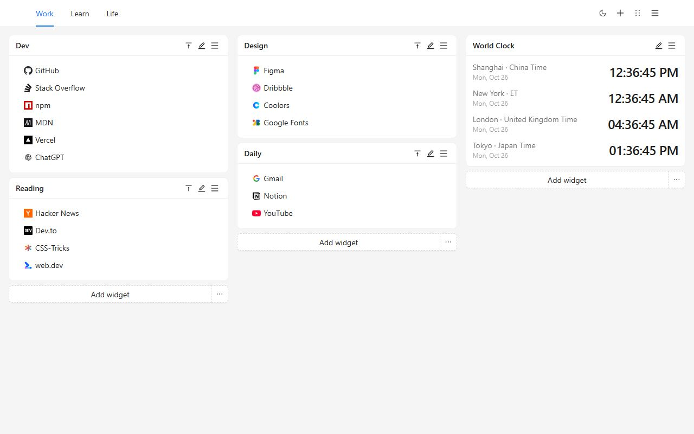
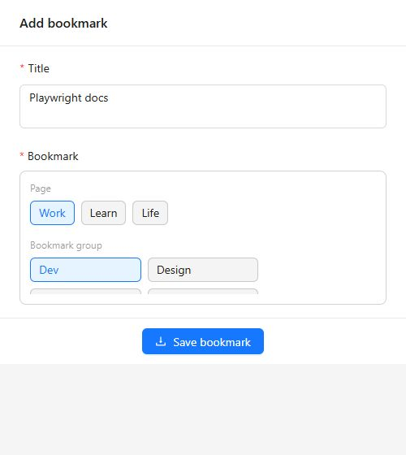
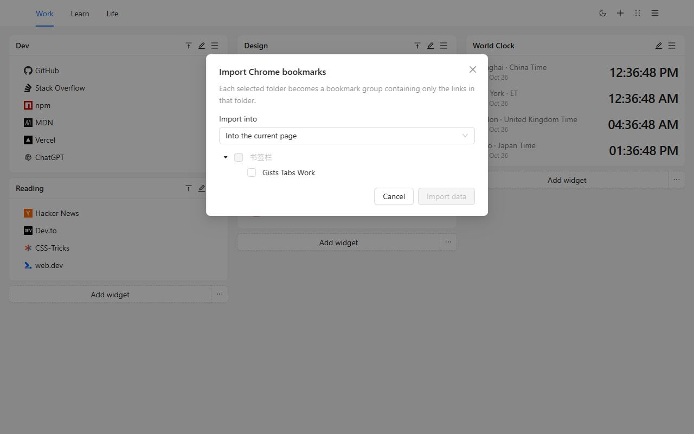
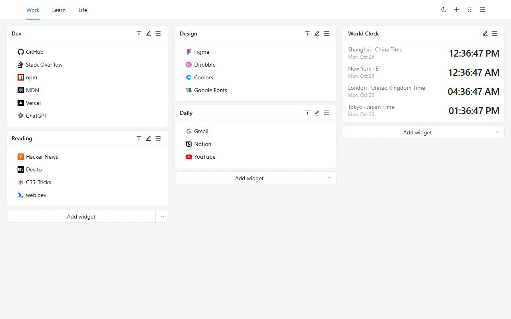
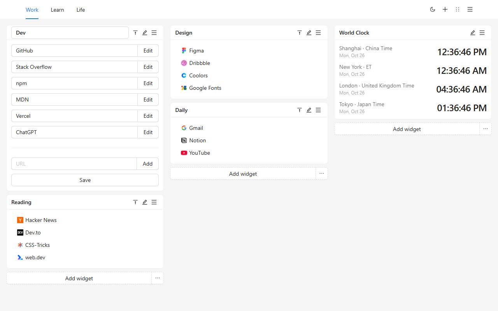
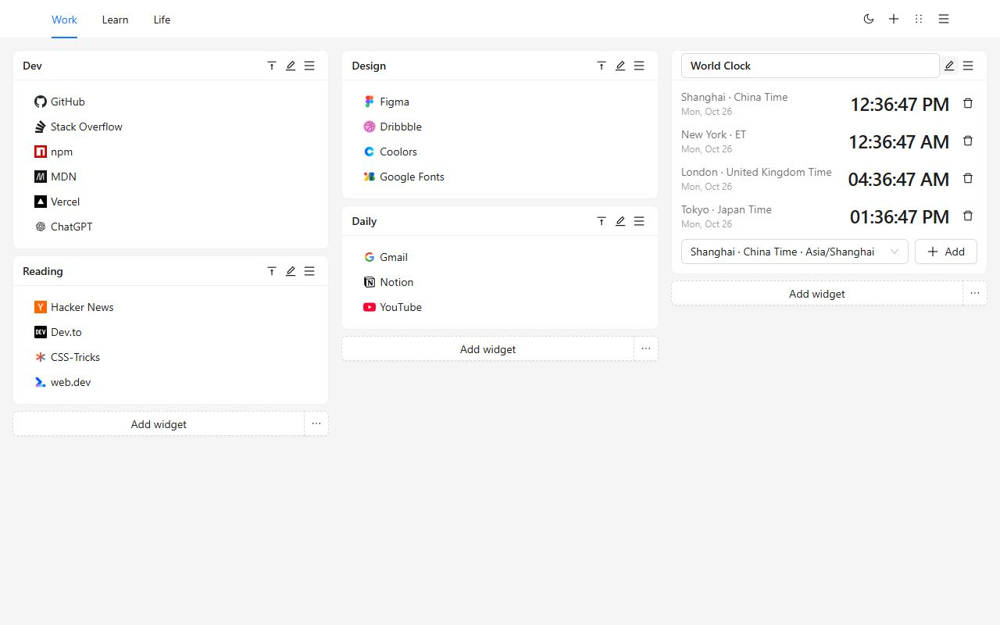
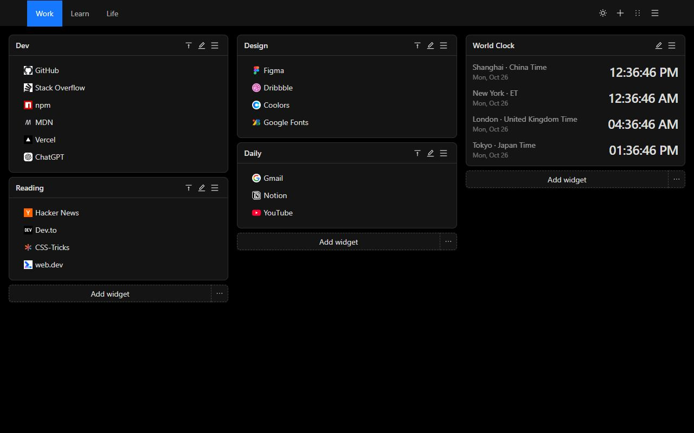
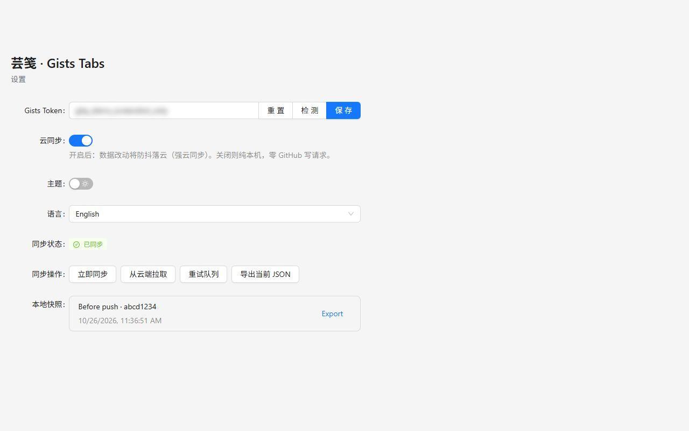
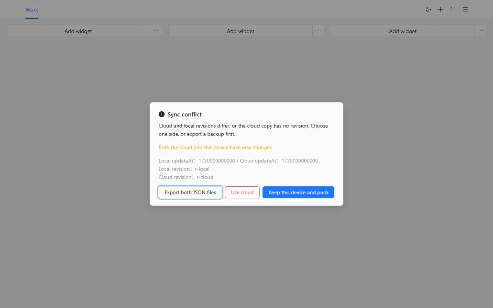

# Gists Tabs

The new tab, arranged by you. Bookmark groups and world clocks on a multi-page canvas. Your data stays on this device until you choose to sync it to a private GitHub Gist.

[Add to Chrome](https://chromewebstore.google.com/detail/cghagphlkcfafhacjgkfidbbkiklhacp)

**English** · [简体中文](docs/readme/README.zh-CN.md) · [繁體中文](docs/readme/README.zh-TW.md) · [日本語](docs/readme/README.ja.md) · [한국어](docs/readme/README.ko.md) · [Español](docs/readme/README.es.md) · [Português](docs/readme/README.pt-BR.md) · [Deutsch](docs/readme/README.de.md) · [Français](docs/readme/README.fr.md) · [Русский](docs/readme/README.ru.md)

Gists Tabs replaces Chrome's new tab with a workspace you lay out yourself. Work, study, and the rest of the day get their own pages. Each page is three columns of bookmark groups and clocks. Nothing is uploaded, and there is no account to create, unless you turn on sync.

The interface follows your browser language when you have not chosen one. You can switch among English, 简体中文, 繁體中文, 日本語, 한국어, Español, Português, Deutsch, Français, and Русский in Settings.

## Why this, and not another new tab

The built-in new tab is a search box and a few shortcuts. The bookmarks bar is one long row. Most dashboard extensions want their own account, and the layout lives on their server.

Gists Tabs is the opposite. The layout is yours. The file, if you sync, is a private Gist in your GitHub account. The extension author does not run a server and does not see your bookmarks.

| | Chrome new tab | Bookmarks bar | Account-based dashboards | Gists Tabs |
| --- | --- | --- | --- | --- |
| Several pages, three columns | No | No | Sometimes | Yes |
| World clocks | No | No | Sometimes | Yes |
| Usable with no account | Yes | Yes | No | Yes |
| Your data, in your private Gist | No | No | No | Yes |
| Open source | No | — | Rarely | Yes |
| Export and import JSON | No | Browser export only | Varies | Yes |
| Ads or tracking | Shortcuts | No | Often | No |

## Three steps

1. Install from the Chrome Web Store. The next new tab is your canvas.
2. Add a bookmark group, or import the Chrome folders you already have.
3. Use the toolbar button to file the page you are reading.

## Move your Chrome bookmarks

Open the page menu and choose **Import Chrome bookmarks**. Chrome asks for the bookmarks permission the first time; it is optional and is not requested at install. Check the folders you want. Each folder becomes one group, containing only the links directly inside it. Put them on the current page, or on a new page.

Icons are the default mark until you edit a link. `javascript:` and other addresses the new tab cannot open are skipped.

To move the canvas to another browser without GitHub, export JSON from the page menu or from Settings, then import that file. Import replaces the current canvas. A local snapshot is not a substitute for that file, so keep the JSON if you might want it back.

## The canvas

Pages sit in the header. Rename, copy, or delete a page from the menu. Deleting the last page is disabled.

A bookmark group is a named list. Edit the title and the links in place, drag links inside the list, or right-click a link to copy or delete it. Double-click a title to collapse the group.

A clock shows the time in the cities you add. The hour cycle follows the interface language: English uses 12-hour time, and 简体中文 uses 24-hour time.

Sort mode turns every group into a bar. Drag one into another column, then save. Leaving sort mode throws away the draft, so a half-finished move does not overwrite the canvas.

Light and dark are a single switch in the header. The choice is stored on this device.

## Sync to your own Gist

Sync is off until you paste a token and turn it on.

Create a token on GitHub:

- A classic personal access token needs the `gist` scope.
- A fine-grained token needs read and write access to Gists. No other repository permission is required.

In Settings, paste the token, check it, save it, and turn on cloud sync. The token stays in the extension's local storage. It is used only to read and write a private Gist on your account. Edits are debounced, so a burst of changes becomes one write.

On a second device, install the extension, paste a token for the same GitHub account, and turn sync on. The canvas comes down from that Gist.

If both sides changed, sync stops and asks you to choose. You can export both JSON files, keep this device and push it, or replace this device with the cloud copy. Before a cloud copy overwrites this device, the previous canvas is kept in the local snapshot list.

GitHub may rate-limit writes. The extension waits and retries. The status line in Settings shows syncing, synced, queued, rate limited, or failed. Automatic retries back off, up to 10 minutes.

## Privacy and permissions

| Permission | When | Why |
| --- | --- | --- |
| `storage` | Install | Keep the canvas, theme, language, and token on this device |
| `tabs`, `activeTab` | Install | Read the current tab so the toolbar button can save it |
| `alarms` | Install | Retry sync on a schedule after you turn cloud sync on |
| `bookmarks` | Only when you import | Read Chrome bookmark folders. Not requested at install |

There is no analytics, no ad network, and no server run by the extension author.

## Questions

**Do I need GitHub?**
No. Leave sync off and the new tab still works.

**Where are the bookmarks?**
In this browser's extension storage. With sync on, a copy also lives in a private Gist under your GitHub account.

**Will my language change after an update?**
If you never picked a language, the interface follows the browser. If you pick one in Settings, that choice stays.

**Can I use it in Firefox?**
The published listing is the Chrome Web Store. The same source builds for Firefox; see below. The Chrome bookmark import uses a Chrome-only permission.

## Develop

Node.js and npm.

| Command | What it does |
| --- | --- |
| `npm run dev` | Chrome development build |
| `npm run dev:firefox` | Firefox development build |
| `npm run build` | Typecheck, then Chrome production build |
| `npm run build:firefox` | Typecheck, then Firefox production build |
| `npm run lint` | `tsc --noEmit` and ESLint |
| `npm test` | Unit tests for locale matching, bookmark import, storage, and clocks |

Load the unpacked extension from `.output/chrome-mv3`. Firefox output is `.output/firefox-mv2` or `.output/firefox-mv3`, whichever directory the command prints.

## License

[MIT](./LICENSE)
