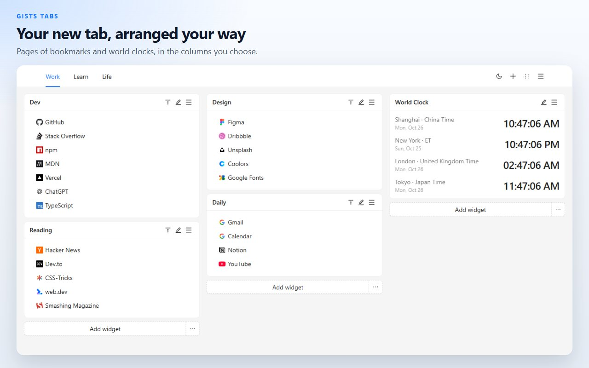
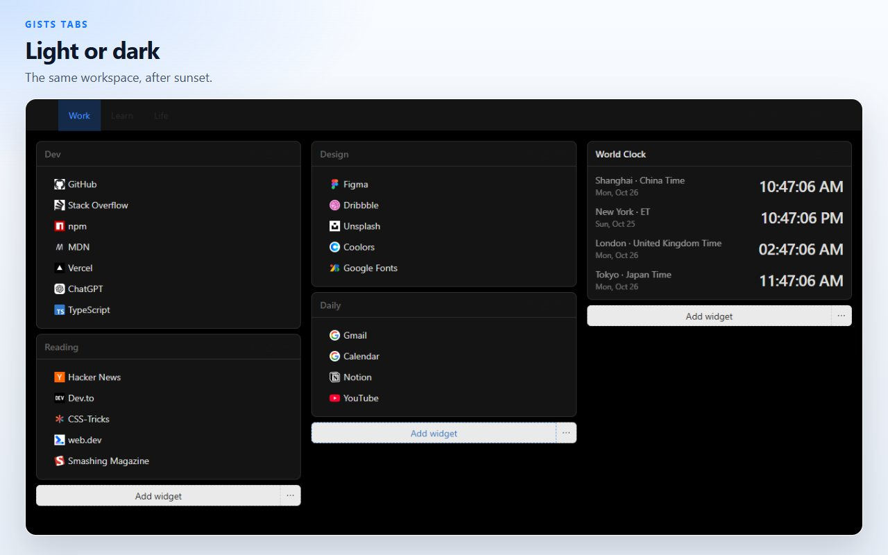
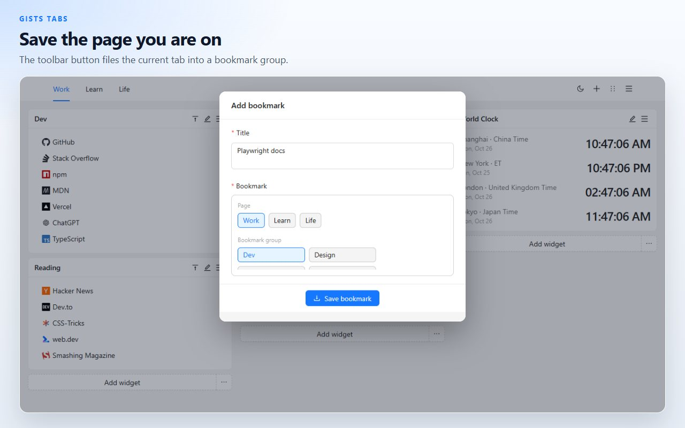
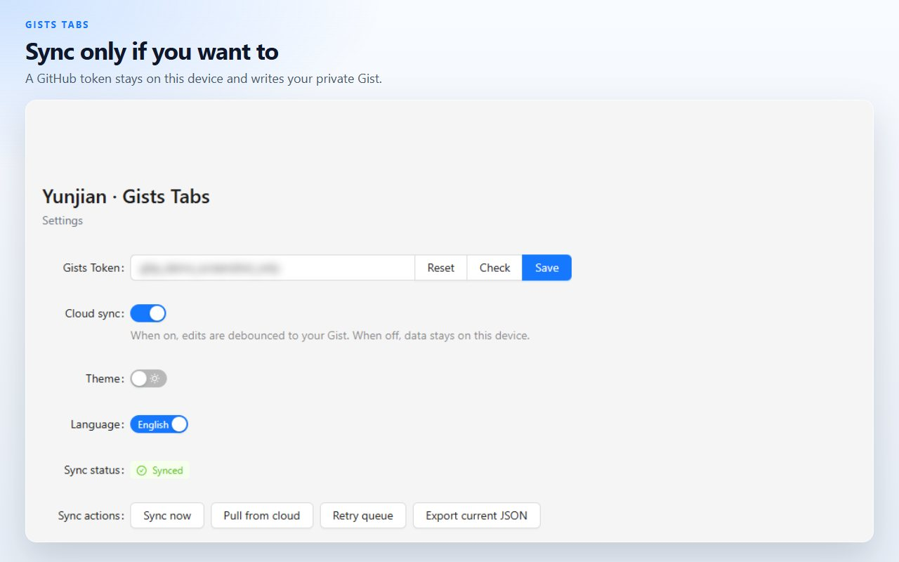

# Gists Tabs

A new tab you arrange yourself. Bookmarks and world clocks on a multi-page canvas. Data stays on this device unless you sync it to your own private GitHub Gist.

[Add to Chrome](https://chromewebstore.google.com/detail/cghagphlkcfafhacjgkfidbbkiklhacp)

**English** · [简体中文](docs/readme/README.zh-CN.md) · [繁體中文](docs/readme/README.zh-TW.md) · [日本語](docs/readme/README.ja.md) · [한국어](docs/readme/README.ko.md) · [Español](docs/readme/README.es.md) · [Português](docs/readme/README.pt-BR.md) · [Deutsch](docs/readme/README.de.md) · [Français](docs/readme/README.fr.md) · [Русский](docs/readme/README.ru.md)

Gists Tabs replaces Chrome's new tab with a personal workspace. Put bookmark groups and clocks into columns, split them across pages, and keep the layout when you come back. Nothing leaves the browser until you turn on sync.

The interface is in English and 中文. Switch it from the extension's settings page.

## Pages, bookmarks, and clocks

Each page is a canvas of three columns. A bookmark widget holds links with site icons. A clock widget shows the time in the cities you add. Open another page when work and the rest of the day should not share a screen.

## Drag, then save

Enter sort mode from the header, drag a widget into another column, and save. Leaving sort mode drops the draft, so a half-finished move does not overwrite the canvas.

## Save the tab you are already on

The toolbar button takes the current tab's title and address and files it into a bookmark group.

## On this device, unless you say otherwise

The canvas is stored in the extension's local storage. Export it as JSON, or import a file you saved earlier.

Cloud sync is off until you paste a GitHub token and turn it on. The token stays in local storage. The extension uses it only to read and write a private Gist on your account. A classic personal access token needs the `gist` scope. A fine-grained token needs read and write access to Gists. There is no server run by the extension author.

| Permission | Why it is there |
| --- | --- |
| `storage` | Keep the workspace on this device |
| `tabs`, `activeTab` | Read the current tab so the toolbar button can save it |
| `alarms` | Retry sync on a schedule after you turn cloud sync on |

## Questions

**Do I need a GitHub account?**
No. The new tab works with sync left off.

**Where do the bookmarks live?**
In this browser's extension storage. With sync on, a copy also lives in a private Gist under your GitHub account.

**Can I move the canvas without GitHub?**
Yes. Export JSON from the new tab menu or from settings, then import that file on the other browser.

**Which languages does the product speak?**
The interface is English and 中文. This page is translated more widely so the project is easier to find.

**Does it run in Firefox?**
The published listing is the Chrome Web Store. The same source builds for Firefox; see below.

## Develop

Node.js and npm.

| Command | What it does |
| --- | --- |
| `npm run dev` | Chrome development build |
| `npm run dev:firefox` | Firefox development build |
| `npm run build` | Typecheck, then Chrome production build |
| `npm run build:firefox` | Typecheck, then Firefox production build |
| `npm run lint` | `tsc --noEmit` and ESLint |
| `npm test` | Unit tests for storage and clock formatting |

Load the unpacked extension from `.output/chrome-mv3`. Firefox output is `.output/firefox-mv2` or `.output/firefox-mv3`, whichever the command prints.

## License

[MIT](./LICENSE)
