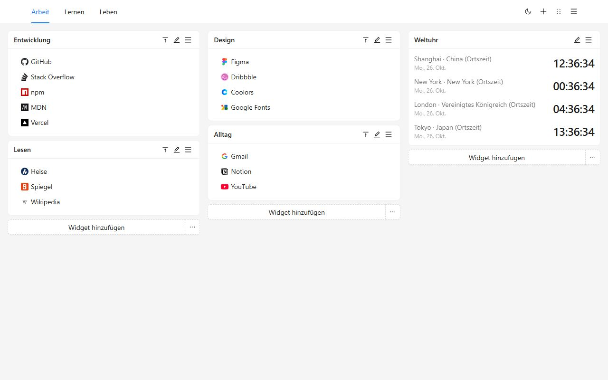
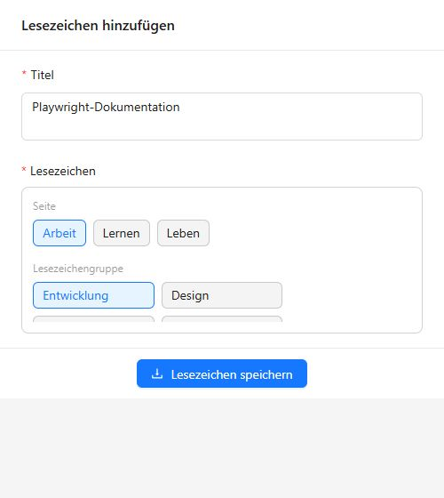
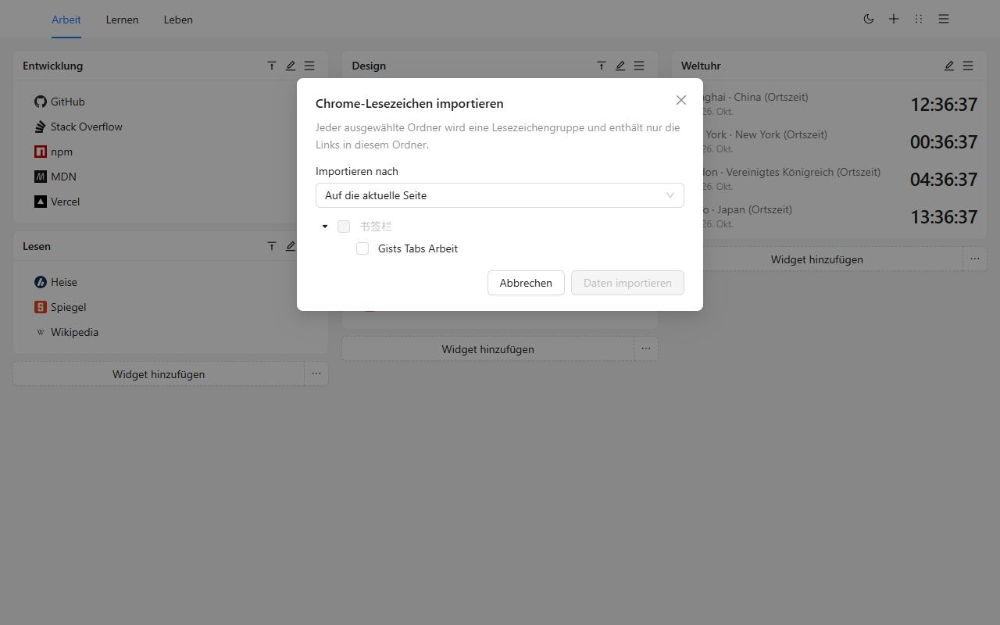
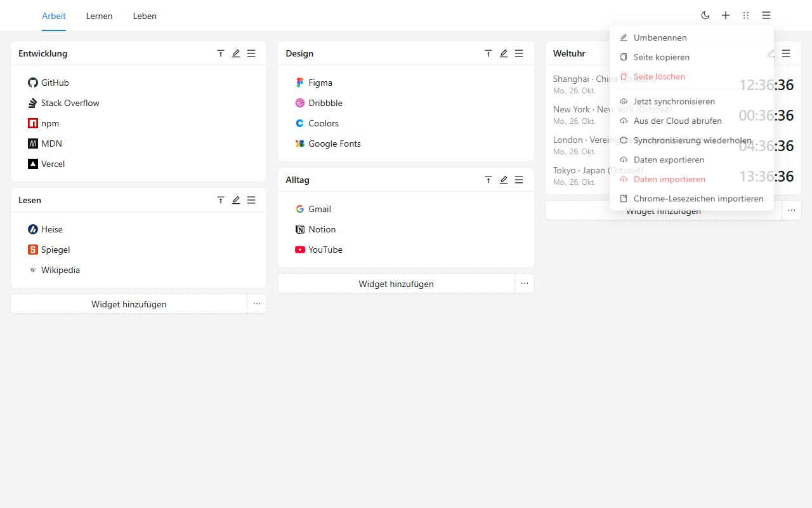
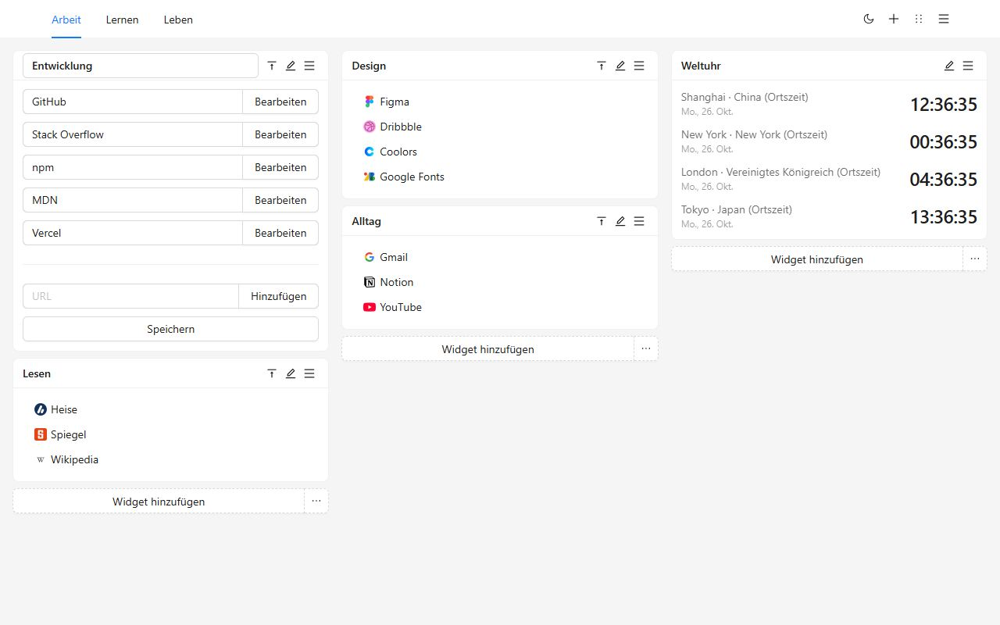
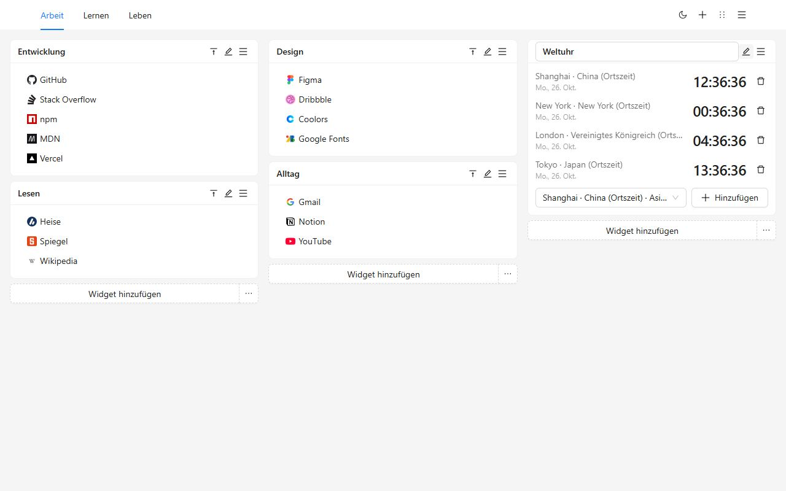
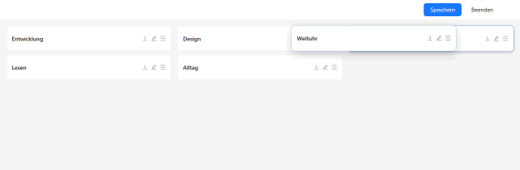
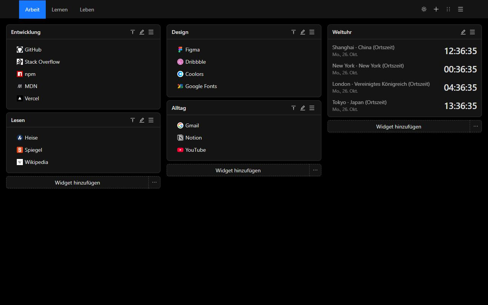
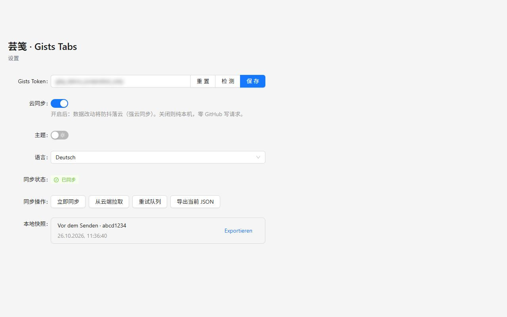
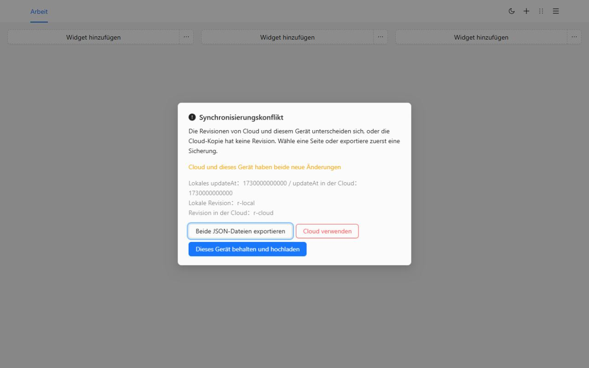

# Gists Tabs

Der neue Tab, von dir angeordnet. Lesezeichengruppen und Weltuhren auf einer Fläche mit mehreren Seiten. Die Daten bleiben auf diesem Gerät, bis du sie in ein privates GitHub Gist synchronisierst.

[Zu Chrome hinzufügen](https://chromewebstore.google.com/detail/cghagphlkcfafhacjgkfidbbkiklhacp)

[English](../../README.md) · [简体中文](./README.zh-CN.md) · [繁體中文](./README.zh-TW.md) · [日本語](./README.ja.md) · [한국어](./README.ko.md) · [Español](./README.es.md) · [Português](./README.pt-BR.md) · **Deutsch** · [Français](./README.fr.md) · [Русский](./README.ru.md)

Gists Tabs ersetzt den neuen Tab in Chrome durch einen Arbeitsplatz, den du selbst anordnest. Arbeit, Lernen und der Rest des Tages bekommen eigene Seiten. Jede Seite hat drei Spalten aus Gruppen und Uhren. Es gibt kein Konto und nichts wird hochgeladen, bis du die Synchronisierung einschaltest.

Wenn du noch keine Sprache gewählt hast, folgt die Oberfläche dem Browser. In den Einstellungen kannst du English, 简体中文, 繁體中文, 日本語, 한국어, Español, Português, Deutsch, Français oder Русский wählen.

## Warum dieses

Der eingebaute neue Tab ist ein Suchfeld und ein paar Verknüpfungen. Die Lesezeichenleiste ist eine lange Zeile. Die meisten Dashboard-Erweiterungen wollen ein eigenes Konto, und das Layout liegt auf deren Server.

Gists Tabs ist das Gegenteil. Das Layout gehört dir. Wenn du synchronisierst, ist die Datei ein privates Gist in deinem GitHub-Konto. Die Autoren der Erweiterung betreiben keinen Server und sehen deine Lesezeichen nicht.

| | Neuer Tab von Chrome | Lesezeichenleiste | Dashboards mit Konto | Gists Tabs |
| --- | --- | --- | --- | --- |
| Mehrere Seiten, drei Spalten | Nein | Nein | Manchmal | Ja |
| Weltuhren | Nein | Nein | Manchmal | Ja |
| Ohne Konto nutzbar | Ja | Ja | Nein | Ja |
| Deine Daten, in deinem privaten Gist | Nein | Nein | Nein | Ja |
| Open Source | Nein | — | Selten | Ja |
| JSON exportieren und importieren | Nein | Nur der Export des Browsers | Unterschiedlich | Ja |
| Werbung oder Tracking | Verknüpfungen | Nein | Oft | Nein |

## Drei Schritte

1. Aus dem Chrome Web Store installieren. Der nächste neue Tab ist die Fläche.
2. Eine Gruppe anlegen oder die Ordner importieren, die schon in Chrome liegen.
3. Mit der Schaltfläche in der Symbolleiste die Seite sichern, die du gerade liest.

## Chrome-Lesezeichen mitnehmen

Öffne das Seitenmenü und wähle **Chrome-Lesezeichen importieren**. Beim ersten Mal fragt Chrome nach der Lesezeichen-Berechtigung. Sie ist optional und wird bei der Installation nicht verlangt. Wähle die Ordner. Jeder Ordner wird eine Gruppe und enthält nur die Links direkt darin. Du kannst sie auf die aktuelle Seite oder auf eine neue setzen.

Die Symbole bleiben die Standardmarke, bis du einen Link bearbeitest. `javascript:` und andere Adressen, die der neue Tab nicht öffnen kann, werden übersprungen.

Um die Fläche ohne GitHub in einen anderen Browser zu bringen, exportiere JSON über das Menü oder die Einstellungen und importiere die Datei dort. Import ersetzt die aktuelle Fläche.

## Die Fläche

Die Seiten sitzen in der Kopfzeile. Benenne sie um, kopiere oder lösche sie über das Menü. Die letzte Seite lässt sich nicht löschen.

Eine Gruppe ist eine benannte Liste. Bearbeite Titel und Links an Ort und Stelle, ziehe innerhalb der Liste oder klicke rechts, um zu kopieren oder zu löschen. Ein Doppelklick auf den Titel klappt die Gruppe zu.

Eine Uhr zeigt die Zeit der Städte, die du hinzufügst. 12- oder 24-Stunden-Anzeige folgt der Gewohnheit der Oberflächensprache.

Der Sortiermodus macht aus jeder Gruppe einen Balken. Ziehe ihn in eine andere Spalte und speichere. Verlassen verwirft den Entwurf.

Hell und dunkel sind ein Schalter in der Kopfzeile. Die Wahl bleibt auf diesem Gerät.

## Mit deinem eigenen Gist synchronisieren

Die Synchronisierung ist aus, bis du ein Token einfügst und sie einschaltest.

- Ein klassisches persönliches Token braucht den Bereich `gist`.
- Ein fein abgestuftes Token braucht nur Lese- und Schreibzugriff auf Gists. Keine Repository-Berechtigung.

In den Einstellungen einfügen, prüfen, speichern und die Cloud einschalten. Das Token bleibt im lokalen Speicher und liest und schreibt nur ein privates Gist deines Kontos. Mehrere Änderungen hintereinander werden ein Schreibvorgang.

Auf einem zweiten Gerät die Erweiterung installieren, ein Token desselben Kontos einfügen und die Synchronisierung einschalten. Die Fläche kommt von diesem Gist.

Wenn beide Seiten sich geändert haben, hält die Synchronisierung an und fragt. Du kannst beide JSON-Dateien exportieren, dieses Gerät behalten und hochladen oder es durch die Cloud-Kopie ersetzen. Vor dem Ersetzen bleibt die bisherige Fläche in den lokalen Schnappschüssen.

GitHub kann Schreibvorgänge begrenzen. Die Erweiterung wartet und versucht es erneut, höchstens 10 Minuten.

## Privatsphäre und Berechtigungen

| Berechtigung | Wann | Warum |
| --- | --- | --- |
| `storage` | Bei der Installation | Fläche, Thema, Sprache und Token auf diesem Gerät behalten |
| `tabs`, `activeTab` | Bei der Installation | Den aktuellen Tab lesen, damit die Schaltfläche ihn sichern kann |
| `alarms` | Bei der Installation | Die Synchronisierung nach dem Einschalten der Cloud erneut versuchen |
| `bookmarks` | Nur beim Import | Chrome-Lesezeichenordner lesen. Bei der Installation nicht verlangt |

Keine Analyse, keine Werbung, kein Server der Erweiterungsautoren.

## Fragen

**Brauche ich GitHub?**
Nein. Mit ausgeschalteter Synchronisierung funktioniert der neue Tab trotzdem.

**Wo liegen die Lesezeichen?**
Im Erweiterungsspeicher dieses Browsers. Mit Synchronisierung liegt zusätzlich eine Kopie in einem privaten Gist deines Kontos.

**Ändert sich die Sprache nach einem Update?**
Wenn du nie eine gewählt hast, folgt die Oberfläche dem Browser. Eine Wahl in den Einstellungen bleibt.

**Läuft es in Firefox?**
Der veröffentlichte Eintrag liegt im Chrome Web Store. Dieselbe Quelle lässt sich für Firefox bauen. Der Chrome-Lesezeichenimport nutzt eine Berechtigung, die es nur in Chrome gibt.

## Entwicklung

Node.js und npm.

| Befehl | Was er tut |
| --- | --- |
| `npm run dev` | Entwicklungsbau für Chrome |
| `npm run dev:firefox` | Entwicklungsbau für Firefox |
| `npm run build` | Typprüfung, danach Produktionsbau für Chrome |
| `npm run build:firefox` | Typprüfung, danach Produktionsbau für Firefox |
| `npm run lint` | `tsc --noEmit` und ESLint |
| `npm test` | Tests für Sprache, Import, Speicher und Uhren |

Lade die entpackte Erweiterung aus `.output/chrome-mv3`. Die Firefox-Ausgabe ist `.output/firefox-mv2` oder `.output/firefox-mv3`.

## Lizenz

[MIT](../../LICENSE)
