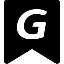
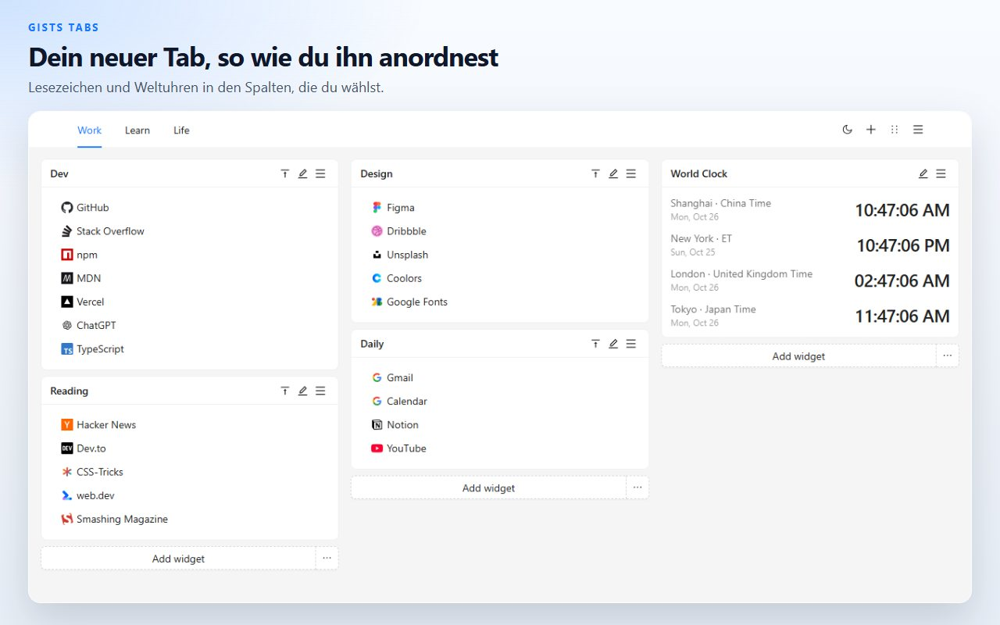
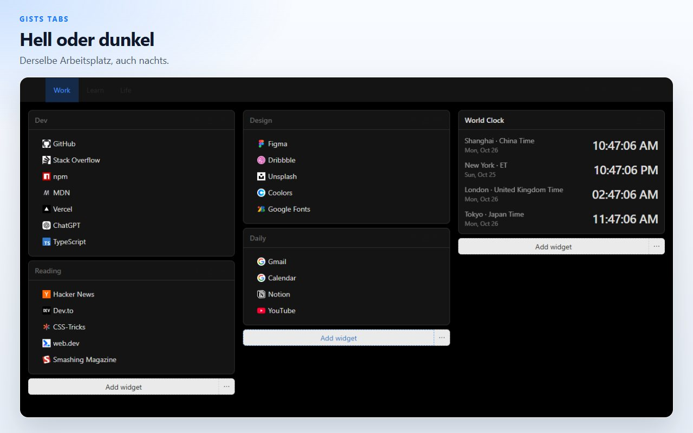
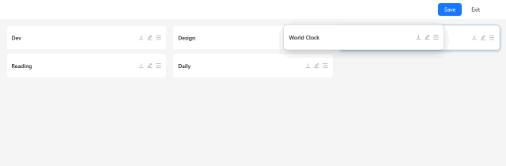
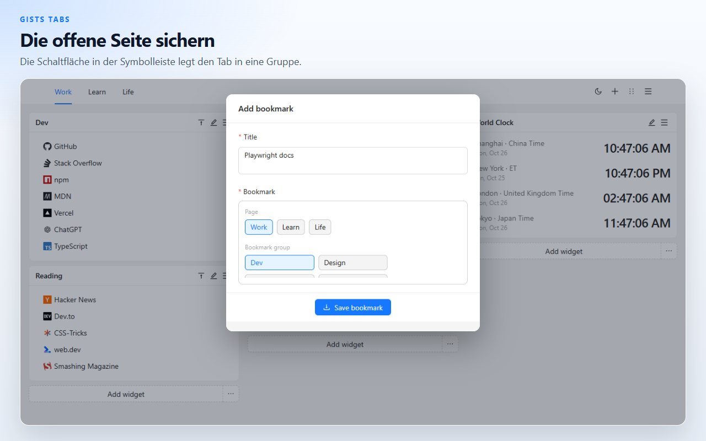
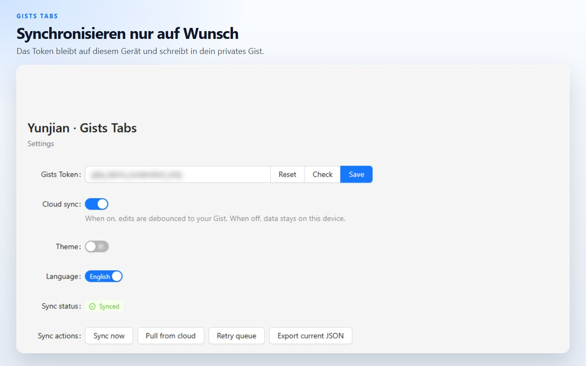

# Gists Tabs

Ein neuer Tab, den du selbst anordnest. Lesezeichen und Weltuhren auf einer Fläche mit mehreren Seiten. Die Daten bleiben auf diesem Gerät, bis du sie in dein eigenes privates GitHub Gist synchronisierst.

[Zu Chrome hinzufügen](https://chromewebstore.google.com/detail/cghagphlkcfafhacjgkfidbbkiklhacp)

[English](../../README.md) · [简体中文](./README.zh-CN.md) · [繁體中文](./README.zh-TW.md) · [日本語](./README.ja.md) · [한국어](./README.ko.md) · [Español](./README.es.md) · [Português](./README.pt-BR.md) · **Deutsch** · [Français](./README.fr.md) · [Русский](./README.ru.md)

Gists Tabs ersetzt den neuen Tab in Chrome durch einen persönlichen Arbeitsplatz. Lege Lesezeichen-Gruppen und Uhren in Spalten und verteile sie auf Seiten. Nichts verlässt den Browser, bis du die Synchronisierung einschaltest.

Die Oberfläche ist English und 中文. Der Wechsel liegt auf der Einstellungsseite der Erweiterung.

## Seiten, Lesezeichen und Uhren

Jede Seite ist eine Fläche mit drei Spalten. Ein Lesezeichen-Widget hält Links mit Website-Icons. Ein Uhren-Widget zeigt die Zeit der Städte, die du hinzufügst. Öffne eine weitere Seite, wenn Arbeit und der Rest des Tages nicht denselben Bildschirm teilen sollen.

## Ziehen, dann speichern

Öffne den Sortiermodus über die Kopfzeile, ziehe ein Widget in eine andere Spalte und speichere. Verlässt du den Modus, wird der Entwurf verworfen. Eine halbfertige Verschiebung überschreibt die Fläche also nicht.

## Den offenen Tab sichern

Die Schaltfläche in der Symbolleiste nimmt Titel und Adresse des aktuellen Tabs und legt sie in einer Lesezeichen-Gruppe ab.

## Auf diesem Gerät, sofern du nichts anderes willst

Die Fläche liegt im lokalen Speicher der Erweiterung. Du kannst sie als JSON exportieren oder eine früher gespeicherte Datei importieren.

Die Cloud-Synchronisierung ist aus, bis du ein GitHub-Token einfügst und sie einschaltest. Das Token bleibt im lokalen Speicher. Die Erweiterung benutzt es nur, um ein privates Gist deines Kontos zu lesen und zu schreiben. Ein klassisches persönliches Token braucht den Bereich `gist`. Ein fein abgestuftes Token braucht Lese- und Schreibzugriff auf Gists. Die Autoren der Erweiterung betreiben keinen eigenen Server.

| Berechtigung | Wozu sie da ist |
| --- | --- |
| `storage` | Den Arbeitsplatz auf diesem Gerät behalten |
| `tabs`, `activeTab` | Den aktuellen Tab lesen, damit die Schaltfläche ihn sichern kann |
| `alarms` | Die Synchronisierung erneut versuchen, nachdem du die Cloud einschaltest |

## Fragen

**Brauche ich ein GitHub-Konto?**
Nein. Der neue Tab funktioniert, wenn die Synchronisierung aus bleibt.

**Wo liegen die Lesezeichen?**
Im Erweiterungsspeicher dieses Browsers. Mit eingeschalteter Synchronisierung liegt eine Kopie zusätzlich in einem privaten Gist deines GitHub-Kontos.

**Kann ich die Fläche ohne GitHub mitnehmen?**
Ja. Exportiere JSON über das Menü des neuen Tabs oder über die Einstellungen und importiere die Datei im anderen Browser.

**Welche Sprachen spricht das Produkt?**
Die Oberfläche ist English und 中文. Diese Seite ist weiter übersetzt, damit das Projekt leichter zu finden ist.

**Läuft es in Firefox?**
Der veröffentlichte Eintrag liegt im Chrome Web Store. Dieselbe Quelle lässt sich für Firefox bauen; sieh dir die Befehle unten an.

## Entwicklung

Node.js und npm.

| Befehl | Was er tut |
| --- | --- |
| `npm run dev` | Entwicklungsbau für Chrome |
| `npm run dev:firefox` | Entwicklungsbau für Firefox |
| `npm run build` | Typprüfung, danach Produktionsbau für Chrome |
| `npm run build:firefox` | Typprüfung, danach Produktionsbau für Firefox |
| `npm run lint` | `tsc --noEmit` und ESLint |
| `npm test` | Unit-Tests für Speicher und Uhrenformat |

Lade die entpackte Erweiterung aus `.output/chrome-mv3`. Die Firefox-Ausgabe ist `.output/firefox-mv2` oder `.output/firefox-mv3`, je nachdem, welches Verzeichnis der Befehl ausgibt.

## Lizenz

[MIT](../../LICENSE)
