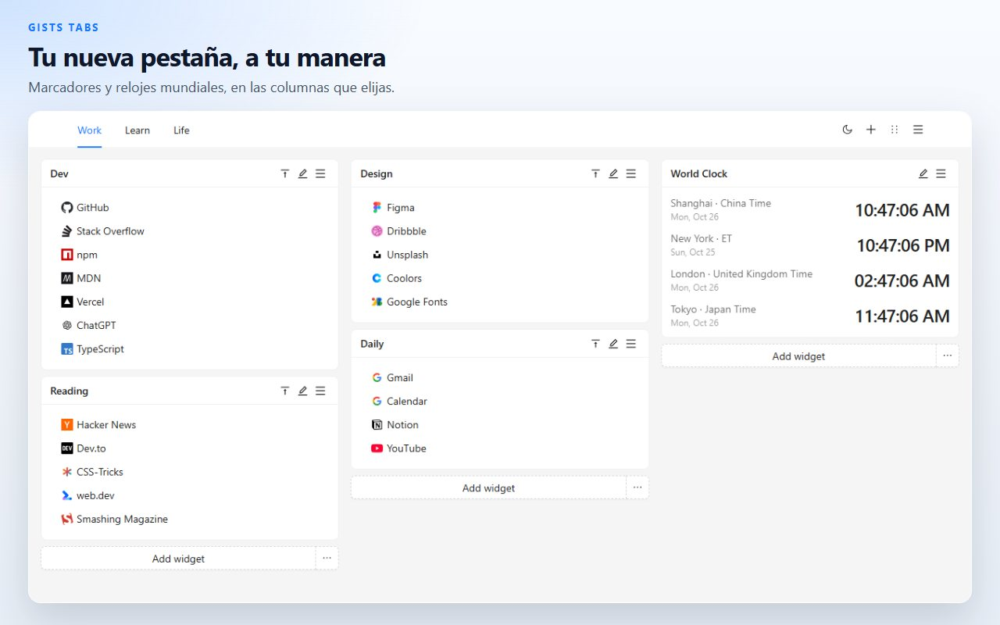
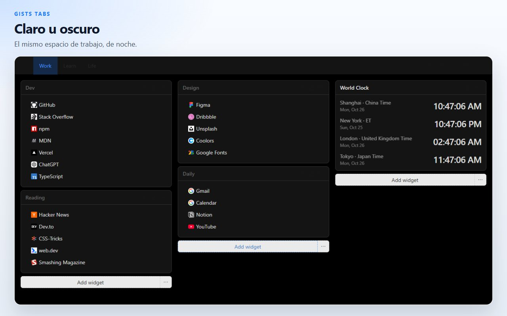
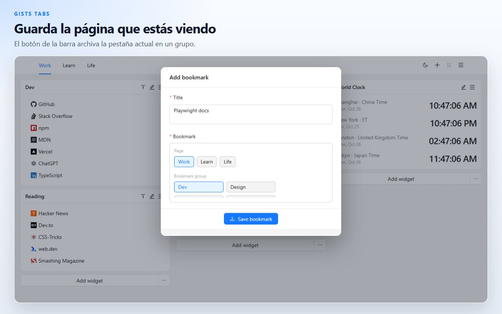
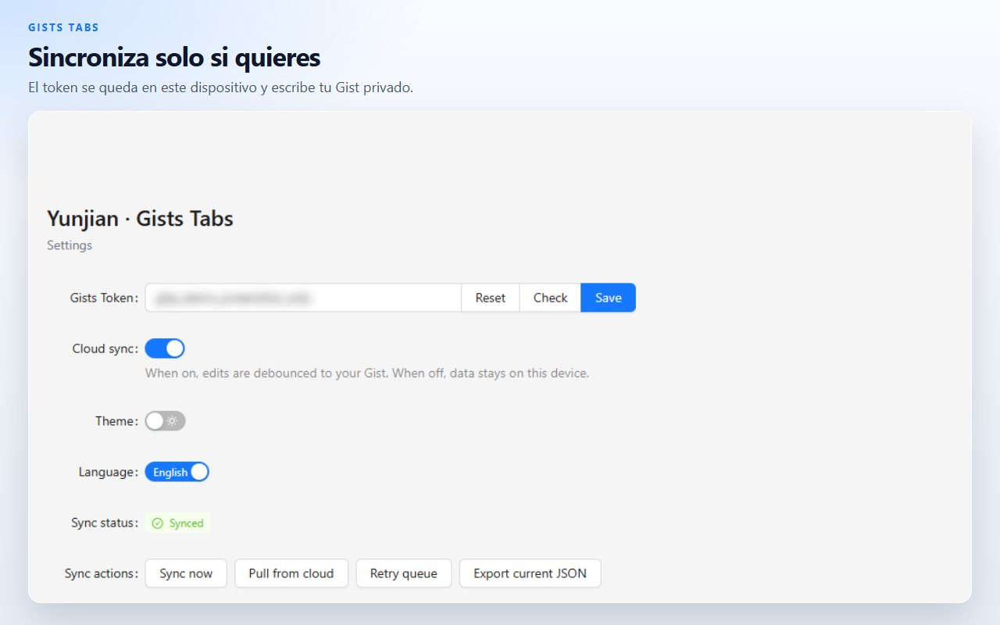

# Gists Tabs

Una nueva pestaña que organizas tú. Marcadores y relojes mundiales en un lienzo de varias páginas. Los datos se quedan en este dispositivo, salvo que los sincronices con tu propio Gist privado de GitHub.

[Añadir a Chrome](https://chromewebstore.google.com/detail/cghagphlkcfafhacjgkfidbbkiklhacp)

[English](../../README.md) · [简体中文](./README.zh-CN.md) · [繁體中文](./README.zh-TW.md) · [日本語](./README.ja.md) · [한국어](./README.ko.md) · **Español** · [Português](./README.pt-BR.md) · [Deutsch](./README.de.md) · [Français](./README.fr.md) · [Русский](./README.ru.md)

Gists Tabs sustituye la nueva pestaña de Chrome por un espacio personal. Coloca grupos de marcadores y relojes en columnas, y sepáralos en páginas. Nada sale del navegador hasta que activas la sincronización.

La interfaz está en English y 中文. Se cambia en la página de ajustes de la extensión.

## Páginas, marcadores y relojes

Cada página es un lienzo de tres columnas. Un widget de marcadores guarda enlaces con el icono del sitio. Un widget de reloj muestra la hora de las ciudades que añades. Abre otra página cuando el trabajo y el resto del día no deban compartir pantalla.

## Arrastra y luego guarda

Entra en el modo de orden desde la cabecera, arrastra un widget a otra columna y guarda. Salir de ese modo descarta el borrador, así que un movimiento a medias no pisa el lienzo.

## Guarda la pestaña que ya tienes abierta

El botón de la barra de herramientas toma el título y la dirección de la pestaña actual y los archiva en un grupo de marcadores.

## En este dispositivo, salvo que indiques lo contrario

El lienzo se guarda en el almacenamiento local de la extensión. Puedes exportarlo como JSON o importar un archivo que hayas guardado antes.

La sincronización en la nube está apagada hasta que pegas un token de GitHub y la activas. El token se queda en el almacenamiento local. La extensión lo usa solo para leer y escribir un Gist privado de tu cuenta. Un token clásico necesita el alcance `gist`. Un token detallado necesita permiso de lectura y escritura sobre los Gists. El autor de la extensión no tiene un servidor propio.

| Permiso | Para qué está |
| --- | --- |
| `storage` | Conservar el espacio de trabajo en este dispositivo |
| `tabs`, `activeTab` | Leer la pestaña actual para que el botón pueda guardarla |
| `alarms` | Reintentar la sincronización cuando activas la nube |

## Preguntas

**¿Hace falta una cuenta de GitHub?**
No. La nueva pestaña funciona con la sincronización apagada.

**¿Dónde están los marcadores?**
En el almacenamiento de la extensión de este navegador. Con la sincronización activa, también hay una copia en un Gist privado de tu cuenta de GitHub.

**¿Puedo llevarme el lienzo sin GitHub?**
Sí. Exporta JSON desde el menú de la nueva pestaña o desde los ajustes, e impórtalo en el otro navegador.

**¿En qué idiomas habla el producto?**
La interfaz está en English y 中文. Esta página está traducida a más idiomas para que el proyecto sea más fácil de encontrar.

**¿Funciona en Firefox?**
La ficha publicada está en Chrome Web Store. El mismo código se puede compilar para Firefox; mira los comandos de abajo.

## Desarrollo

Hacen falta Node.js y npm.

| Comando | Qué hace |
| --- | --- |
| `npm run dev` | Compilación de desarrollo para Chrome |
| `npm run dev:firefox` | Compilación de desarrollo para Firefox |
| `npm run build` | Comprueba tipos y genera la compilación de Chrome |
| `npm run build:firefox` | Comprueba tipos y genera la compilación de Firefox |
| `npm run lint` | `tsc --noEmit` y ESLint |
| `npm test` | Pruebas unitarias de almacenamiento y del reloj |

Carga la extensión sin empaquetar desde `.output/chrome-mv3`. La salida de Firefox es `.output/firefox-mv2` o `.output/firefox-mv3`, el directorio que imprima el comando.

## Licencia

[MIT](../../LICENSE)
