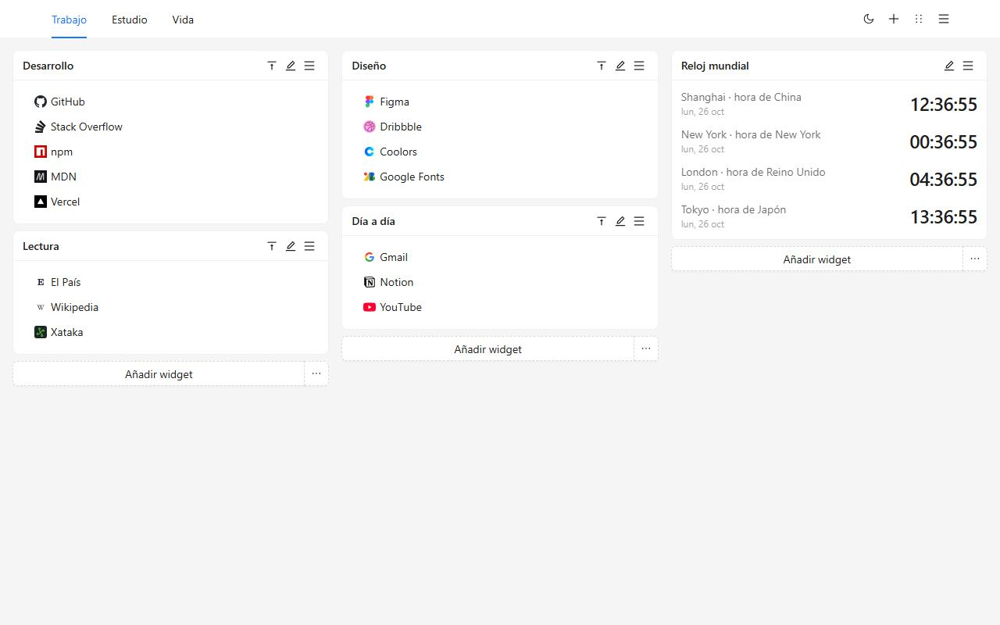
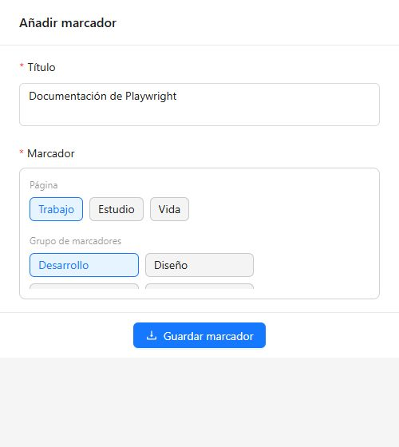
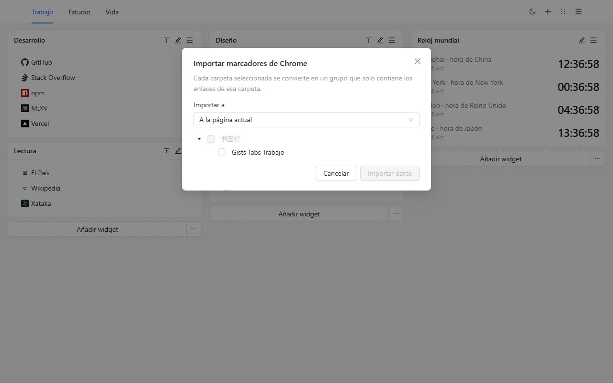
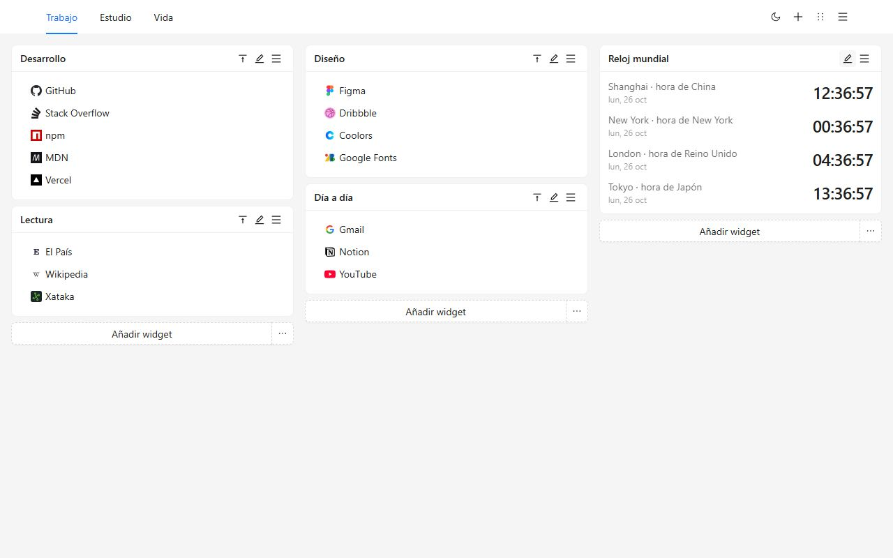
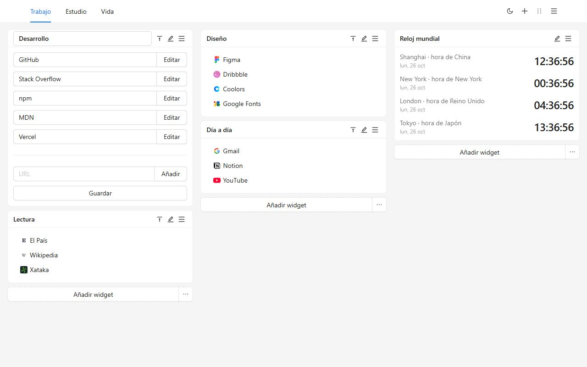
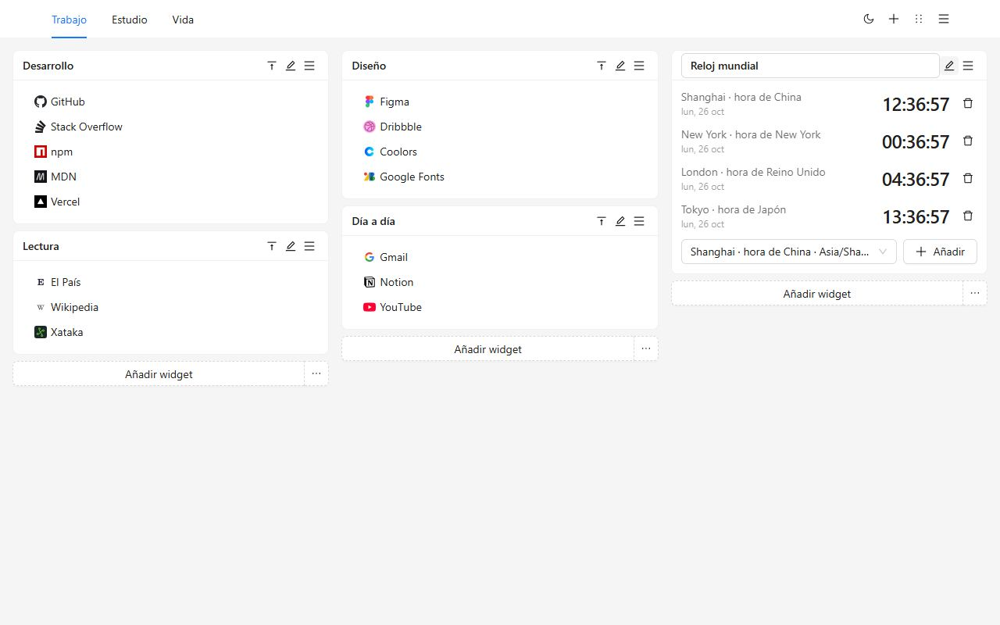
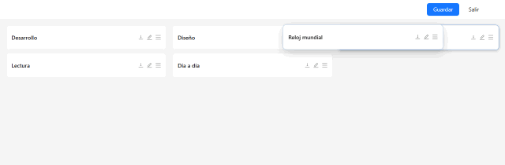
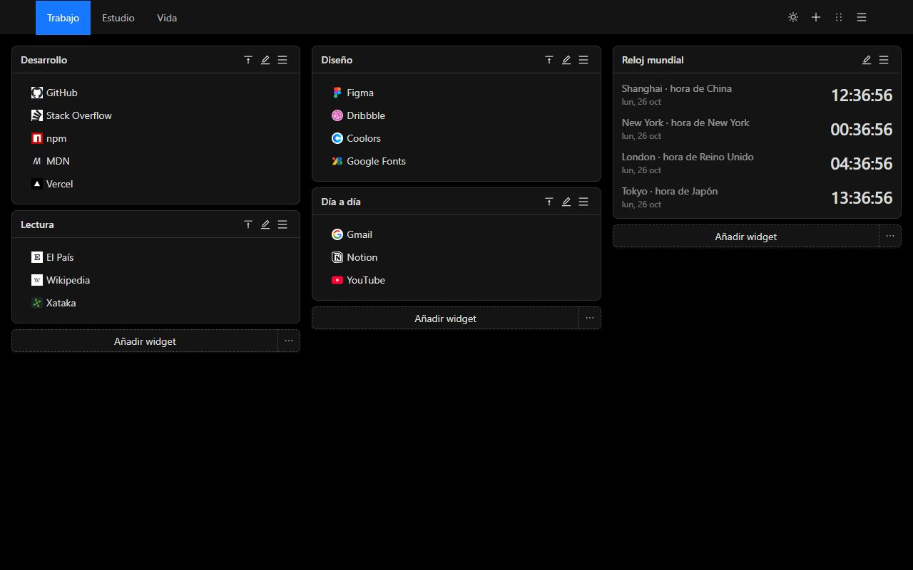
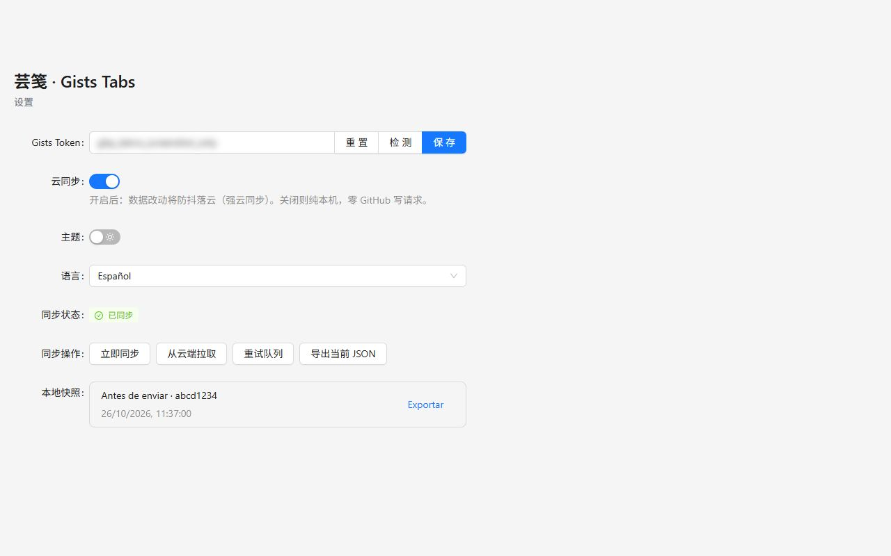
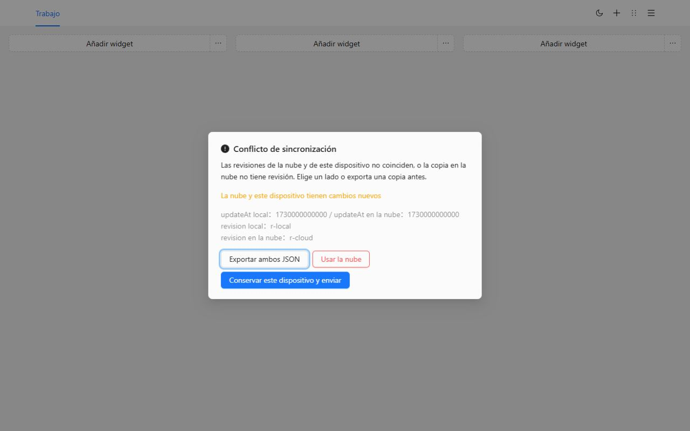

# Gists Tabs

La nueva pestaña, organizada por ti. Grupos de marcadores y relojes mundiales en un lienzo de varias páginas. Los datos se quedan en este dispositivo hasta que decidas sincronizarlos con un Gist privado de GitHub.

[Añadir a Chrome](https://chromewebstore.google.com/detail/cghagphlkcfafhacjgkfidbbkiklhacp)

[English](../../README.md) · [简体中文](./README.zh-CN.md) · [繁體中文](./README.zh-TW.md) · [日本語](./README.ja.md) · [한국어](./README.ko.md) · **Español** · [Português](./README.pt-BR.md) · [Deutsch](./README.de.md) · [Français](./README.fr.md) · [Русский](./README.ru.md)

Gists Tabs sustituye la nueva pestaña de Chrome por un espacio que organizas tú. Trabajo, estudio y el resto del día tienen su página. Cada página son tres columnas de grupos y relojes. No hay cuenta que crear ni nada que subir, salvo que actives la sincronización.

Si no has elegido idioma, la interfaz sigue al navegador. En Ajustes puedes cambiar a English, 简体中文, 繁體中文, 日本語, 한국어, Español, Português, Deutsch, Français o Русский.

## Por qué esta

La nueva pestaña del navegador es un buscador y unos pocos accesos. La barra de marcadores es una fila larga. La mayoría de los paneles piden su propia cuenta y guardan el diseño en su servidor.

Gists Tabs hace lo contrario. El diseño es tuyo. Si sincronizas, el archivo es un Gist privado de tu cuenta de GitHub. Quien hizo la extensión no tiene servidor y no ve tus marcadores.

| | Nueva pestaña de Chrome | Barra de marcadores | Paneles con cuenta | Gists Tabs |
| --- | --- | --- | --- | --- |
| Varias páginas, tres columnas | No | No | A veces | Sí |
| Relojes mundiales | No | No | A veces | Sí |
| Sin cuenta | Sí | Sí | No | Sí |
| Tus datos, en tu Gist privado | No | No | No | Sí |
| Código abierto | No | — | Rara vez | Sí |
| Exportar e importar JSON | No | Solo la exportación del navegador | Varía | Sí |
| Anuncios o rastreo | Accesos | No | A menudo | No |

## Tres pasos

1. Instálala desde Chrome Web Store. La siguiente pestaña nueva es el lienzo.
2. Crea un grupo o importa las carpetas que ya tienes en Chrome.
3. Usa el botón de la barra para archivar la página que estás leyendo.

## Trae tus marcadores de Chrome

Abre el menú de la página y elige **Importar marcadores de Chrome**. La primera vez Chrome pide el permiso de marcadores; es opcional y no se solicita al instalar. Marca las carpetas. Cada una se convierte en un grupo con solo los enlaces que contiene directamente. Puedes ponerlos en la página actual o en una nueva.

Los iconos son la marca predeterminada hasta que edites un enlace. Se omiten `javascript:` y otras direcciones que la pestaña nueva no puede abrir.

Para llevar el lienzo a otro navegador sin GitHub, exporta JSON desde el menú o desde Ajustes e impórtalo allí. Importar sustituye el lienzo actual.

## El lienzo

Las páginas están en la cabecera. Cámbiales el nombre, cópialas o bórralas desde el menú. No se puede borrar la última.

Un grupo es una lista con nombre. Edita el título y los enlaces en el sitio, arrastra dentro de la lista o haz clic derecho para copiar o eliminar. Doble clic en el título pliega el grupo.

Un reloj muestra la hora de las ciudades que añades. El ciclo de 12 o 24 horas sigue la costumbre del idioma de la interfaz.

El modo de orden convierte cada grupo en una barra. Arrástralo a otra columna y guarda. Salir descarta el borrador.

Claro y oscuro son un interruptor de la cabecera. La elección se guarda en este dispositivo.

## Sincroniza con tu propio Gist

La sincronización está apagada hasta que pegas un token y la activas.

- Un token clásico necesita el alcance `gist`.
- Un token detallado solo necesita leer y escribir Gists. No hace falta permiso de repositorios.

En Ajustes, pega el token, compruébalo, guárdalo y activa la nube. El token se queda en el almacenamiento local y solo lee y escribe un Gist privado de tu cuenta. Varios cambios seguidos se convierten en una sola escritura.

En un segundo dispositivo, instala la extensión, pega un token de la misma cuenta y activa la sincronización. El lienzo baja de ese Gist.

Si ambos lados cambiaron, la sincronización se detiene y pregunta. Puedes exportar los dos JSON, conservar este dispositivo y enviarlo, o sustituirlo por la copia de la nube. Antes de sustituir, el lienzo anterior queda en las instantáneas locales.

GitHub puede limitar las escrituras. La extensión espera y reintenta, hasta 10 minutos.

## Privacidad y permisos

| Permiso | Cuándo | Por qué |
| --- | --- | --- |
| `storage` | Al instalar | Guardar el lienzo, el tema, el idioma y el token en este dispositivo |
| `tabs`, `activeTab` | Al instalar | Leer la pestaña actual para que el botón pueda guardarla |
| `alarms` | Al instalar | Reintentar la sincronización después de activar la nube |
| `bookmarks` | Solo al importar | Leer carpetas de Chrome. No se pide al instalar |

No hay analítica, ni anuncios, ni un servidor del autor de la extensión.

## Preguntas

**¿Hace falta GitHub?**
No. Con la sincronización apagada, la pestaña nueva funciona igual.

**¿Dónde están los marcadores?**
En el almacenamiento de la extensión de este navegador. Con la sincronización activa, también hay una copia en un Gist privado de tu cuenta.

**¿El idioma cambia al actualizar?**
Si nunca elegiste uno, la interfaz sigue al navegador. Si lo eliges en Ajustes, se queda.

**¿Funciona en Firefox?**
La ficha publicada está en Chrome Web Store. El mismo código se compila para Firefox. Importar marcadores de Chrome usa un permiso exclusivo de Chrome.

## Desarrollo

Hacen falta Node.js y npm.

| Comando | Qué hace |
| --- | --- |
| `npm run dev` | Compilación de desarrollo para Chrome |
| `npm run dev:firefox` | Compilación de desarrollo para Firefox |
| `npm run build` | Comprueba tipos y genera la compilación de Chrome |
| `npm run build:firefox` | Comprueba tipos y genera la compilación de Firefox |
| `npm run lint` | `tsc --noEmit` y ESLint |
| `npm test` | Pruebas de idioma, importación, almacenamiento y relojes |

Carga la extensión sin empaquetar desde `.output/chrome-mv3`. La salida de Firefox es `.output/firefox-mv2` o `.output/firefox-mv3`.

## Licencia

[MIT](../../LICENSE)
