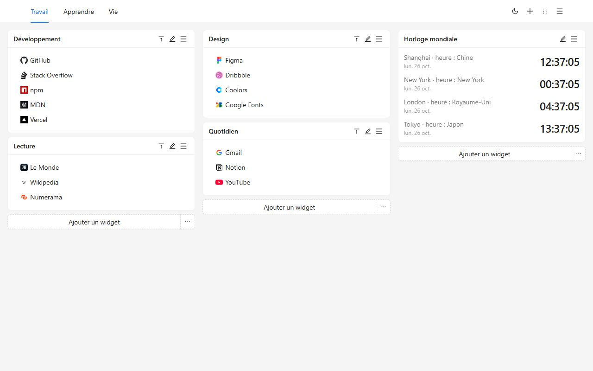
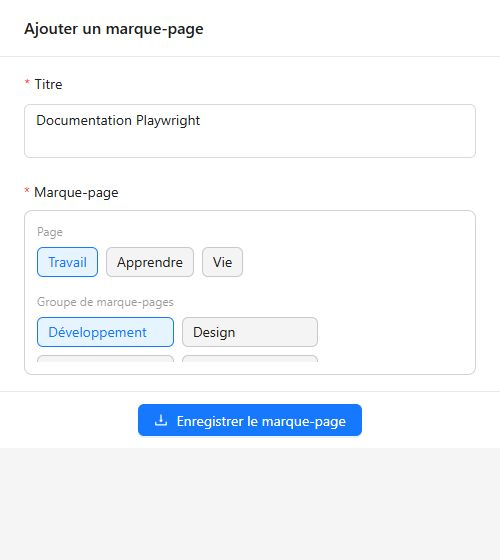
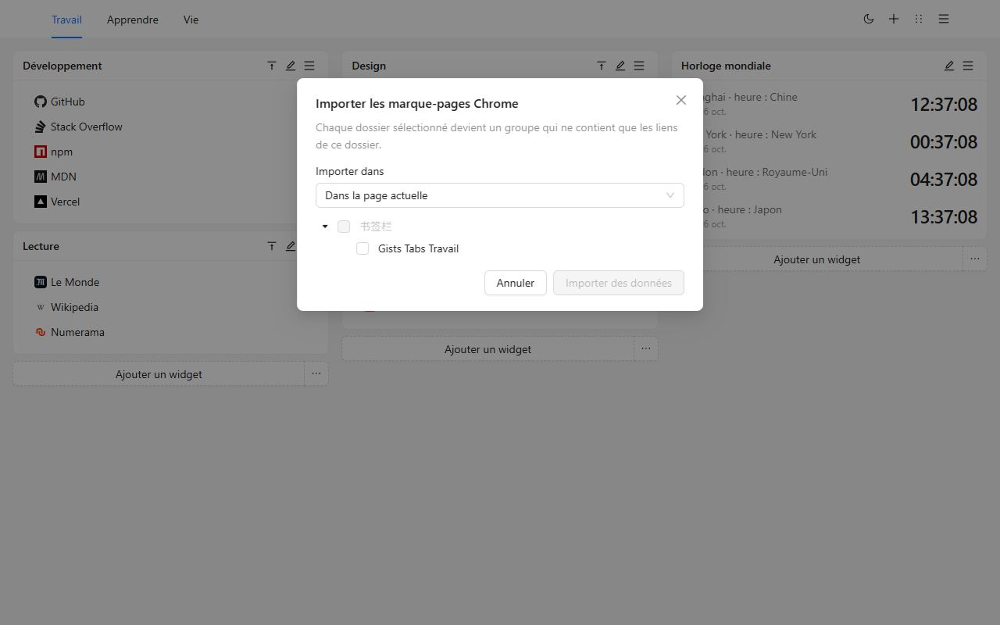
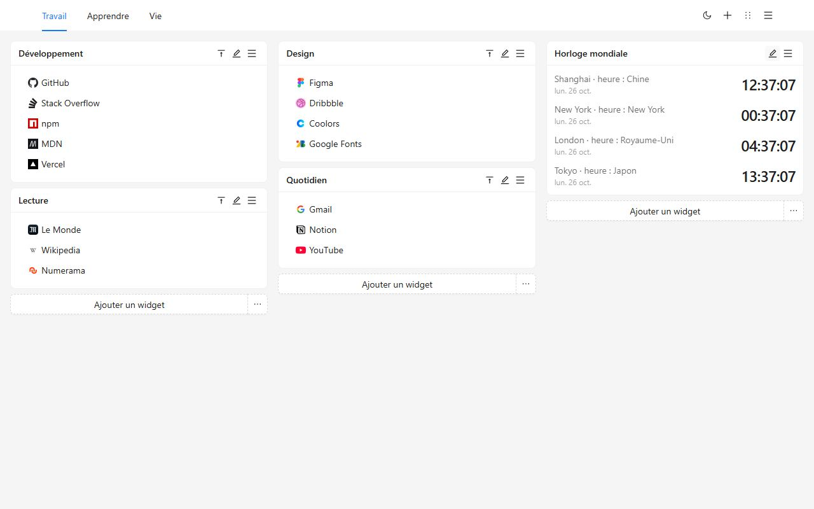
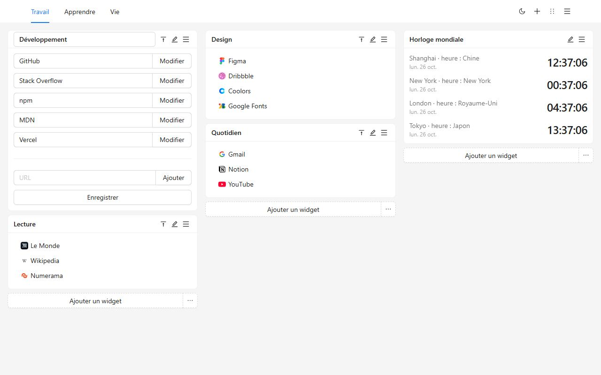
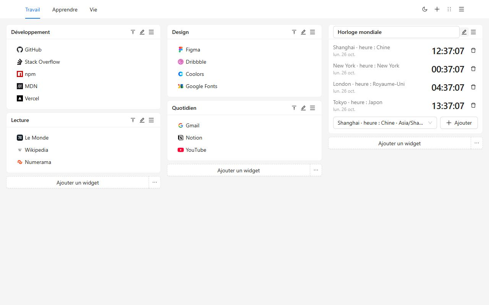
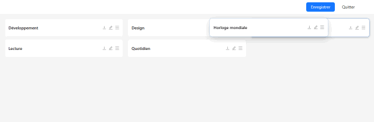
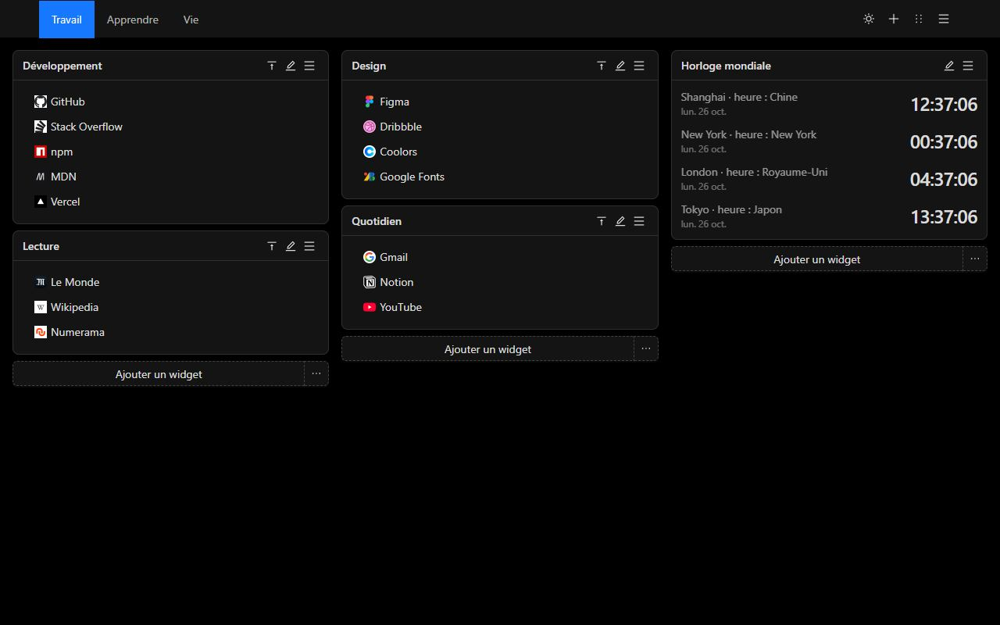
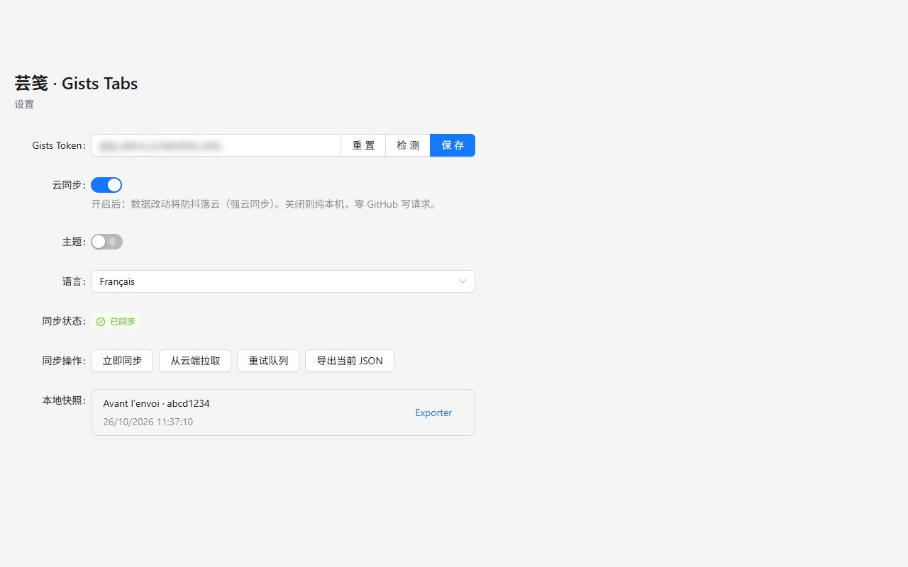
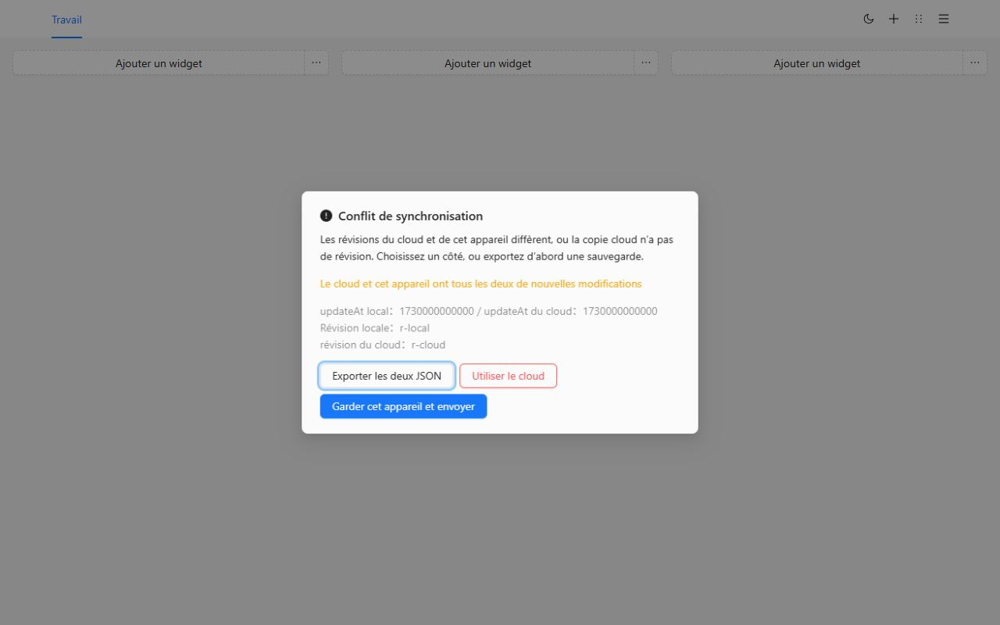

# Gists Tabs

Le nouvel onglet, organisé par vous. Groupes de marque-pages et horloges mondiales sur un canevas de plusieurs pages. Les données restent sur cet appareil jusqu’à ce que vous les synchronisiez vers un Gist GitHub privé.

[Ajouter à Chrome](https://chromewebstore.google.com/detail/cghagphlkcfafhacjgkfidbbkiklhacp)

[English](../../README.md) · [简体中文](./README.zh-CN.md) · [繁體中文](./README.zh-TW.md) · [日本語](./README.ja.md) · [한국어](./README.ko.md) · [Español](./README.es.md) · [Português](./README.pt-BR.md) · [Deutsch](./README.de.md) · **Français** · [Русский](./README.ru.md)

Gists Tabs remplace le nouvel onglet de Chrome par un espace que vous organisez. Travail, études et le reste de la journée ont chacun leur page. Chaque page a trois colonnes de groupes et d’horloges. Pas de compte à créer, et rien n’est envoyé tant que vous n’activez pas la synchronisation.

Si vous n’avez pas choisi de langue, l’interface suit le navigateur. Dans les réglages, vous pouvez passer à English, 简体中文, 繁體中文, 日本語, 한국어, Español, Português, Deutsch, Français ou Русский.

## Pourquoi celui-ci

Le nouvel onglet du navigateur est un champ de recherche et quelques raccourcis. La barre de marque-pages est une longue ligne. La plupart des tableaux de bord demandent leur propre compte, et la disposition vit sur leur serveur.

Gists Tabs fait l’inverse. La disposition est la vôtre. Si vous synchronisez, le fichier est un Gist privé de votre compte GitHub. L’auteur de l’extension n’a pas de serveur et ne voit pas vos marque-pages.

| | Nouvel onglet Chrome | Barre de marque-pages | Tableaux de bord avec compte | Gists Tabs |
| --- | --- | --- | --- | --- |
| Plusieurs pages, trois colonnes | Non | Non | Parfois | Oui |
| Horloges mondiales | Non | Non | Parfois | Oui |
| Sans compte | Oui | Oui | Non | Oui |
| Vos données, dans votre Gist privé | Non | Non | Non | Oui |
| Open source | Non | — | Rarement | Oui |
| Exporter et importer du JSON | Non | Export du navigateur seulement | Variable | Oui |
| Publicité ou pistage | Raccourcis | Non | Souvent | Non |

## Trois étapes

1. Installez depuis le Chrome Web Store. Le prochain nouvel onglet est le canevas.
2. Créez un groupe, ou importez les dossiers déjà présents dans Chrome.
3. Utilisez le bouton de la barre pour ranger la page que vous lisez.

## Apportez vos marque-pages Chrome

Ouvrez le menu de la page et choisissez **Importer les marque-pages Chrome**. La première fois, Chrome demande l’autorisation des marque-pages. Elle est facultative et n’est pas demandée à l’installation. Cochez les dossiers. Chacun devient un groupe qui ne contient que les liens directement à l’intérieur. Vous pouvez les mettre sur la page actuelle ou sur une nouvelle.

Les icônes restent la marque par défaut jusqu’à ce que vous modifiiez un lien. Les adresses `javascript:` et celles que le nouvel onglet ne peut pas ouvrir sont ignorées.

Pour emporter le canevas vers un autre navigateur sans GitHub, exportez le JSON depuis le menu ou les réglages, puis importez-le. L’import remplace le canevas actuel.

## Le canevas

Les pages sont dans l’en-tête. Renommez, copiez ou supprimez depuis le menu. La dernière page ne peut pas être supprimée.

Un groupe est une liste nommée. Modifiez le titre et les liens sur place, glissez dans la liste, ou faites un clic droit pour copier ou supprimer. Un double-clic sur le titre replie le groupe.

Une horloge montre l’heure des villes que vous ajoutez. Le cycle 12 ou 24 heures suit l’usage de la langue de l’interface.

Le mode tri transforme chaque groupe en barre. Glissez-le dans une autre colonne, puis enregistrez. Quitter abandonne le brouillon.

Clair et sombre sont un interrupteur de l’en-tête. Le choix reste sur cet appareil.

## Synchroniser vers votre propre Gist

La synchronisation est coupée tant que vous ne collez pas un jeton et que vous ne l’activez pas.

- Un jeton classique a besoin du scope `gist`.
- Un jeton affiné n’a besoin que de lire et écrire les Gists. Aucun droit sur les dépôts.

Dans les réglages, collez, vérifiez, enregistrez, puis activez le cloud. Le jeton reste dans le stockage local et ne sert qu’à lire et écrire un Gist privé de votre compte. Plusieurs modifications d’affilée deviennent une seule écriture.

Sur un second appareil, installez l’extension, collez un jeton du même compte et activez la synchronisation. Le canevas descend de ce Gist.

Si les deux côtés ont changé, la synchronisation s’arrête et demande un choix. Vous pouvez exporter les deux JSON, garder cet appareil et l’envoyer, ou le remplacer par la copie cloud. Avant le remplacement, le canevas précédent reste dans les instantanés locaux.

GitHub peut limiter les écritures. L’extension attend et réessaie, jusqu’à 10 minutes.

## Confidentialité et autorisations

| Autorisation | Quand | Pourquoi |
| --- | --- | --- |
| `storage` | À l’installation | Garder le canevas, le thème, la langue et le jeton sur cet appareil |
| `tabs`, `activeTab` | À l’installation | Lire l’onglet ouvert pour que le bouton puisse l’enregistrer |
| `alarms` | À l’installation | Réessayer la synchronisation après l’activation du cloud |
| `bookmarks` | Seulement à l’import | Lire les dossiers Chrome. Pas demandée à l’installation |

Pas d’analyse, pas de publicité, pas de serveur exploité par l’auteur de l’extension.

## Questions

**Faut-il GitHub ?**
Non. Avec la synchronisation coupée, le nouvel onglet fonctionne quand même.

**Où sont les marque-pages ?**
Dans le stockage de l’extension de ce navigateur. Avec la synchronisation, une copie existe aussi dans un Gist privé de votre compte.

**La langue change-t-elle après une mise à jour ?**
Si vous n’en avez jamais choisi, l’interface suit le navigateur. Un choix dans les réglages reste.

**Est-ce que ça tourne sous Firefox ?**
La fiche publiée est sur le Chrome Web Store. Le même code se compile pour Firefox. L’import des marque-pages Chrome utilise une autorisation propre à Chrome.

## Développement

Node.js et npm.

| Commande | Rôle |
| --- | --- |
| `npm run dev` | Build de développement Chrome |
| `npm run dev:firefox` | Build de développement Firefox |
| `npm run build` | Vérifie les types, puis build Chrome |
| `npm run build:firefox` | Vérifie les types, puis build Firefox |
| `npm run lint` | `tsc --noEmit` et ESLint |
| `npm test` | Tests de langue, d’import, de stockage et d’horloges |

Chargez l’extension non empaquetée depuis `.output/chrome-mv3`. La sortie Firefox est `.output/firefox-mv2` ou `.output/firefox-mv3`.

## Licence

[MIT](../../LICENSE)
