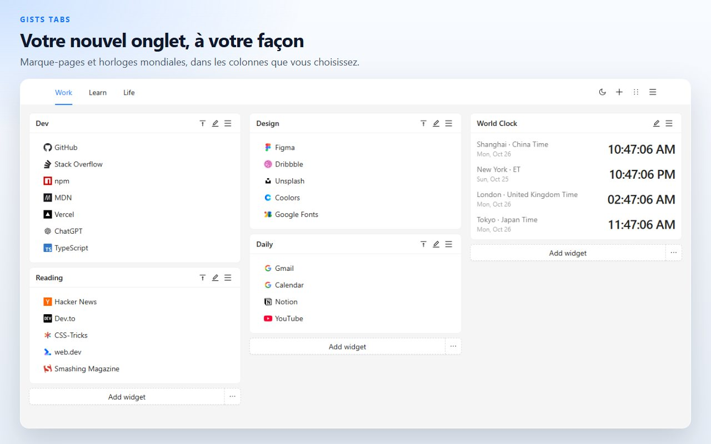
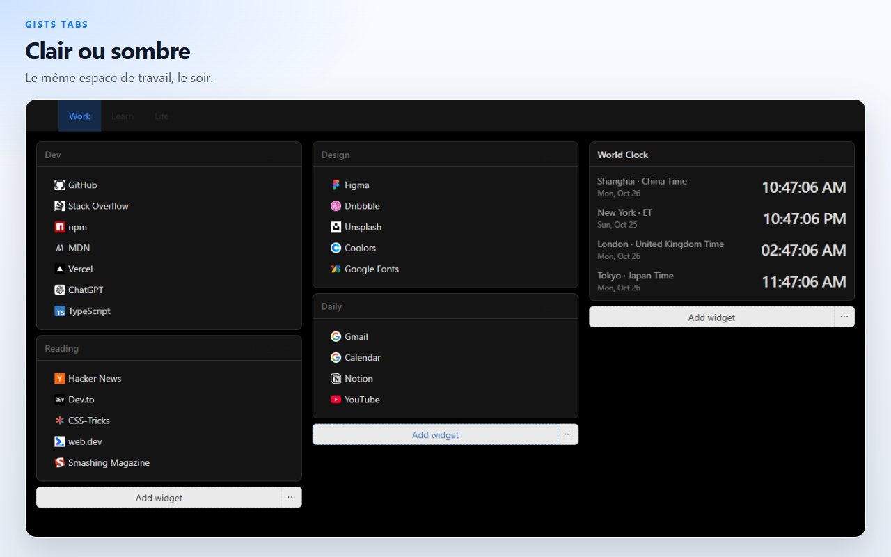
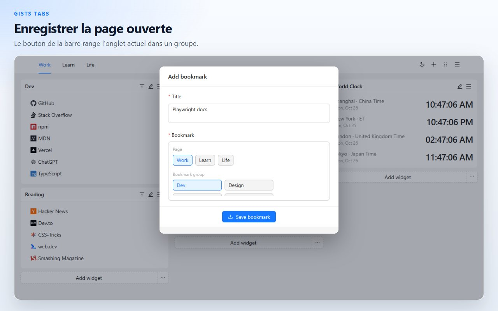
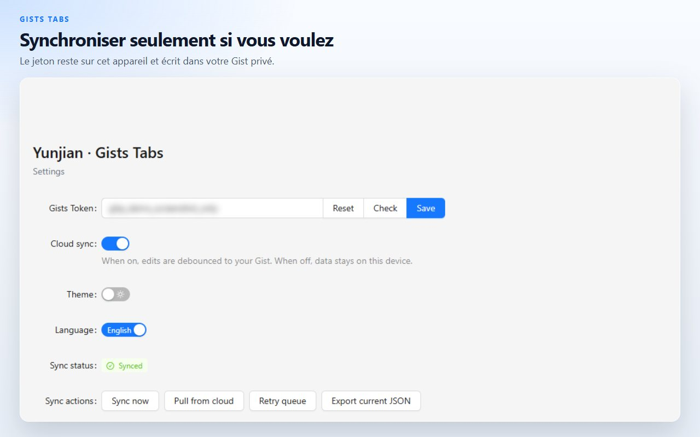

# Gists Tabs

Un nouvel onglet que vous organisez. Marque-pages et horloges mondiales sur un canevas de plusieurs pages. Les données restent sur cet appareil, sauf si vous les synchronisez vers votre propre Gist GitHub privé.

[Ajouter à Chrome](https://chromewebstore.google.com/detail/cghagphlkcfafhacjgkfidbbkiklhacp)

[English](../../README.md) · [简体中文](./README.zh-CN.md) · [繁體中文](./README.zh-TW.md) · [日本語](./README.ja.md) · [한국어](./README.ko.md) · [Español](./README.es.md) · [Português](./README.pt-BR.md) · [Deutsch](./README.de.md) · **Français** · [Русский](./README.ru.md)

Gists Tabs remplace le nouvel onglet de Chrome par un espace personnel. Placez des groupes de marque-pages et des horloges dans des colonnes, puis répartissez-les sur des pages. Rien ne quitte le navigateur tant que vous n’activez pas la synchronisation.

L’interface est en English et en 中文. Le choix se fait dans les paramètres de l’extension.

## Pages, marque-pages et horloges

Chaque page est un canevas de trois colonnes. Un widget de marque-pages contient des liens avec l’icône du site. Un widget d’horloge montre l’heure des villes que vous ajoutez. Ouvrez une autre page quand le travail et le reste de la journée ne doivent pas partager le même écran.

## Glisser, puis enregistrer

Entrez dans le mode de tri depuis l’en-tête, glissez un widget dans une autre colonne, puis enregistrez. Quitter ce mode abandonne le brouillon : un déplacement à moitié fait n’écrase pas le canevas.

## Enregistrer l’onglet déjà ouvert

Le bouton de la barre d’outils prend le titre et l’adresse de l’onglet ouvert et les range dans un groupe de marque-pages.

## Sur cet appareil, sauf si vous décidez autrement

Le canevas est dans le stockage local de l’extension. Vous pouvez l’exporter en JSON, ou importer un fichier enregistré plus tôt.

La synchronisation cloud est coupée tant que vous ne collez pas un jeton GitHub et que vous ne l’activez pas. Le jeton reste dans le stockage local. L’extension s’en sert seulement pour lire et écrire un Gist privé de votre compte. Un jeton classique a besoin du scope `gist`. Un jeton affiné a besoin d’un accès en lecture et en écriture aux Gists. L’auteur de l’extension n’exploite pas de serveur.

| Autorisation | Pourquoi elle est là |
| --- | --- |
| `storage` | Garder l’espace de travail sur cet appareil |
| `tabs`, `activeTab` | Lire l’onglet ouvert pour que le bouton puisse l’enregistrer |
| `alarms` | Réessayer la synchronisation après l’activation du cloud |

## Questions

**Faut-il un compte GitHub ?**
Non. Le nouvel onglet fonctionne avec la synchronisation coupée.

**Où sont les marque-pages ?**
Dans le stockage de l’extension de ce navigateur. Avec la synchronisation activée, une copie existe aussi dans un Gist privé de votre compte GitHub.

**Puis-je emporter le canevas sans GitHub ?**
Oui. Exportez le JSON depuis le menu du nouvel onglet ou depuis les paramètres, puis importez-le dans l’autre navigateur.

**Quelles langues parle le produit ?**
L’interface est en English et en 中文. Cette page est traduite plus largement pour que le projet soit plus facile à trouver.

**Est-ce que ça tourne sous Firefox ?**
La fiche publiée est sur le Chrome Web Store. Le même code se compile pour Firefox ; voyez les commandes plus bas.

## Développement

Node.js et npm.

| Commande | Rôle |
| --- | --- |
| `npm run dev` | Build de développement Chrome |
| `npm run dev:firefox` | Build de développement Firefox |
| `npm run build` | Vérifie les types, puis build de production Chrome |
| `npm run build:firefox` | Vérifie les types, puis build de production Firefox |
| `npm run lint` | `tsc --noEmit` et ESLint |
| `npm test` | Tests unitaires du stockage et du format de l’horloge |

Chargez l’extension non empaquetée depuis `.output/chrome-mv3`. La sortie Firefox est `.output/firefox-mv2` ou `.output/firefox-mv3`, le dossier que la commande affiche.

## Licence

[MIT](../../LICENSE)
