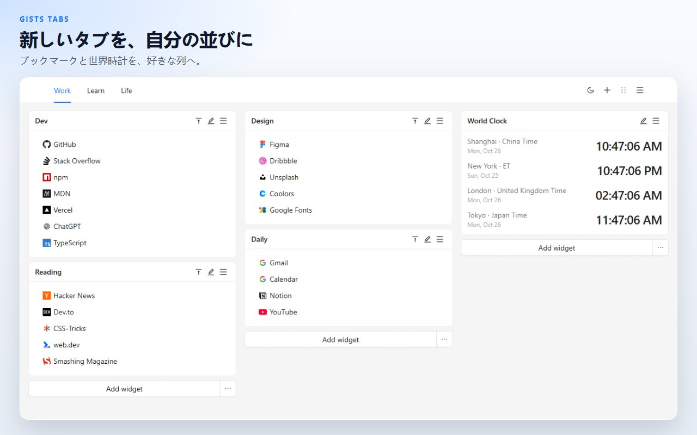
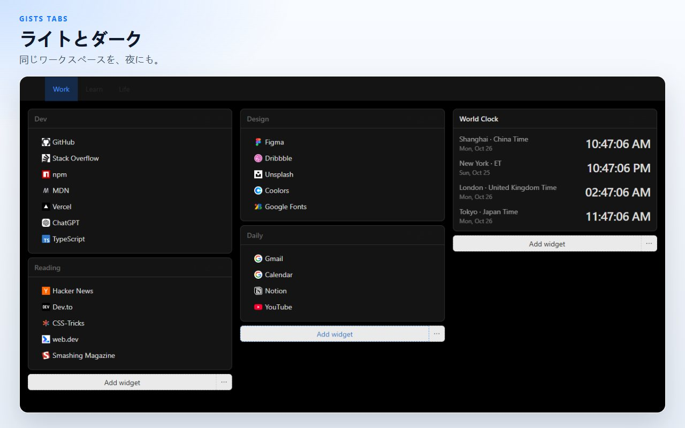
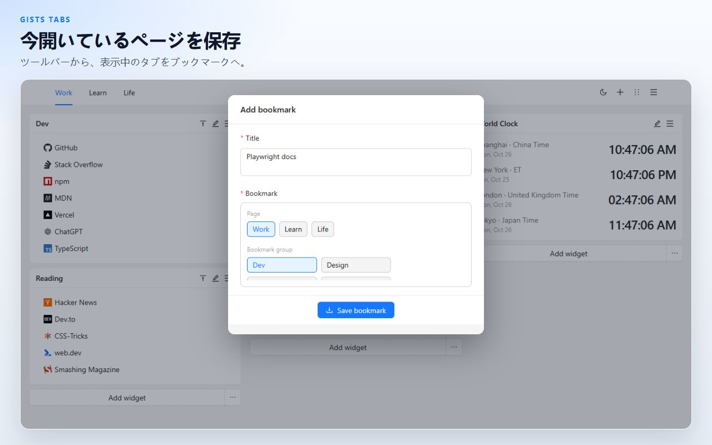
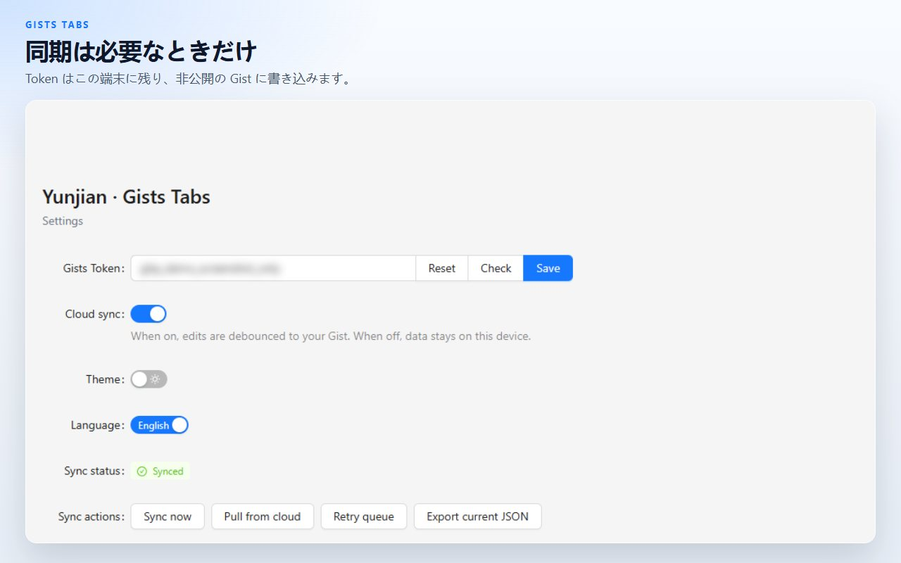

# Gists Tabs

自分で並べる、新しいタブ。ブックマークと世界時計を、複数ページのキャンバスに置きます。同期するまで、データはこの端末に残ります。同期先は、あなた自身の非公開 GitHub Gist です。

[Chrome に追加](https://chromewebstore.google.com/detail/cghagphlkcfafhacjgkfidbbkiklhacp)

[English](../../README.md) · [简体中文](./README.zh-CN.md) · [繁體中文](./README.zh-TW.md) · **日本語** · [한국어](./README.ko.md) · [Español](./README.es.md) · [Português](./README.pt-BR.md) · [Deutsch](./README.de.md) · [Français](./README.fr.md) · [Русский](./README.ru.md)

Gists Tabs は Chrome の新しいタブを、個人の作業台に置き換えます。ブックマークのまとまりと時計を列に置き、ページで分けます。同期をオンにするまで、内容はこのブラウザの外へ出ません。

画面の言語は English と中文です。拡張機能の設定ページで切り替えます。

## ページ、ブックマーク、時計

各ページは 3 列のキャンバスです。ブックマークのウィジェットには、サイトのアイコン付きリンクが並びます。時計のウィジェットは、追加した都市の時刻を表示します。仕事とそれ以外を同じ画面に置きたくないときは、ページを増やします。

## ドラッグしてから保存

ヘッダーから並べ替えに入り、ウィジェットを別の列へドラッグして保存します。並べ替えを終了すると下書きは捨てられるので、途中の移動がキャンバスを上書きすることはありません。

## 開いているタブを保存

ツールバーのボタンは、表示中のタブのタイトルとアドレスを読み、ブックマークグループに入れます。

## 初期状態ではこの端末だけ

キャンバスは拡張機能のローカルストレージにあります。JSON として書き出せます。以前保存したファイルを読み込むこともできます。

クラウド同期は、GitHub の Token を貼り付けてオンにするまでオフです。Token はローカルストレージに残り、あなたのアカウントの非公開 Gist を読み書きするためだけに使われます。クラシックな個人アクセス Token には `gist` スコープが必要です。Fine-grained Token には Gist の読み書き権限が必要です。拡張機能の作者が運用するサーバーはありません。

| 権限 | 理由 |
| --- | --- |
| `storage` | 作業台をこの端末に残す |
| `tabs`、`activeTab` | 表示中のタブを読み、ツールバーから保存する |
| `alarms` | クラウド同期をオンにしたあと、再試行をスケジュールする |

## 質問

**GitHub アカウントは必要ですか？**
いいえ。同期をオフにしたままで、新しいタブは使えます。

**ブックマークはどこにありますか？**
このブラウザの拡張機能ストレージです。同期をオンにすると、あなたの GitHub アカウントに非公開 Gist のコピーもできます。

**GitHub を使わずにキャンバスを移せますか？**
はい。新しいタブのメニューか設定から JSON を書き出し、別のブラウザで読み込みます。

**製品の画面は何語ですか？**
画面は English と中文です。この説明は、プロジェクトを見つけやすくするために、より多くの言語で置いています。

**Firefox でも動きますか？**
公開されているのは Chrome ウェブストアです。同じソースから Firefox 向けにもビルドできます。下のコマンドを見てください。

## 開発

Node.js と npm が必要です。

| コマンド | 内容 |
| --- | --- |
| `npm run dev` | Chrome の開発ビルド |
| `npm run dev:firefox` | Firefox の開発ビルド |
| `npm run build` | 型チェックのあと、Chrome の本番ビルド |
| `npm run build:firefox` | 型チェックのあと、Firefox の本番ビルド |
| `npm run lint` | `tsc --noEmit` と ESLint |
| `npm test` | ストレージと時計表示のユニットテスト |

パッケージ化されていない拡張機能を読み込むときは `.output/chrome-mv3` を選びます。Firefox の出力は `.output/firefox-mv2` または `.output/firefox-mv3` で、コマンドが表示したディレクトリです。

## ライセンス

[MIT](../../LICENSE)
