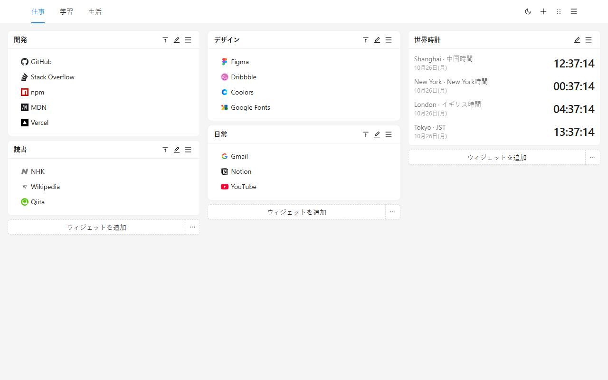
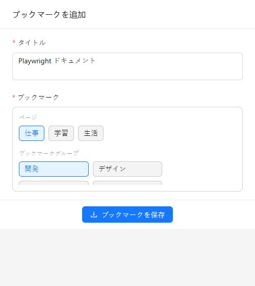
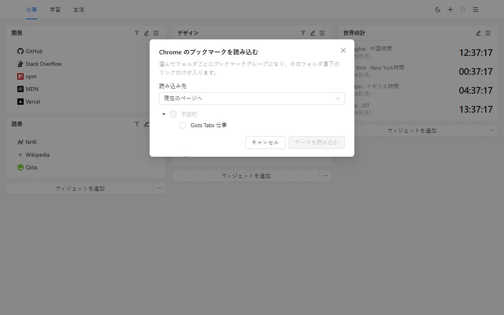
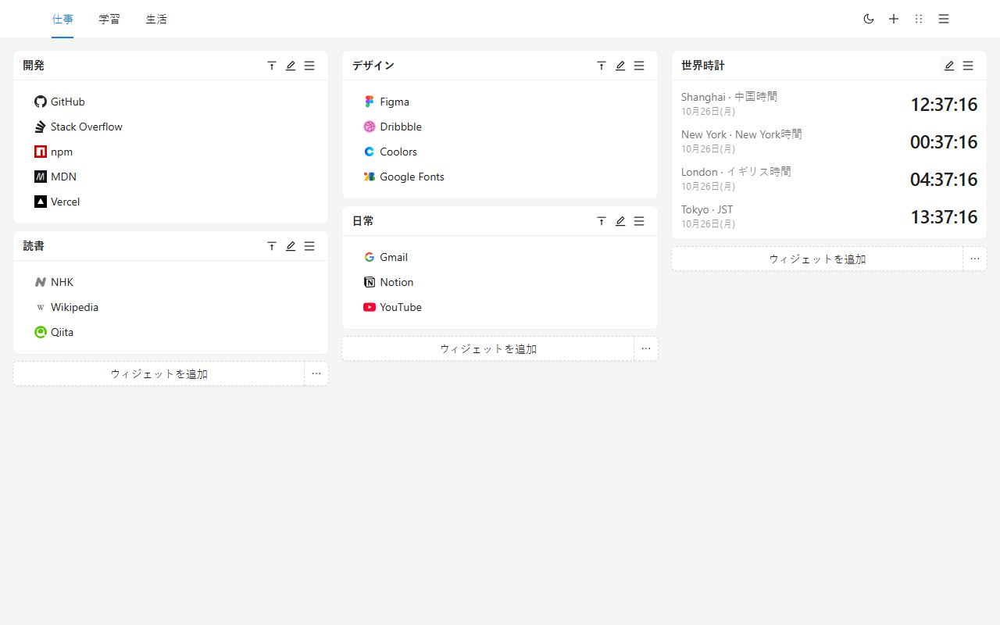
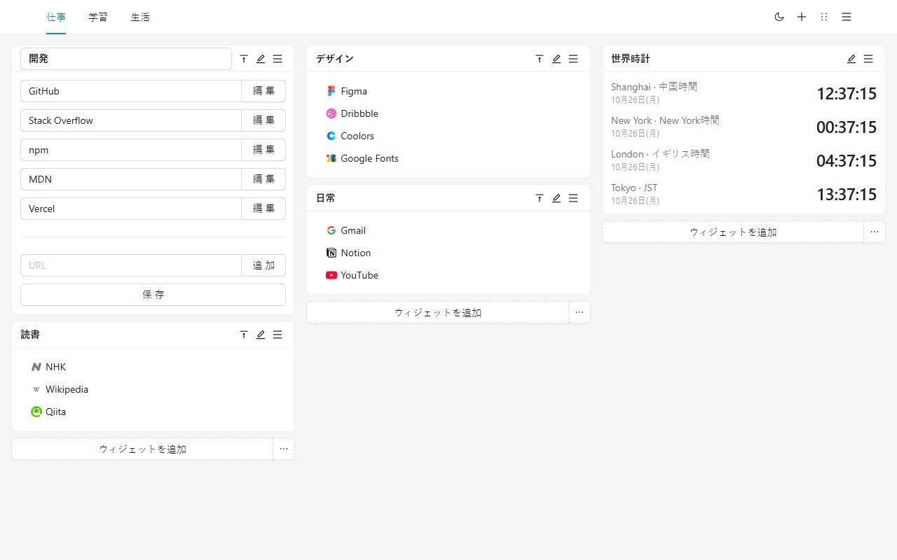
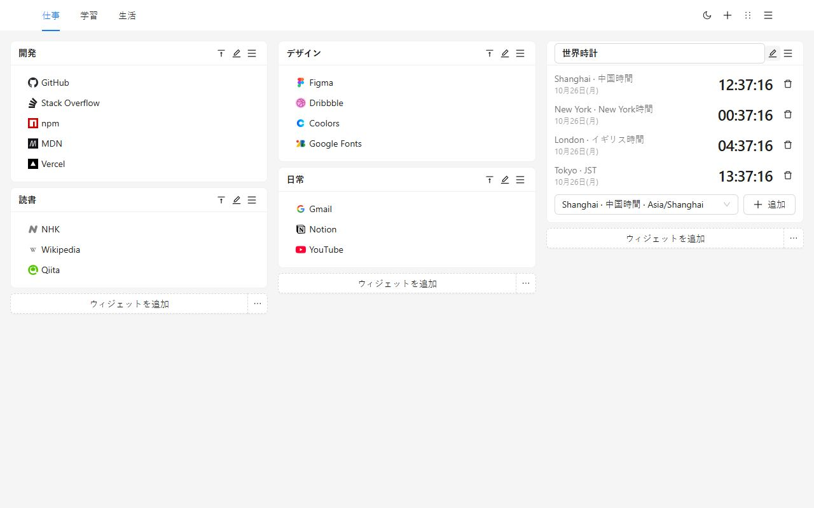
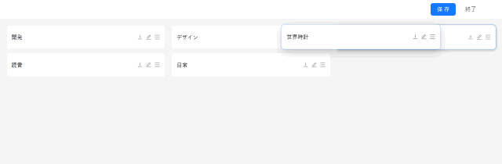
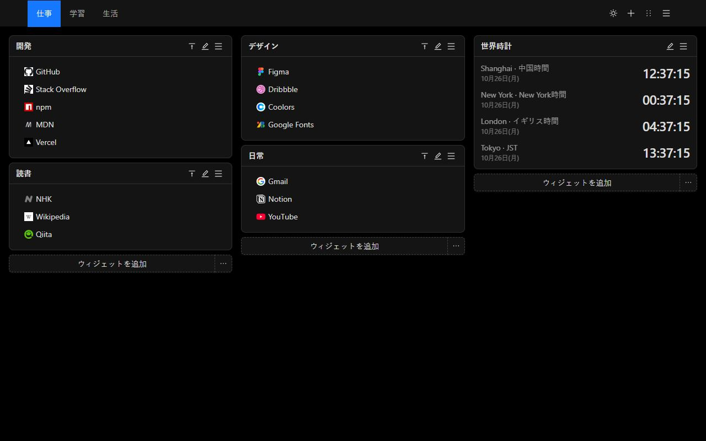
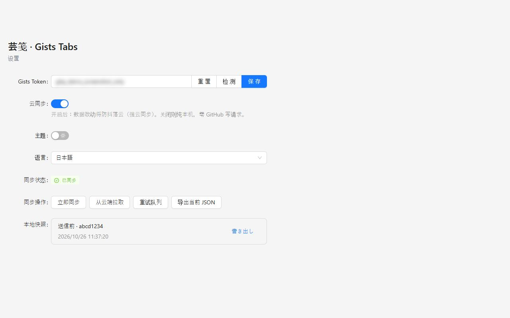
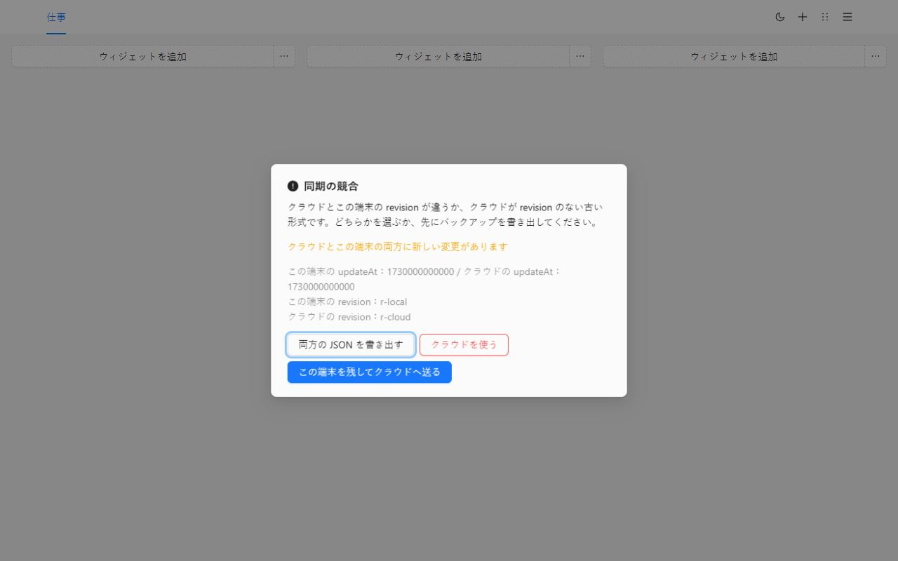

# Gists Tabs

自分で並べる、新しいタブ。ブックマークと世界時計を、複数ページのキャンバスに置きます。同期するまで、データはこの端末に残ります。

[Chrome に追加](https://chromewebstore.google.com/detail/cghagphlkcfafhacjgkfidbbkiklhacp)

[English](../../README.md) · [简体中文](./README.zh-CN.md) · [繁體中文](./README.zh-TW.md) · **日本語** · [한국어](./README.ko.md) · [Español](./README.es.md) · [Português](./README.pt-BR.md) · [Deutsch](./README.de.md) · [Français](./README.fr.md) · [Русский](./README.ru.md)

Gists Tabs は Chrome の新しいタブを、自分で並べる作業台に置き換えます。仕事、学習、それ以外をページで分けます。各ページは 3 列のブックマークと時計です。アカウントは要らず、同期をオンにするまで何も送信されません。

言語を選んでいなければ、画面はブラウザに従います。設定で English、简体中文、繁體中文、日本語、한국어、Español、Português、Deutsch、Français、Русский に切り替えられます。

## なぜこれか

ブラウザ標準の新しいタブは検索欄と少しのショートカットです。ブックマークバーは長い一行です。多くのダッシュボード拡張は独自アカウントを求め、配置は相手のサーバーにあります。

Gists Tabs は逆です。配置はあなたのもの。同期するなら、ファイルはあなたの GitHub アカウントの非公開 Gist です。拡張機能の作者にサーバーはなく、ブックマークは見えません。

| | Chrome の新しいタブ | ブックマークバー | アカウント制のダッシュボード | Gists Tabs |
| --- | --- | --- | --- | --- |
| 複数ページ、3 列 | なし | なし | 場合による | あり |
| 世界時計 | なし | なし | 場合による | あり |
| アカウントなしで使える | はい | はい | いいえ | はい |
| データは自分の非公開 Gist | なし | なし | なし | あり |
| オープンソース | いいえ | — | まれ | はい |
| JSON の書き出しと読み込み | なし | ブラウザの書き出しのみ | 場合による | あり |
| 広告や追跡 | ショートカット | なし | 多い | なし |

## 3 ステップ

1. Chrome ウェブストアからインストールします。次の新しいタブがキャンバスです。
2. ブックマークグループを作るか、Chrome にあるフォルダを読み込みます。
3. ツールバーのボタンで、今開いているページを保存します。

## Chrome のブックマークを移す

ページメニューから **Chrome のブックマークを読み込む** を選びます。最初だけ Chrome がブックマーク権限を求めます。インストール時には求めません。フォルダを選びます。フォルダごとにグループになり、そのフォルダ直下のリンクだけが入ります。現在のページにも、新しいページにも置けます。

アイコンはあとから編集するまで既定の印です。`javascript:` など、新しいタブで開けないアドレスは飛ばします。

GitHub を使わずに別のブラウザへ移すときは、ページメニューか設定から JSON を書き出し、向こうで読み込みます。読み込むと現在のキャンバスは置き換わります。

## キャンバス

ページはヘッダーに並びます。メニューから名前の変更、コピー、削除ができます。最後の 1 ページは削除できません。

ブックマークグループは名前付きのリストです。タイトルとリンクをその場で編集し、リスト内でドラッグし、右クリックでコピーや削除ができます。タイトルをダブルクリックすると折りたたみます。

時計は追加した都市の時刻を表示します。12 時間制か 24 時間制かは、画面の言語の習慣に従います。

並べ替えでは各グループが一本のバーになります。別の列へドラッグして保存します。終了すると下書きは捨てられます。

ライトとダークはヘッダーの一つのスイッチで、この端末に保存されます。

## 自分の Gist に同期する

同期は、Token を貼り付けてオンにするまでオフです。

- クラシックな個人アクセス Token には `gist` スコープが必要です。
- Fine-grained Token には Gist の読み書きだけが必要で、リポジトリ権限は要りません。

設定で貼り付け、確認し、保存してからクラウド同期をオンにします。Token はローカルストレージに残り、あなたのアカウントの非公開 Gist を読み書きするためだけに使われます。連続した編集は一つの書き込みにまとまります。

2 台目では同じ GitHub アカウントの Token を貼り付けて同期をオンにすると、その Gist からキャンバスが降ります。

両方に変更があると、同期は止まって選択を求めます。両方の JSON を書き出す、この端末を残して送る、クラウドでこの端末を置き換える、の三つです。置き換える前に、それまでのキャンバスはローカルスナップショットに残ります。

GitHub が書き込みを制限することがあります。拡張機能は待って再試行し、間隔は最長 10 分まで伸びます。

## プライバシーと権限

| 権限 | いつ | 理由 |
| --- | --- | --- |
| `storage` | インストール時 | キャンバス、テーマ、言語、Token をこの端末に残す |
| `tabs`、`activeTab` | インストール時 | 表示中のタブを読み、ツールバーから保存する |
| `alarms` | インストール時 | クラウド同期のあと、再試行をスケジュールする |
| `bookmarks` | 読み込むときだけ | Chrome のブックマークフォルダを読む。インストール時には求めない |

分析も広告もなく、拡張機能の作者が運用するサーバーもありません。

## 質問

**GitHub は必要ですか？**
いいえ。同期をオフにしたままで使えます。

**ブックマークはどこにありますか？**
このブラウザの拡張機能ストレージです。同期をオンにすると、あなたの GitHub アカウントに非公開 Gist もできます。

**更新で言語は変わりますか？**
一度も選んでいなければブラウザに従います。設定で選べば、その選択が残ります。

**Firefox でも動きますか？**
公開されているのは Chrome ウェブストアです。同じソースから Firefox 向けにもビルドできます。Chrome のブックマーク読み込みは Chrome だけの権限です。

## 開発

Node.js と npm が必要です。

| コマンド | 内容 |
| --- | --- |
| `npm run dev` | Chrome の開発ビルド |
| `npm run dev:firefox` | Firefox の開発ビルド |
| `npm run build` | 型チェックのあと、Chrome の本番ビルド |
| `npm run build:firefox` | 型チェックのあと、Firefox の本番ビルド |
| `npm run lint` | `tsc --noEmit` と ESLint |
| `npm test` | 言語判定、ブックマーク読み込み、ストレージ、時計のユニットテスト |

パッケージ化されていない拡張機能は `.output/chrome-mv3` を読み込みます。Firefox の出力は `.output/firefox-mv2` または `.output/firefox-mv3` です。

## ライセンス

[MIT](../../LICENSE)
