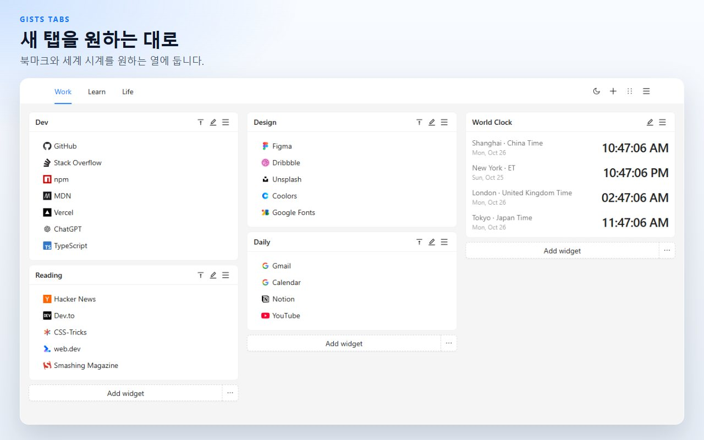
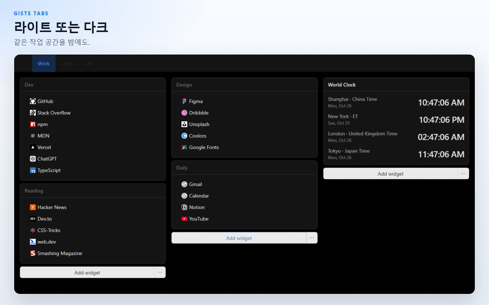
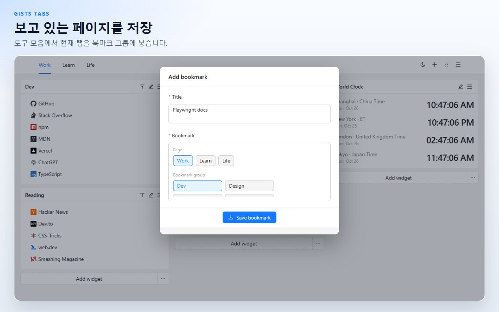
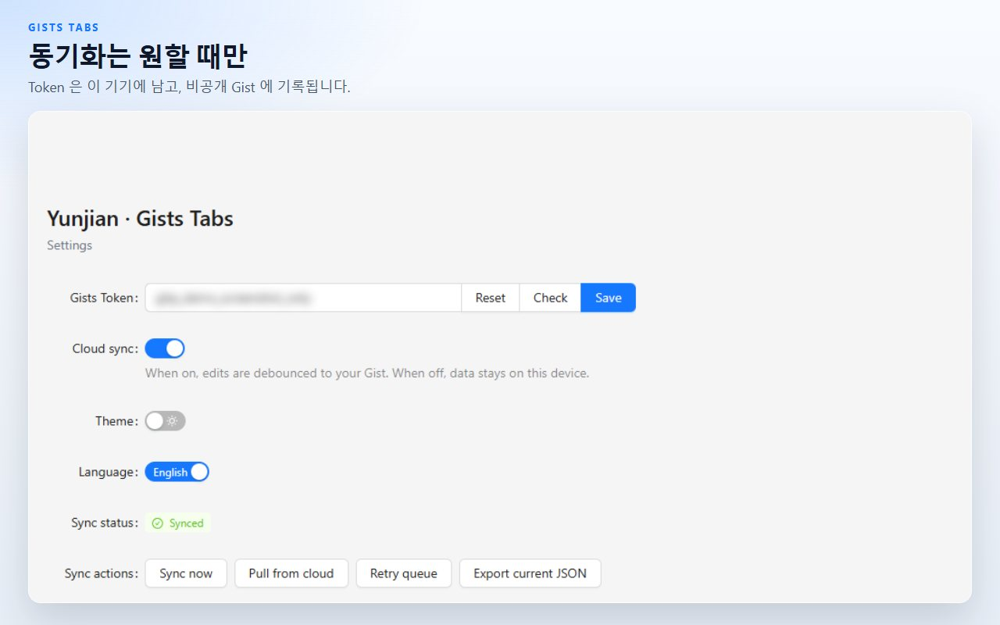

# Gists Tabs

직접 배치하는 새 탭. 북마크와 세계 시계를 여러 페이지의 캔버스에 둡니다. 동기화하기 전에는 데이터가 이 기기에 남습니다. 동기화하면 내 비공개 GitHub Gist로 갑니다.

[Chrome에 추가](https://chromewebstore.google.com/detail/cghagphlkcfafhacjgkfidbbkiklhacp)

[English](../../README.md) · [简体中文](./README.zh-CN.md) · [繁體中文](./README.zh-TW.md) · [日本語](./README.ja.md) · **한국어** · [Español](./README.es.md) · [Português](./README.pt-BR.md) · [Deutsch](./README.de.md) · [Français](./README.fr.md) · [Русский](./README.ru.md)

Gists Tabs는 Chrome 새 탭을 개인 작업 공간으로 바꿉니다. 북마크 묶음과 시계를 열에 넣고, 페이지로 나눕니다. 동기화를 켜기 전에는 내용이 이 브라우저 밖에 나가지 않습니다.

화면 언어는 English와 중문입니다. 확장 프로그램 설정 페이지에서 바꿉니다.

## 페이지, 북마크, 시계

각 페이지는 세 열의 캔버스입니다. 북마크 위젯에는 사이트 아이콘이 있는 링크가 있습니다. 시계 위젯은 추가한 도시의 시각을 보여 줍니다. 일과 그 밖의 시간을 한 화면에 두고 싶지 않으면 페이지를 더 만듭니다.

## 끌어다 놓은 다음 저장

머리글에서 정렬 모드로 들어가 위젯을 다른 열로 끌고 저장합니다. 정렬 모드를 나가면 초안은 버려지므로, 끝나지 않은 이동이 캔버스를 덮어쓰지 않습니다.

## 보고 있는 탭 저장

도구 모음 버튼은 현재 탭의 제목과 주소를 읽어 북마크 그룹에 넣습니다.

## 기본은 이 기기

캔버스는 확장 프로그램의 로컬 저장소에 있습니다. JSON으로 내보내거나, 예전에 저장한 파일을 가져올 수 있습니다.

클라우드 동기화는 GitHub Token을 붙여 넣고 켜기 전까지 꺼져 있습니다. Token은 로컬 저장소에 남으며, 내 계정의 비공개 Gist를 읽고 쓰는 데만 쓰입니다. 클래식 개인용 액세스 토큰에는 `gist` 범위가 필요합니다. 세분화된 토큰에는 Gist 읽기와 쓰기 권한이 필요합니다. 확장 프로그램 작성자가 운영하는 서버는 없습니다.

| 권한 | 이유 |
| --- | --- |
| `storage` | 작업 공간을 이 기기에 둡니다 |
| `tabs`, `activeTab` | 현재 탭을 읽어 도구 모음에서 저장합니다 |
| `alarms` | 클라우드 동기화를 켠 뒤 재시도를 예약합니다 |

## 질문

**GitHub 계정이 필요한가요?**
아니요. 동기화를 끈 채로 새 탭을 쓸 수 있습니다.

**북마크는 어디에 있나요?**
이 브라우저의 확장 프로그램 저장소입니다. 동기화를 켜면 내 GitHub 계정의 비공개 Gist에도 사본이 생깁니다.

**GitHub 없이 캔버스를 옮길 수 있나요?**
예. 새 탭 메뉴나 설정에서 JSON을 내보낸 뒤, 다른 브라우저에서 가져옵니다.

**제품 화면은 어떤 언어인가요?**
화면은 English와 중문입니다. 이 설명은 프로젝트를 찾기 쉽게 더 많은 언어로 두었습니다.

**Firefox에서도 되나요?**
공개된 목록은 Chrome 웹 스토어입니다. 같은 소스로 Firefox용을 빌드할 수 있습니다. 아래 명령을 보세요.

## 개발

Node.js와 npm이 필요합니다.

| 명령 | 하는 일 |
| --- | --- |
| `npm run dev` | Chrome 개발 빌드 |
| `npm run dev:firefox` | Firefox 개발 빌드 |
| `npm run build` | 타입 검사 후 Chrome 프로덕션 빌드 |
| `npm run build:firefox` | 타입 검사 후 Firefox 프로덕션 빌드 |
| `npm run lint` | `tsc --noEmit`와 ESLint |
| `npm test` | 저장소와 시계 형식의 단위 테스트 |

압축을 푼 확장 프로그램을 불러올 때는 `.output/chrome-mv3`를 고릅니다. Firefox 결과는 `.output/firefox-mv2` 또는 `.output/firefox-mv3`이며, 명령이 출력한 디렉터리입니다.

## 라이선스

[MIT](../../LICENSE)
