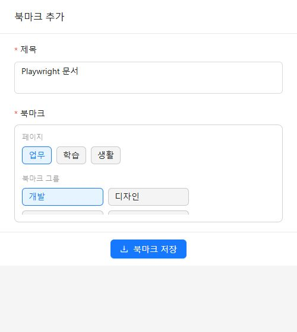
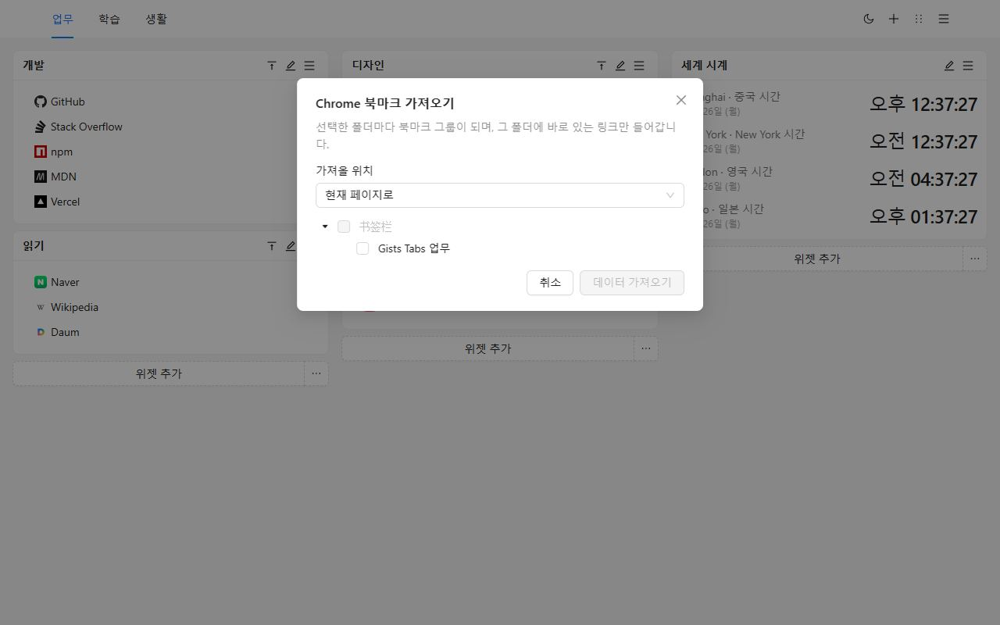
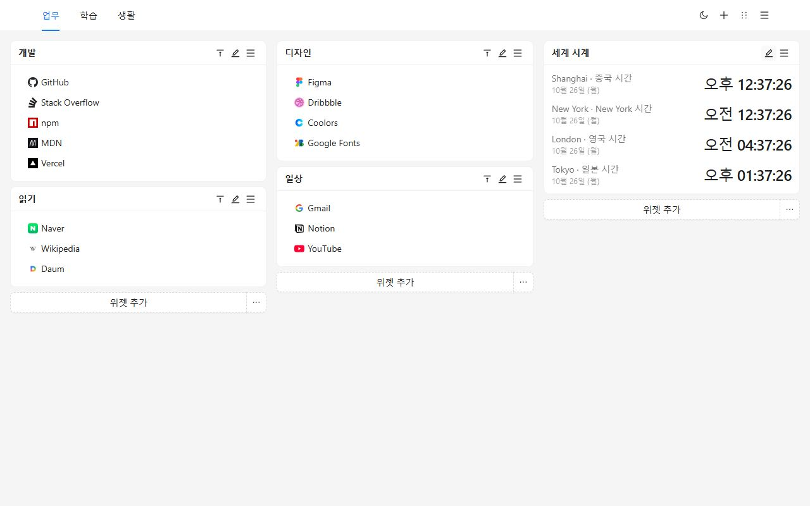
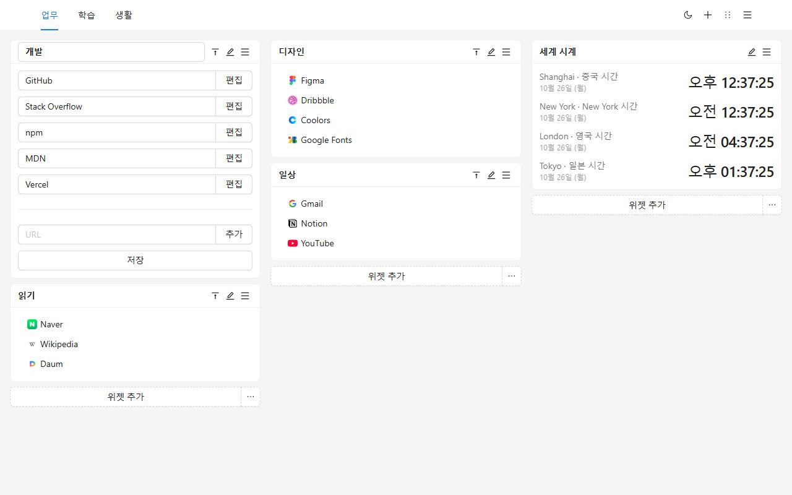
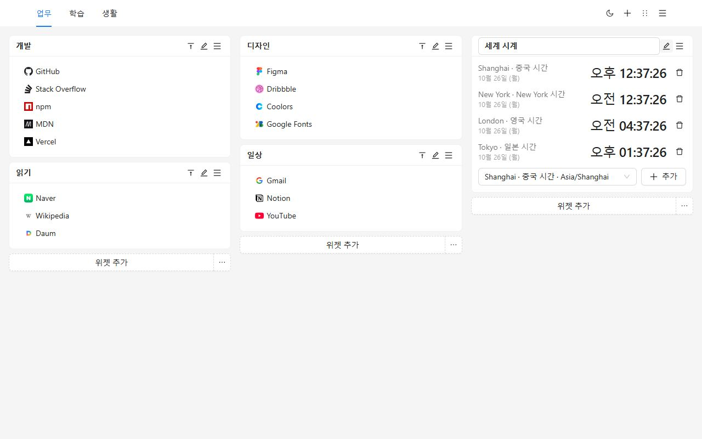
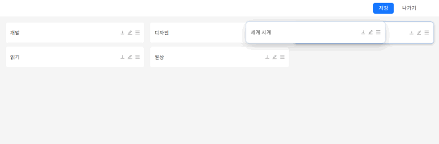
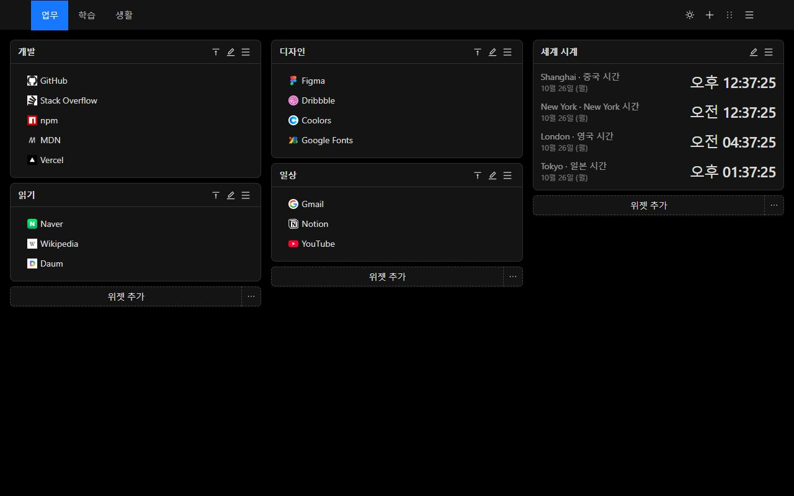
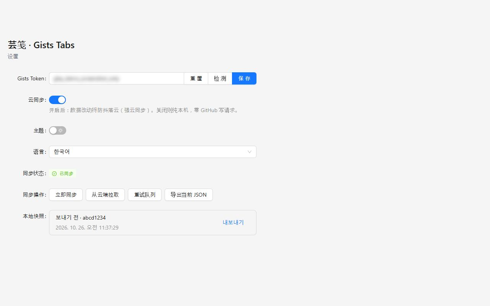
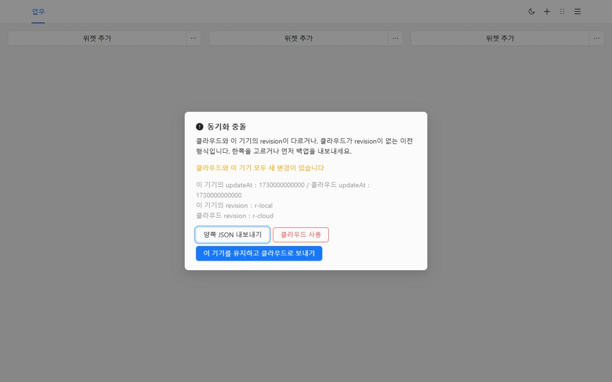

# Gists Tabs

직접 배치하는 새 탭. 북마크와 세계 시계를 여러 페이지의 캔버스에 둡니다. 동기화하기 전에는 데이터가 이 기기에 남습니다.

[Chrome에 추가](https://chromewebstore.google.com/detail/cghagphlkcfafhacjgkfidbbkiklhacp)

[English](../../README.md) · [简体中文](./README.zh-CN.md) · [繁體中文](./README.zh-TW.md) · [日本語](./README.ja.md) · **한국어** · [Español](./README.es.md) · [Português](./README.pt-BR.md) · [Deutsch](./README.de.md) · [Français](./README.fr.md) · [Русский](./README.ru.md)

Gists Tabs는 Chrome 새 탭을 직접 배치하는 작업 공간으로 바꿉니다. 일, 공부, 그 밖의 시간을 페이지로 나눕니다. 각 페이지는 세 열의 북마크와 시계입니다. 계정을 만들지 않으며, 동기화를 켜기 전에는 아무것도 올라가지 않습니다.

언어를 고르지 않았다면 화면은 브라우저를 따릅니다. 설정에서 English, 简体中文, 繁體中文, 日本語, 한국어, Español, Português, Deutsch, Français, Русский 중에서 바꿀 수 있습니다.

## 왜 이것인가

브라우저 기본 새 탭은 검색창과 몇 개의 바로가기입니다. 북마크 막대는 긴 한 줄입니다. 많은 대시보드 확장 프로그램은 자기 계정을 요구하고, 배치는 그 서버에 있습니다.

Gists Tabs는 반대입니다. 배치는 내 것입니다. 동기화하면 파일은 내 GitHub 계정의 비공개 Gist입니다. 확장 프로그램 작성자에게는 서버가 없고, 북마크를 보지 않습니다.

| | Chrome 새 탭 | 북마크 막대 | 계정이 필요한 대시보드 | Gists Tabs |
| --- | --- | --- | --- | --- |
| 여러 페이지, 세 열 | 없음 | 없음 | 가끔 | 있음 |
| 세계 시계 | 없음 | 없음 | 가끔 | 있음 |
| 계정 없이 사용 | 예 | 예 | 아니요 | 예 |
| 데이터는 내 비공개 Gist | 없음 | 없음 | 없음 | 있음 |
| 오픈 소스 | 아니요 | — | 드묾 | 예 |
| JSON 내보내기/가져오기 | 없음 | 브라우저 내보내기만 | 경우마다 다름 | 있음 |
| 광고나 추적 | 바로가기 | 없음 | 흔함 | 없음 |

## 세 단계

1. Chrome 웹 스토어에서 설치합니다. 다음 새 탭이 캔버스입니다.
2. 북마크 그룹을 만들거나, Chrome에 있는 폴더를 가져옵니다.
3. 도구 모음 버튼으로 보고 있는 페이지를 저장합니다.

## Chrome 북마크 옮기기

페이지 메뉴에서 **Chrome 북마크 가져오기**를 고릅니다. 처음 한 번 Chrome이 북마크 권한을 묻습니다. 설치할 때는 묻지 않습니다. 폴더를 고르면 폴더마다 그룹이 되고, 그 폴더에 바로 있는 링크만 들어갑니다. 현재 페이지나 새 페이지에 둘 수 있습니다.

아이콘은 링크를 편집하기 전까지 기본 표시입니다. `javascript:`처럼 새 탭에서 열 수 없는 주소는 건너뜁니다.

GitHub 없이 다른 브라우저로 옮기려면 페이지 메뉴나 설정에서 JSON을 내보낸 뒤 가져옵니다. 가져오기는 현재 캔버스를 바꿉니다.

## 캔버스

페이지는 머리글에 있습니다. 메뉴에서 이름을 바꾸고, 복사하고, 삭제합니다. 마지막 페이지는 지울 수 없습니다.

북마크 그룹은 이름이 있는 목록입니다. 제목과 링크를 그 자리에서 고치고, 목록 안에서 끌며, 오른쪽 클릭으로 복사하거나 삭제합니다. 제목을 두 번 누르면 접힙니다.

시계는 추가한 도시의 시각을 보여 줍니다. 12시간제와 24시간제는 화면 언어의 습관을 따릅니다.

정렬 모드에서는 그룹이 막대가 됩니다. 다른 열로 끌어 저장합니다. 나가면 초안은 버려집니다.

라이트와 다크는 머리글의 스위치 하나이며, 이 기기에 저장됩니다.

## 내 Gist로 동기화

동기화는 Token을 붙여 넣고 켜기 전까지 꺼져 있습니다.

- 클래식 개인용 액세스 토큰에는 `gist` 범위가 필요합니다.
- 세분화된 토큰에는 Gist 읽기와 쓰기만 필요하고, 저장소 권한은 필요 없습니다.

설정에서 붙여 넣고, 확인하고, 저장한 다음 클라우드 동기화를 켭니다. Token은 로컬 저장소에 남으며, 내 계정의 비공개 Gist를 읽고 쓰는 데만 쓰입니다.

두 번째 기기에서는 같은 GitHub 계정의 Token을 붙여 넣고 동기화를 켜면 그 Gist에서 캔버스가 내려옵니다.

양쪽이 바뀌면 동기화가 멈추고 고르게 합니다. 양쪽 JSON을 내보내거나, 이 기기를 유지하고 보내거나, 클라우드로 이 기기를 바꿀 수 있습니다. 바꾸기 전에 이전 캔버스는 로컬 스냅샷에 남습니다.

GitHub가 요청을 제한할 수 있습니다. 확장 프로그램은 기다렸다가 다시 시도하며, 간격은 최대 10분입니다.

## 개인정보와 권한

| 권한 | 언제 | 이유 |
| --- | --- | --- |
| `storage` | 설치 시 | 캔버스, 테마, 언어, Token을 이 기기에 둡니다 |
| `tabs`, `activeTab` | 설치 시 | 현재 탭을 읽어 도구 모음에서 저장합니다 |
| `alarms` | 설치 시 | 클라우드 동기화 뒤 재시도를 예약합니다 |
| `bookmarks` | 가져올 때만 | Chrome 북마크 폴더를 읽습니다. 설치 시에는 요청하지 않습니다 |

분석도 광고도 없고, 작성자가 운영하는 서버도 없습니다.

## 질문

**GitHub가 필요한가요?**
아니요. 동기화를 끈 채로 쓸 수 있습니다.

**북마크는 어디에 있나요?**
이 브라우저의 확장 프로그램 저장소입니다. 동기화를 켜면 내 GitHub 계정의 비공개 Gist에도 사본이 생깁니다.

**업데이트 후 언어가 바뀌나요?**
한 번도 고르지 않았다면 브라우저를 따릅니다. 설정에서 고르면 그 선택이 남습니다.

**Firefox에서도 되나요?**
공개된 목록은 Chrome 웹 스토어입니다. 같은 소스로 Firefox용을 빌드할 수 있습니다. Chrome 북마크 가져오기는 Chrome 전용 권한입니다.

## 개발

Node.js와 npm이 필요합니다.

| 명령 | 하는 일 |
| --- | --- |
| `npm run dev` | Chrome 개발 빌드 |
| `npm run dev:firefox` | Firefox 개발 빌드 |
| `npm run build` | 타입 검사 후 Chrome 프로덕션 빌드 |
| `npm run build:firefox` | 타입 검사 후 Firefox 프로덕션 빌드 |
| `npm run lint` | `tsc --noEmit`와 ESLint |
| `npm test` | 언어 판별, 북마크 가져오기, 저장소, 시계의 단위 테스트 |

압축을 푼 확장 프로그램은 `.output/chrome-mv3`에서 불러옵니다. Firefox 결과는 `.output/firefox-mv2` 또는 `.output/firefox-mv3`입니다.

## 라이선스

[MIT](../../LICENSE)
