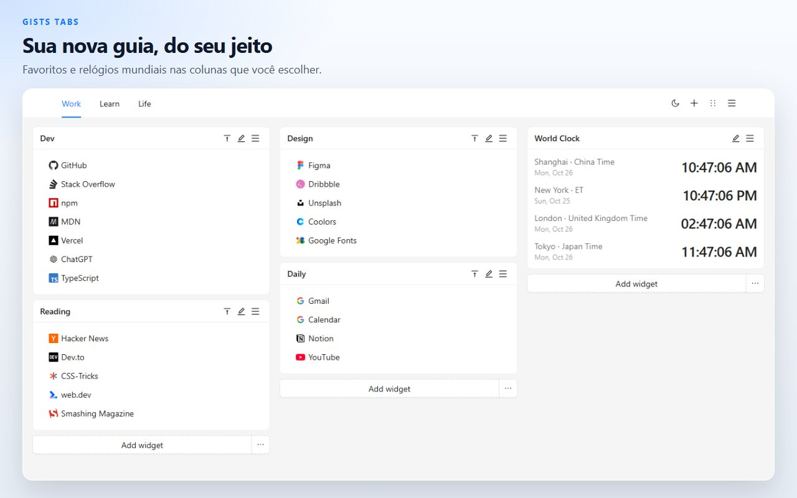
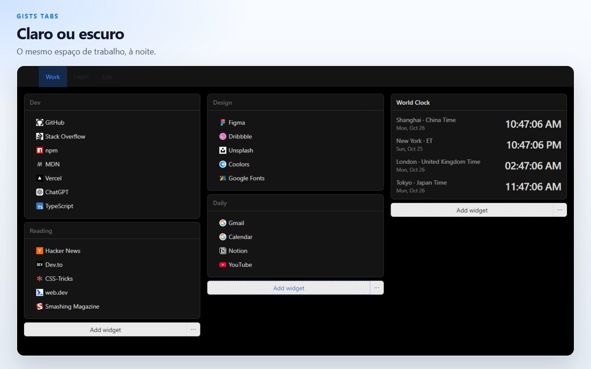
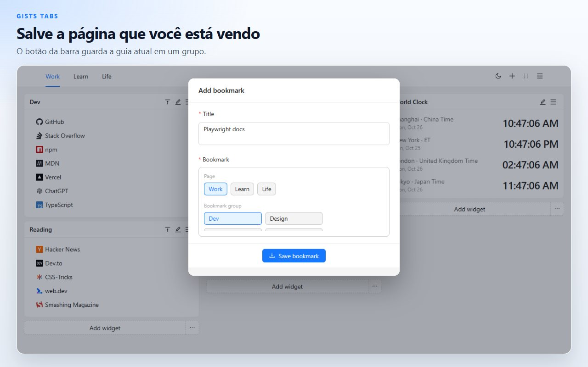
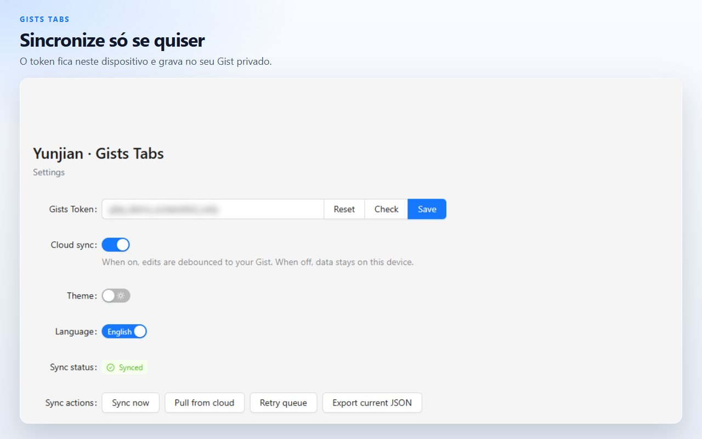

# Gists Tabs

Uma nova guia que você organiza. Favoritos e relógios mundiais num espaço de várias páginas. Os dados ficam neste dispositivo, a menos que você sincronize com o seu próprio Gist privado do GitHub.

[Adicionar ao Chrome](https://chromewebstore.google.com/detail/cghagphlkcfafhacjgkfidbbkiklhacp)

[English](../../README.md) · [简体中文](./README.zh-CN.md) · [繁體中文](./README.zh-TW.md) · [日本語](./README.ja.md) · [한국어](./README.ko.md) · [Español](./README.es.md) · **Português** · [Deutsch](./README.de.md) · [Français](./README.fr.md) · [Русский](./README.ru.md)

O Gists Tabs troca a nova guia do Chrome por um espaço pessoal. Coloque grupos de favoritos e relógios em colunas e separe-os em páginas. Nada sai do navegador até você ligar a sincronização.

A interface está em English e 中文. A troca fica na página de configurações da extensão.

## Páginas, favoritos e relógios

Cada página é uma tela de três colunas. Um widget de favoritos guarda links com o ícone do site. Um widget de relógio mostra a hora das cidades que você adiciona. Abra outra página quando trabalho e o resto do dia não deveriam dividir a mesma tela.

## Arraste e depois salve

Entre no modo de ordenar pelo cabeçalho, arraste um widget para outra coluna e salve. Sair desse modo descarta o rascunho, então um movimento pela metade não substitui a tela.

## Salve a guia que já está aberta

O botão da barra de ferramentas pega o título e o endereço da guia atual e guarda num grupo de favoritos.

## Neste dispositivo, salvo se você decidir o contrário

A tela fica no armazenamento local da extensão. Dá para exportar em JSON ou importar um arquivo que você tenha guardado antes.

A sincronização na nuvem fica desligada até você colar um token do GitHub e ligá-la. O token permanece no armazenamento local. A extensão usa o token só para ler e gravar um Gist privado da sua conta. Um token clássico precisa do escopo `gist`. Um token refinado precisa de leitura e gravação em Gists. Quem fez a extensão não opera um servidor.

| Permissão | Por que existe |
| --- | --- |
| `storage` | Manter o espaço de trabalho neste dispositivo |
| `tabs`, `activeTab` | Ler a guia atual para o botão poder salvá-la |
| `alarms` | Tentar de novo a sincronização depois que você liga a nuvem |

## Perguntas

**Preciso de uma conta do GitHub?**
Não. A nova guia funciona com a sincronização desligada.

**Onde ficam os favoritos?**
No armazenamento da extensão deste navegador. Com a sincronização ligada, também existe uma cópia num Gist privado da sua conta do GitHub.

**Consigo levar a tela sem o GitHub?**
Sim. Exporte o JSON pelo menu da nova guia ou pelas configurações e importe no outro navegador.

**Em quais idiomas o produto aparece?**
A interface está em English e 中文. Esta página está traduzida para mais idiomas para o projeto ser mais fácil de achar.

**Funciona no Firefox?**
A ficha publicada está na Chrome Web Store. O mesmo código gera uma build para Firefox; veja os comandos abaixo.

## Desenvolvimento

É preciso Node.js e npm.

| Comando | O que faz |
| --- | --- |
| `npm run dev` | Build de desenvolvimento para Chrome |
| `npm run dev:firefox` | Build de desenvolvimento para Firefox |
| `npm run build` | Verifica tipos e gera a build de produção do Chrome |
| `npm run build:firefox` | Verifica tipos e gera a build de produção do Firefox |
| `npm run lint` | `tsc --noEmit` e ESLint |
| `npm test` | Testes de unidade do armazenamento e do relógio |

Carregue a extensão descompactada a partir de `.output/chrome-mv3`. A saída do Firefox é `.output/firefox-mv2` ou `.output/firefox-mv3`, o diretório que o comando imprimir.

## Licença

[MIT](../../LICENSE)
