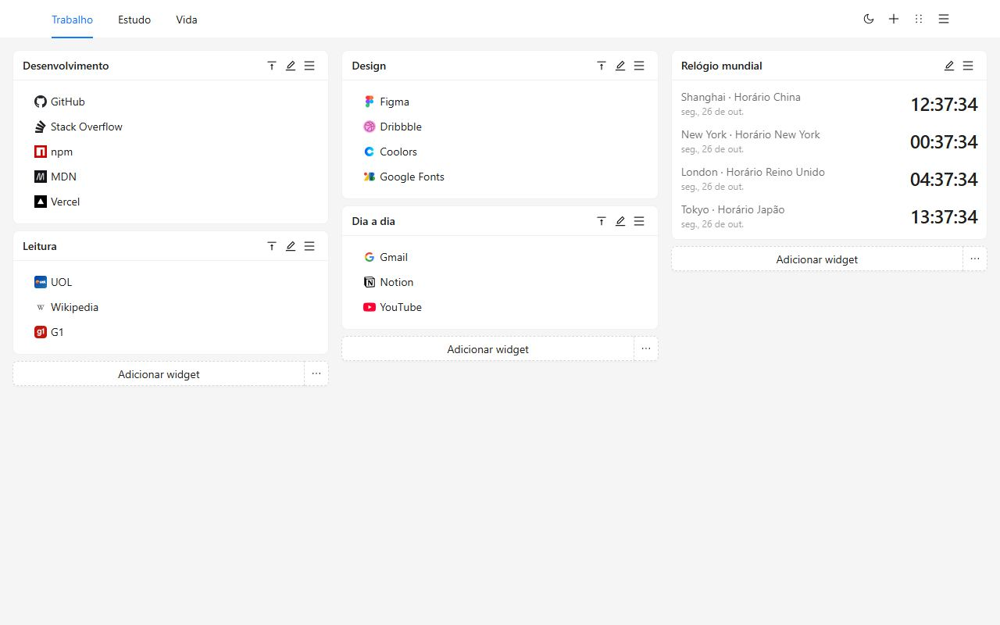
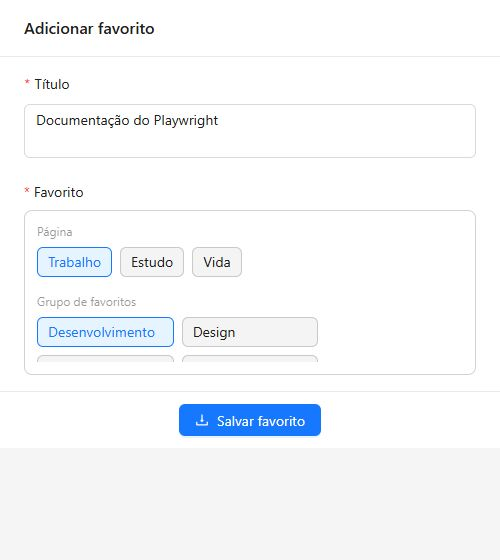
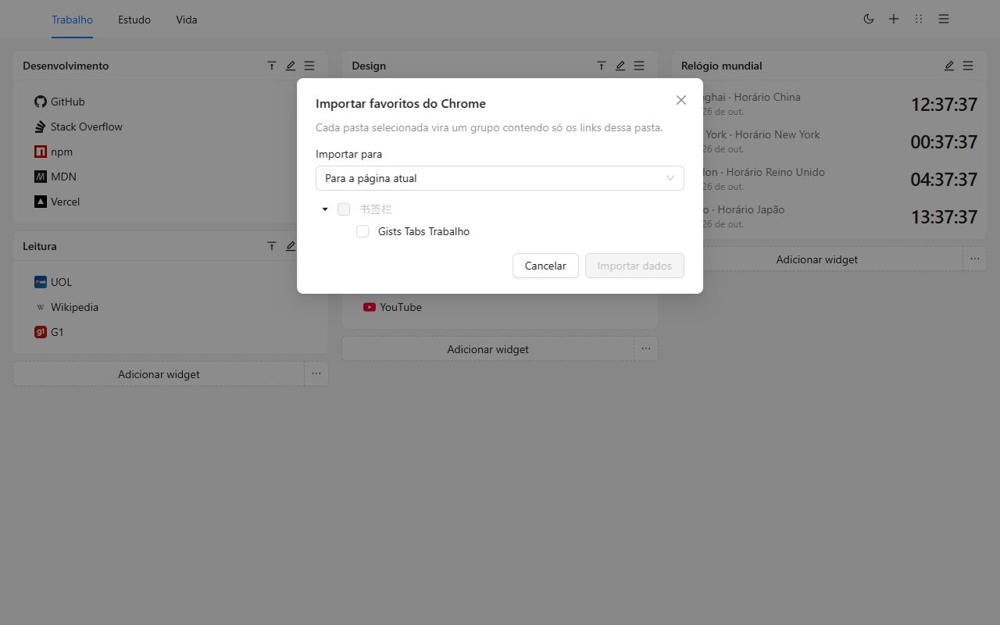
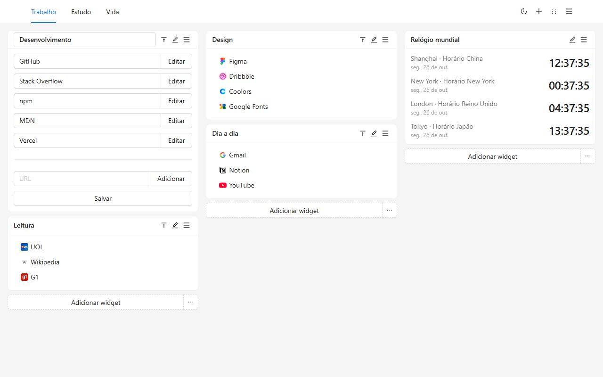
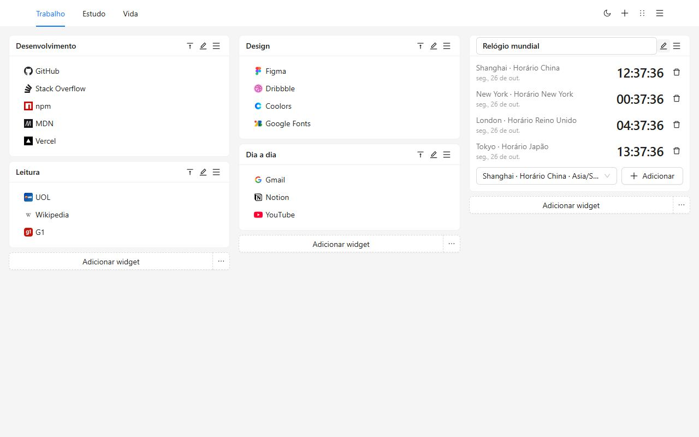
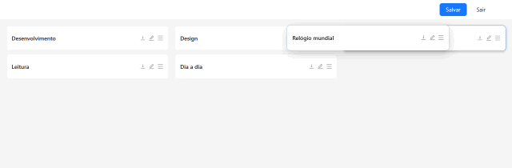
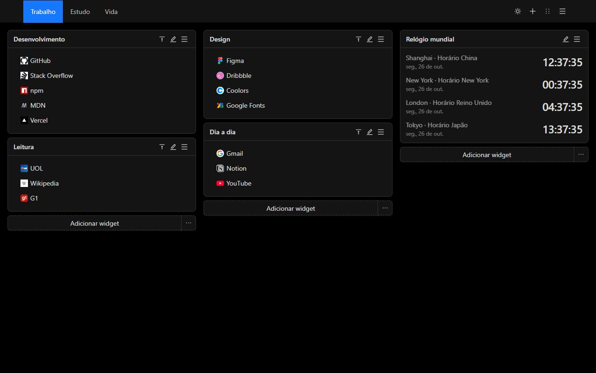
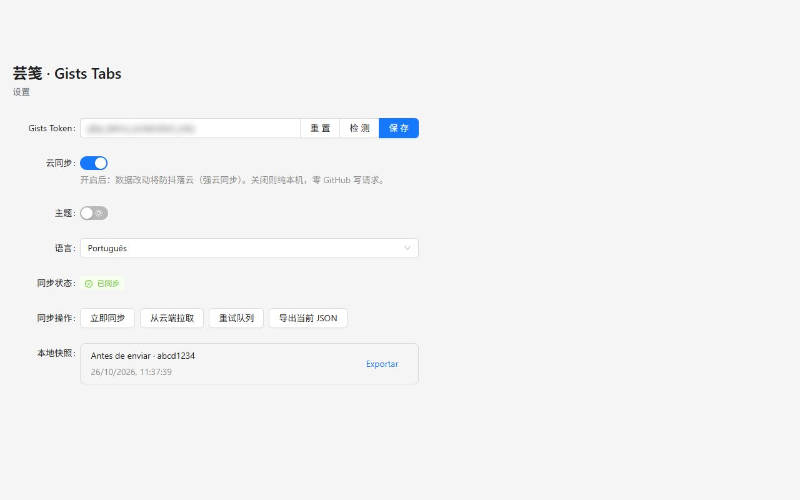
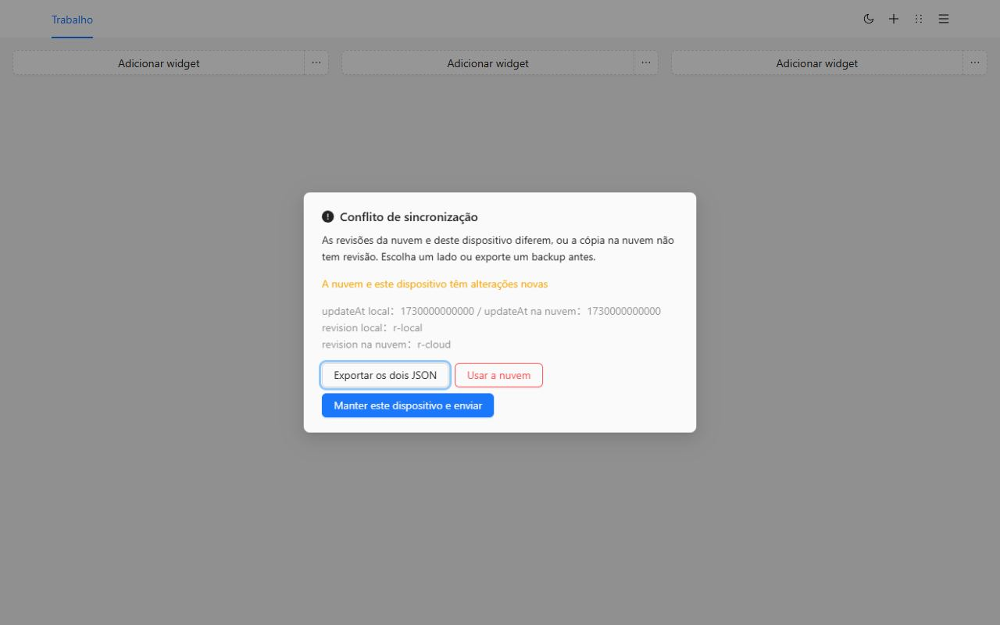

# Gists Tabs

A nova guia, organizada por você. Grupos de favoritos e relógios mundiais num espaço de várias páginas. Os dados ficam neste dispositivo até você sincronizar com um Gist privado do GitHub.

[Adicionar ao Chrome](https://chromewebstore.google.com/detail/cghagphlkcfafhacjgkfidbbkiklhacp)

[English](../../README.md) · [简体中文](./README.zh-CN.md) · [繁體中文](./README.zh-TW.md) · [日本語](./README.ja.md) · [한국어](./README.ko.md) · [Español](./README.es.md) · **Português** · [Deutsch](./README.de.md) · [Français](./README.fr.md) · [Русский](./README.ru.md)

O Gists Tabs troca a nova guia do Chrome por um espaço que você organiza. Trabalho, estudo e o resto do dia ficam em páginas separadas. Cada página tem três colunas de grupos e relógios. Não há conta para criar e nada é enviado, a menos que você ligue a sincronização.

Se você ainda não escolheu um idioma, a interface segue o navegador. Nas Configurações dá para mudar para English, 简体中文, 繁體中文, 日本語, 한국어, Español, Português, Deutsch, Français ou Русский.

## Por que este

A nova guia do navegador é uma busca e alguns atalhos. A barra de favoritos é uma fileira longa. A maioria dos painéis pede a própria conta e guarda o layout no servidor deles.

O Gists Tabs faz o contrário. O layout é seu. Se sincronizar, o arquivo é um Gist privado da sua conta do GitHub. Quem fez a extensão não opera um servidor e não vê seus favoritos.

| | Nova guia do Chrome | Barra de favoritos | Painéis com conta | Gists Tabs |
| --- | --- | --- | --- | --- |
| Várias páginas, três colunas | Não | Não | Às vezes | Sim |
| Relógios mundiais | Não | Não | Às vezes | Sim |
| Sem conta | Sim | Sim | Não | Sim |
| Seus dados, no seu Gist privado | Não | Não | Não | Sim |
| Código aberto | Não | — | Raramente | Sim |
| Exportar e importar JSON | Não | Só a exportação do navegador | Varia | Sim |
| Anúncios ou rastreamento | Atalhos | Não | Com frequência | Não |

## Três passos

1. Instale pela Chrome Web Store. A próxima nova guia é a tela.
2. Crie um grupo ou importe as pastas que você já tem no Chrome.
3. Use o botão da barra para guardar a página que você está lendo.

## Traga os favoritos do Chrome

Abra o menu da página e escolha **Importar favoritos do Chrome**. Na primeira vez o Chrome pede a permissão de favoritos; ela é opcional e não é pedida na instalação. Marque as pastas. Cada uma vira um grupo só com os links que estão diretamente nela. Dá para colocar na página atual ou numa nova.

Os ícones ficam na marca padrão até você editar um link. Endereços `javascript:` e outros que a nova guia não abre são ignorados.

Para levar a tela a outro navegador sem GitHub, exporte o JSON pelo menu ou pelas Configurações e importe lá. Importar substitui a tela atual.

## A tela

As páginas ficam no cabeçalho. Renomeie, copie ou apague pelo menu. A última página não pode ser apagada.

Um grupo é uma lista com nome. Edite o título e os links no lugar, arraste dentro da lista ou clique com o botão direito para copiar ou excluir. Um clique duplo no título recolhe o grupo.

Um relógio mostra a hora das cidades que você adiciona. O ciclo de 12 ou 24 horas segue o costume do idioma da interface.

O modo de ordenar transforma cada grupo numa barra. Arraste para outra coluna e salve. Sair descarta o rascunho.

Claro e escuro são um interruptor no cabeçalho. A escolha fica neste dispositivo.

## Sincronize com o seu Gist

A sincronização fica desligada até você colar um token e ligá-la.

- Um token clássico precisa do escopo `gist`.
- Um token refinado só precisa ler e gravar Gists. Não precisa de permissão de repositório.

Nas Configurações, cole, verifique, salve e ligue a nuvem. O token fica no armazenamento local e só lê e grava um Gist privado da sua conta. Várias edições seguidas viram uma escrita só.

No segundo dispositivo, instale a extensão, cole um token da mesma conta e ligue a sincronização. A tela desce desse Gist.

Se os dois lados mudaram, a sincronização para e pergunta. Dá para exportar os dois JSON, manter este dispositivo e enviar, ou substituí-lo pela cópia da nuvem. Antes da substituição, a tela anterior fica nos instantâneos locais.

O GitHub pode limitar as escritas. A extensão espera e tenta de novo, até 10 minutos.

## Privacidade e permissões

| Permissão | Quando | Por quê |
| --- | --- | --- |
| `storage` | Na instalação | Guardar a tela, o tema, o idioma e o token neste dispositivo |
| `tabs`, `activeTab` | Na instalação | Ler a guia atual para o botão poder salvá-la |
| `alarms` | Na instalação | Tentar de novo a sincronização depois de ligar a nuvem |
| `bookmarks` | Só ao importar | Ler pastas do Chrome. Não é pedida na instalação |

Não há análise, nem anúncio, nem um servidor de quem fez a extensão.

## Perguntas

**Preciso do GitHub?**
Não. Com a sincronização desligada, a nova guia funciona do mesmo jeito.

**Onde ficam os favoritos?**
No armazenamento da extensão deste navegador. Com a sincronização ligada, também existe uma cópia num Gist privado da sua conta.

**O idioma muda numa atualização?**
Se você nunca escolheu, a interface segue o navegador. Se escolher nas Configurações, a escolha permanece.

**Funciona no Firefox?**
A ficha publicada está na Chrome Web Store. O mesmo código gera uma build para Firefox. Importar favoritos do Chrome usa uma permissão exclusiva do Chrome.

## Desenvolvimento

É preciso Node.js e npm.

| Comando | O que faz |
| --- | --- |
| `npm run dev` | Build de desenvolvimento para Chrome |
| `npm run dev:firefox` | Build de desenvolvimento para Firefox |
| `npm run build` | Verifica tipos e gera a build do Chrome |
| `npm run build:firefox` | Verifica tipos e gera a build do Firefox |
| `npm run lint` | `tsc --noEmit` e ESLint |
| `npm test` | Testes de idioma, importação, armazenamento e relógios |

Carregue a extensão descompactada a partir de `.output/chrome-mv3`. A saída do Firefox é `.output/firefox-mv2` ou `.output/firefox-mv3`.

## Licença

[MIT](../../LICENSE)
