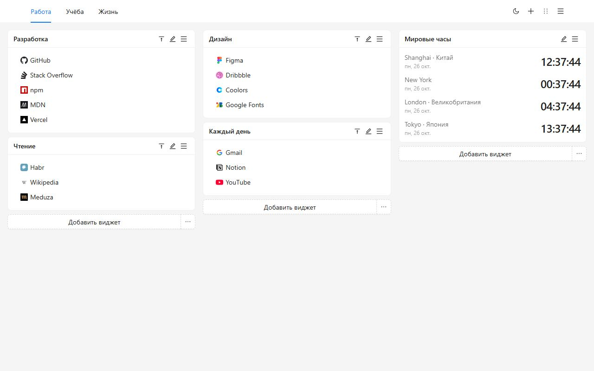
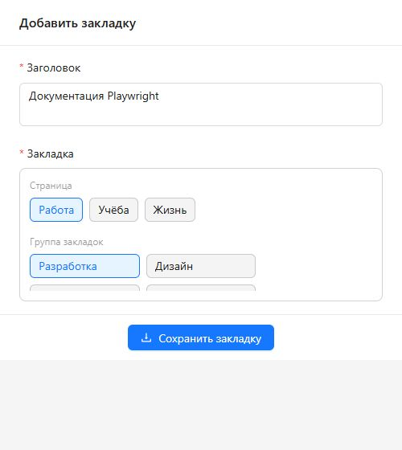
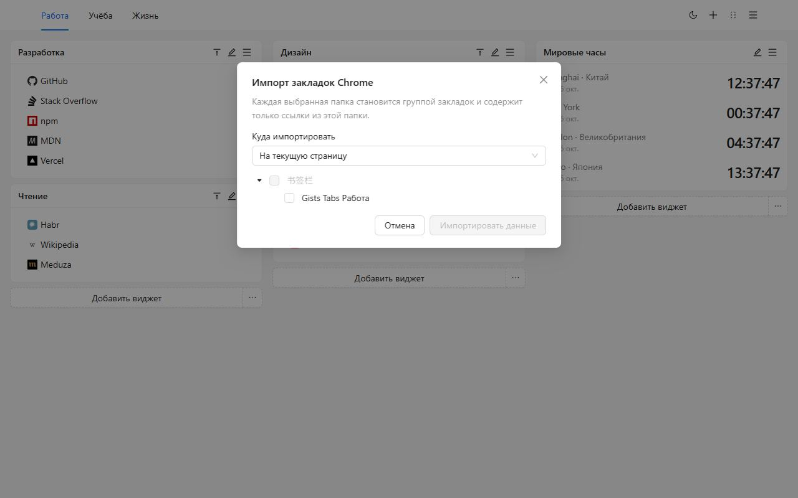
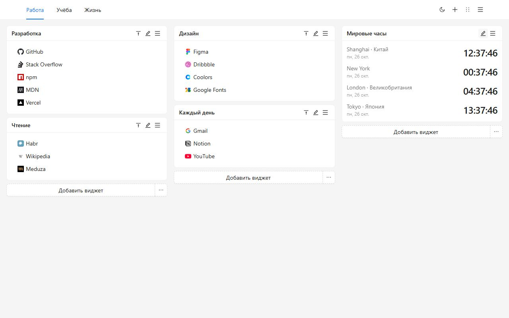
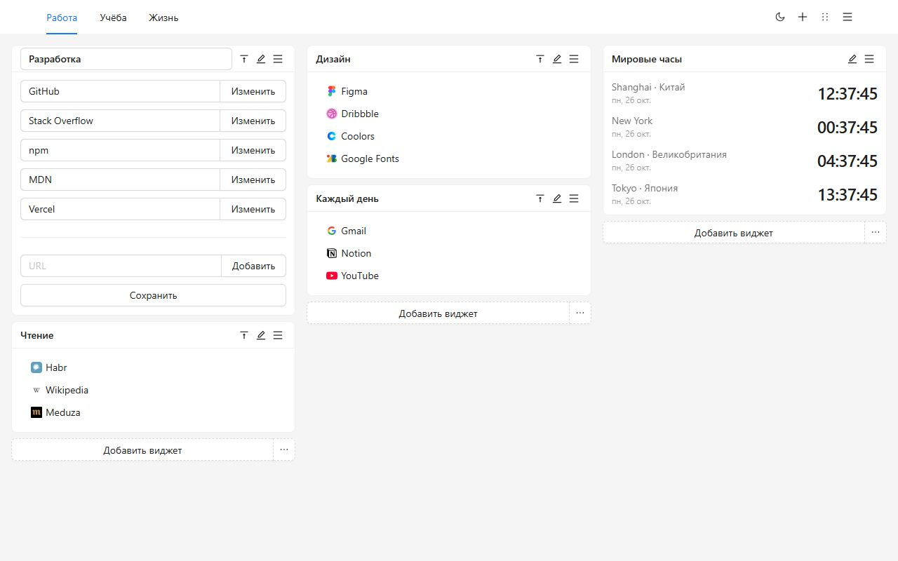
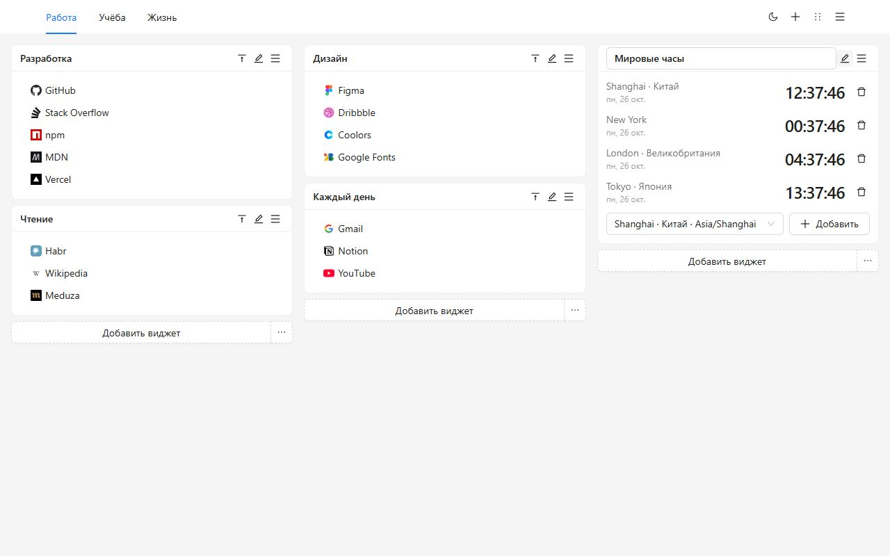
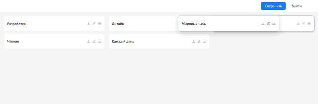
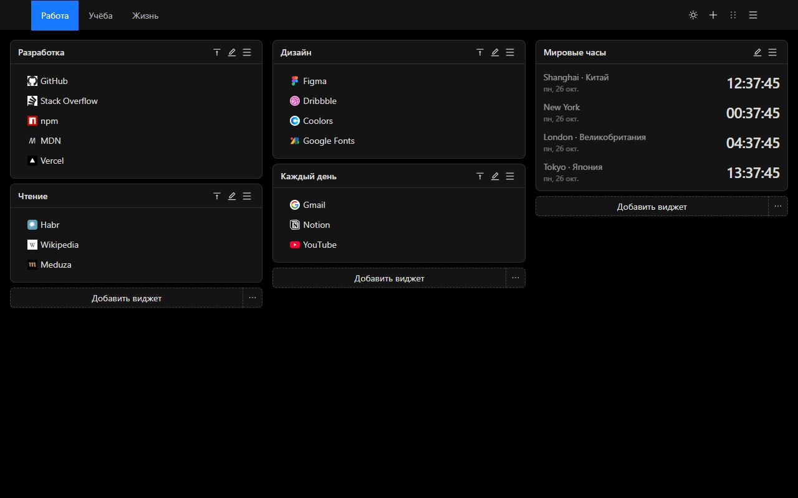
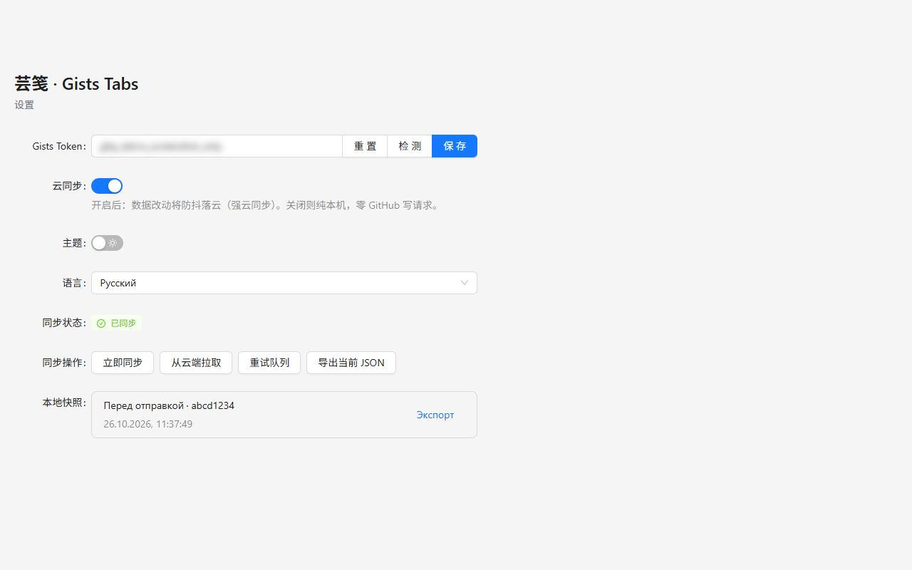
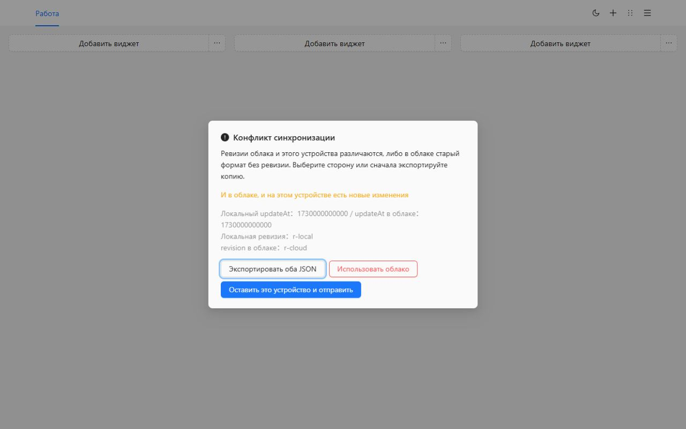

# Gists Tabs

Новая вкладка, которую раскладываете вы. Группы закладок и мировые часы на холсте из нескольких страниц. Данные остаются на этом устройстве, пока вы не синхронизируете их в закрытый GitHub Gist.

[Добавить в Chrome](https://chromewebstore.google.com/detail/cghagphlkcfafhacjgkfidbbkiklhacp)

[English](../../README.md) · [简体中文](./README.zh-CN.md) · [繁體中文](./README.zh-TW.md) · [日本語](./README.ja.md) · [한국어](./README.ko.md) · [Español](./README.es.md) · [Português](./README.pt-BR.md) · [Deutsch](./README.de.md) · [Français](./README.fr.md) · **Русский**

Gists Tabs заменяет новую вкладку Chrome рабочим местом, которое вы раскладываете сами. Работа, учёба и остальной день получают свои страницы. На каждой странице три колонки групп и часов. Учётная запись не нужна, и ничего не отправляется, пока вы не включите синхронизацию.

Если язык ещё не выбран, интерфейс следует за браузером. В настройках можно выбрать English, 简体中文, 繁體中文, 日本語, 한국어, Español, Português, Deutsch, Français или Русский.

## Почему именно это

Встроенная новая вкладка — это поиск и несколько ярлыков. Панель закладок — одна длинная строка. Большинство панелей просят собственную учётную запись, и раскладка живёт на их сервере.

Gists Tabs устроен наоборот. Раскладка ваша. Если синхронизировать, файл — это закрытый Gist в вашей учётной записи GitHub. У автора расширения нет сервера, и он не видит ваши закладки.

| | Новая вкладка Chrome | Панель закладок | Панели с учётной записью | Gists Tabs |
| --- | --- | --- | --- | --- |
| Несколько страниц, три колонки | Нет | Нет | Иногда | Да |
| Мировые часы | Нет | Нет | Иногда | Да |
| Без учётной записи | Да | Да | Нет | Да |
| Ваши данные в вашем закрытом Gist | Нет | Нет | Нет | Да |
| Открытый код | Нет | — | Редко | Да |
| Экспорт и импорт JSON | Нет | Только экспорт браузера | По-разному | Да |
| Реклама или слежение | Ярлыки | Нет | Часто | Нет |

## Три шага

1. Установите из Chrome Web Store. Следующая новая вкладка — это холст.
2. Создайте группу или импортируйте папки, которые уже есть в Chrome.
3. Кнопкой на панели сохраните страницу, которую читаете.

## Перенесите закладки Chrome

Откройте меню страницы и выберите **Импорт закладок Chrome**. В первый раз Chrome спросит разрешение на закладки. Оно необязательное и не запрашивается при установке. Отметьте папки. Каждая станет группой и будет содержать только ссылки прямо внутри неё. Их можно положить на текущую страницу или на новую.

Значки остаются меткой по умолчанию, пока вы не измените ссылку. Адреса `javascript:` и другие, которые новая вкладка не открывает, пропускаются.

Чтобы перенести холст в другой браузер без GitHub, экспортируйте JSON из меню или из настроек и импортируйте файл там. Импорт заменяет текущий холст.

## Холст

Страницы стоят в шапке. Переименуйте, скопируйте или удалите их из меню. Последнюю страницу удалить нельзя.

Группа — это именованный список. Правьте заголовок и ссылки на месте, перетаскивайте внутри списка или щёлкайте правой кнопкой, чтобы копировать и удалять. Двойной щелчок по заголовку сворачивает группу.

Часы показывают время в добавленных городах. 12- или 24-часовой формат следует обычаю языка интерфейса.

В режиме сортировки каждая группа становится полоской. Перетащите её в другую колонку и сохраните. Выход отбрасывает черновик.

Светлая и тёмная тема — один переключатель в шапке. Выбор хранится на этом устройстве.

## Синхронизация в ваш Gist

Синхронизация выключена, пока вы не вставите токен и не включите её.

- Классическому токену нужна область `gist`.
- Токену с тонкой настройкой нужны только чтение и запись Gist. Права на репозитории не нужны.

В настройках вставьте токен, проверьте, сохраните и включите облако. Токен остаётся в локальном хранилище и только читает и записывает закрытый Gist вашей учётной записи. Несколько правок подряд становятся одной записью.

На втором устройстве установите расширение, вставьте токен той же учётной записи и включите синхронизацию. Холст придёт из этого Gist.

Если изменились обе стороны, синхронизация останавливается и спрашивает. Можно экспортировать оба JSON, оставить это устройство и отправить его или заменить его облачной копией. Перед заменой прежний холст остаётся в локальных снимках.

GitHub может ограничивать запись. Расширение ждёт и повторяет попытку, не дольше 10 минут.

## Конфиденциальность и разрешения

| Разрешение | Когда | Зачем |
| --- | --- | --- |
| `storage` | При установке | Хранить холст, тему, язык и токен на этом устройстве |
| `tabs`, `activeTab` | При установке | Читать текущую вкладку, чтобы кнопка могла её сохранить |
| `alarms` | При установке | Повторять синхронизацию после включения облака |
| `bookmarks` | Только при импорте | Читать папки закладок Chrome. При установке не запрашивается |

Нет аналитики, нет рекламы и нет сервера автора расширения.

## Вопросы

**Нужен ли GitHub?**
Нет. С выключенной синхронизацией новая вкладка работает.

**Где лежат закладки?**
В хранилище расширения этого браузера. При включённой синхронизации копия также лежит в закрытом Gist вашей учётной записи.

**Сменится ли язык после обновления?**
Если вы его не выбирали, интерфейс следует за браузером. Выбор в настройках сохраняется.

**Работает ли это в Firefox?**
Опубликованная карточка — в Chrome Web Store. Тот же код собирается для Firefox. Импорт закладок Chrome использует разрешение, которое есть только в Chrome.

## Разработка

Нужны Node.js и npm.

| Команда | Что делает |
| --- | --- |
| `npm run dev` | Сборка для разработки в Chrome |
| `npm run dev:firefox` | Сборка для разработки в Firefox |
| `npm run build` | Проверка типов, затем сборка Chrome |
| `npm run build:firefox` | Проверка типов, затем сборка Firefox |
| `npm run lint` | `tsc --noEmit` и ESLint |
| `npm test` | Тесты языка, импорта, хранилища и часов |

Загрузите распакованное расширение из `.output/chrome-mv3`. Результат Firefox — `.output/firefox-mv2` или `.output/firefox-mv3`.

## Лицензия

[MIT](../../LICENSE)
