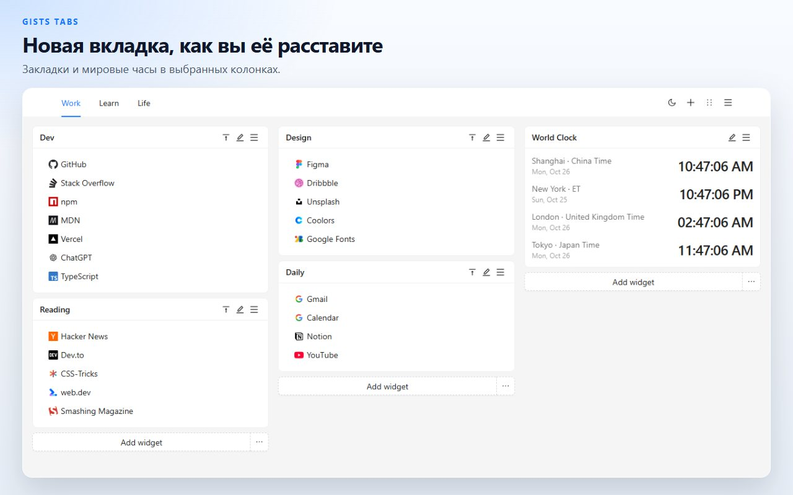
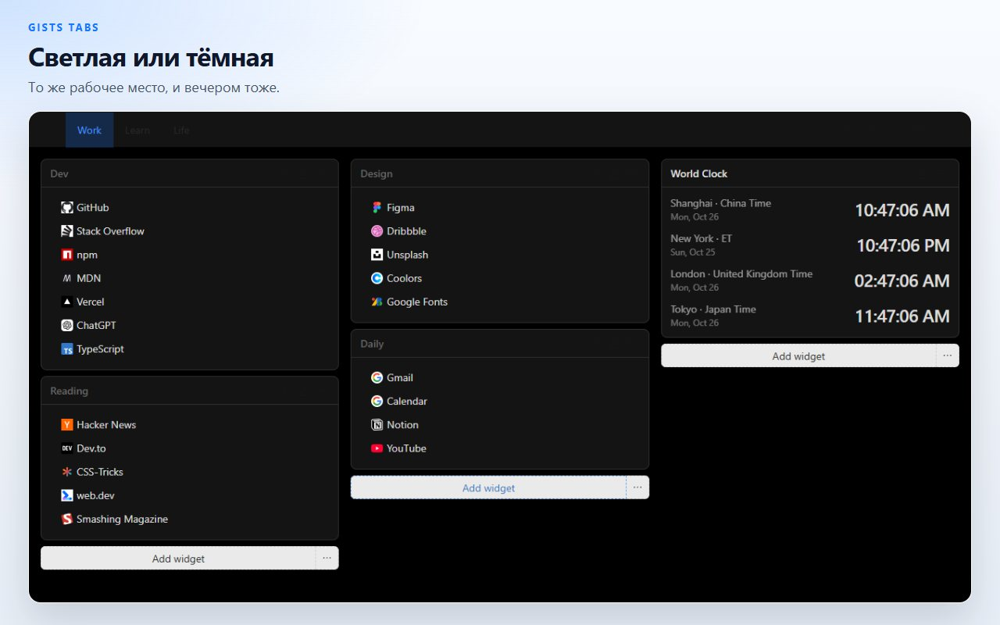
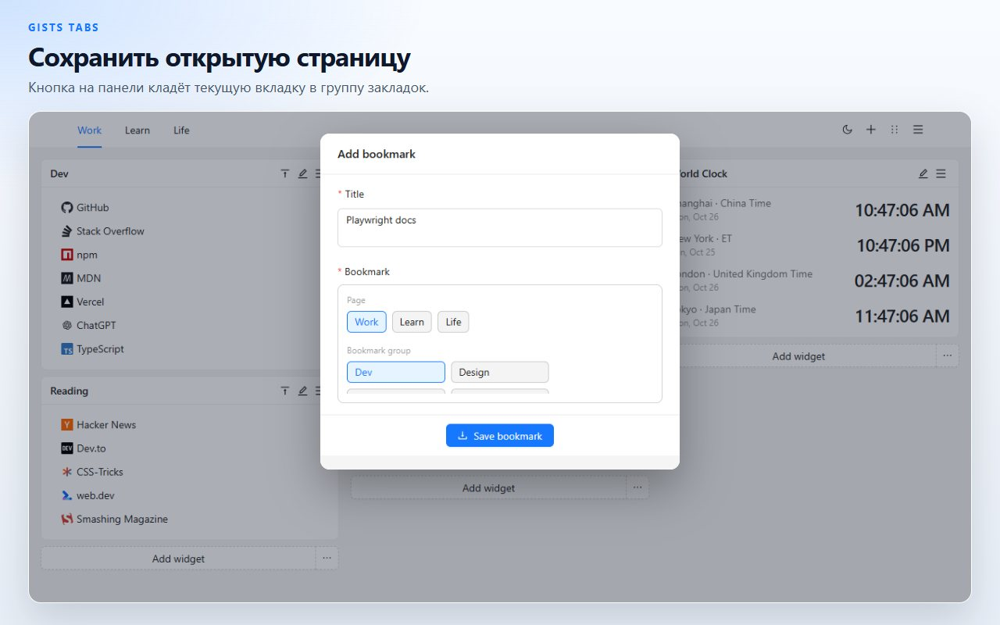
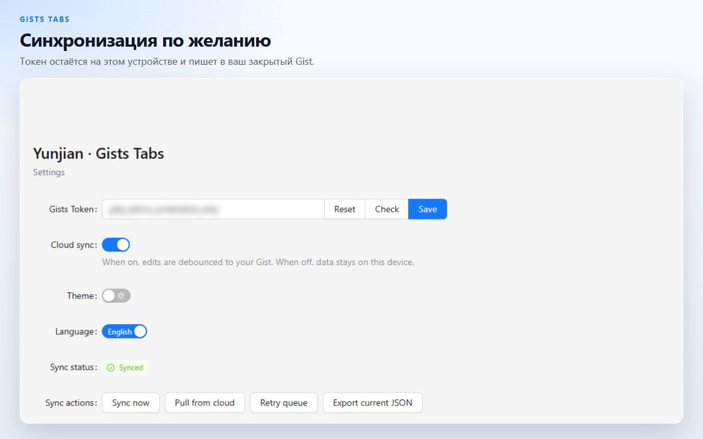

# Gists Tabs

Новая вкладка, которую вы раскладываете сами. Закладки и мировые часы на холсте из нескольких страниц. Данные остаются на этом устройстве, пока вы не синхронизируете их в свой закрытый GitHub Gist.

[Добавить в Chrome](https://chromewebstore.google.com/detail/cghagphlkcfafhacjgkfidbbkiklhacp)

[English](../../README.md) · [简体中文](./README.zh-CN.md) · [繁體中文](./README.zh-TW.md) · [日本語](./README.ja.md) · [한국어](./README.ko.md) · [Español](./README.es.md) · [Português](./README.pt-BR.md) · [Deutsch](./README.de.md) · [Français](./README.fr.md) · **Русский**

Gists Tabs заменяет новую вкладку Chrome личным рабочим местом. Группы закладок и часы стоят в колонках и разнесены по страницам. Ничего не покидает браузер, пока вы не включите синхронизацию.

Интерфейс на English и 中文. Переключение — на странице настроек расширения.

## Страницы, закладки и часы

Каждая страница — холст из трёх колонок. Виджет закладок хранит ссылки с иконками сайтов. Виджет часов показывает время в добавленных городах. Откройте ещё одну страницу, если работа и остальной день не должны делить один экран.

## Перетащите, потом сохраните

Войдите в режим сортировки из шапки, перетащите виджет в другую колонку и сохраните. Выход из режима сбрасывает черновик, поэтому незавершённый перенос не затирает холст.

## Сохранить уже открытую вкладку

Кнопка на панели берёт заголовок и адрес текущей вкладки и кладёт их в группу закладок.

## На этом устройстве, если вы не решите иначе

Холст лежит в локальном хранилище расширения. Его можно экспортировать в JSON или импортировать ранее сохранённый файл.

Облачная синхронизация выключена, пока вы не вставите токен GitHub и не включите её. Токен остаётся в локальном хранилище. Расширение использует его только чтобы читать и записывать закрытый Gist вашей учётной записи. Классическому токену нужна область `gist`. Токену с тонкой настройкой нужны чтение и запись Gist. У автора расширения нет своего сервера.

| Разрешение | Зачем оно |
| --- | --- |
| `storage` | Хранить рабочее место на этом устройстве |
| `tabs`, `activeTab` | Читать текущую вкладку, чтобы кнопка могла её сохранить |
| `alarms` | Повторять синхронизацию после включения облака |

## Вопросы

**Нужна ли учётная запись GitHub?**
Нет. Новая вкладка работает с выключенной синхронизацией.

**Где лежат закладки?**
В хранилище расширения этого браузера. Когда синхронизация включена, копия также лежит в закрытом Gist вашей учётной записи GitHub.

**Можно ли перенести холст без GitHub?**
Да. Экспортируйте JSON из меню новой вкладки или из настроек и импортируйте файл в другом браузере.

**На каких языках говорит продукт?**
Интерфейс на English и 中文. Эта страница переведена шире, чтобы проект было проще найти.

**Работает ли это в Firefox?**
Опубликованная карточка — в Chrome Web Store. Тот же исходный код собирается для Firefox; команды ниже.

## Разработка

Нужны Node.js и npm.

| Команда | Что делает |
| --- | --- |
| `npm run dev` | Сборка для разработки в Chrome |
| `npm run dev:firefox` | Сборка для разработки в Firefox |
| `npm run build` | Проверка типов, затем производственная сборка Chrome |
| `npm run build:firefox` | Проверка типов, затем производственная сборка Firefox |
| `npm run lint` | `tsc --noEmit` и ESLint |
| `npm test` | Модульные тесты хранилища и формата часов |

Загрузите распакованное расширение из `.output/chrome-mv3`. Результат Firefox — `.output/firefox-mv2` или `.output/firefox-mv3`, тот каталог, который напечатает команда.

## Лицензия

[MIT](../../LICENSE)
