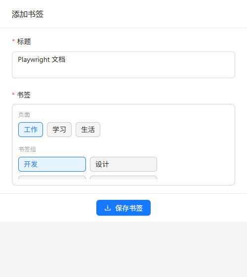
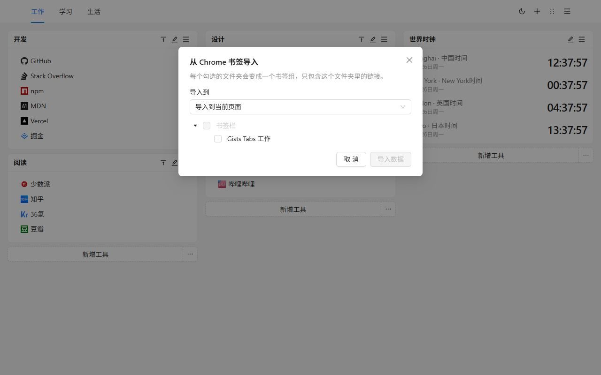
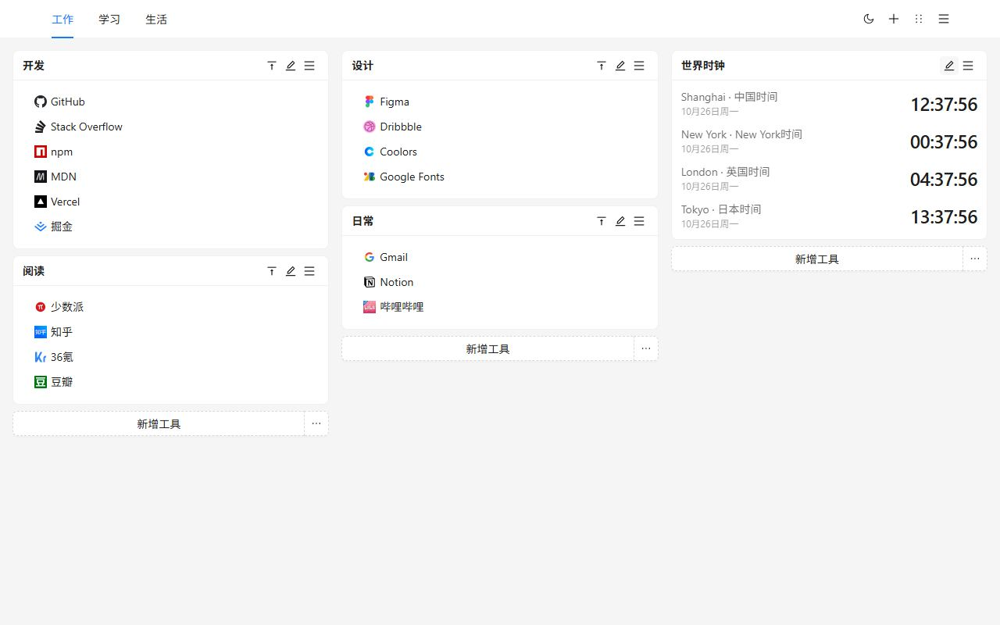
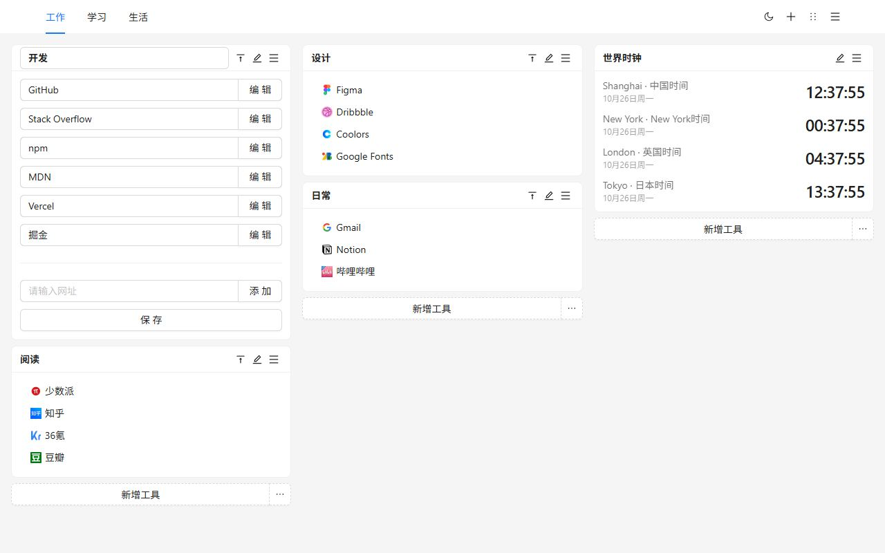
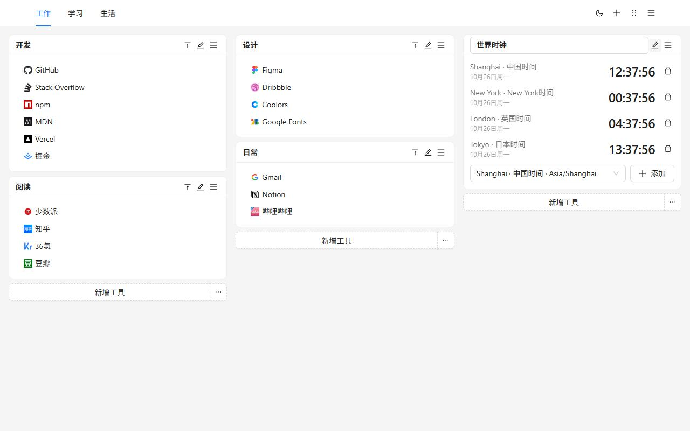
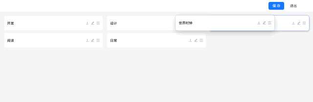
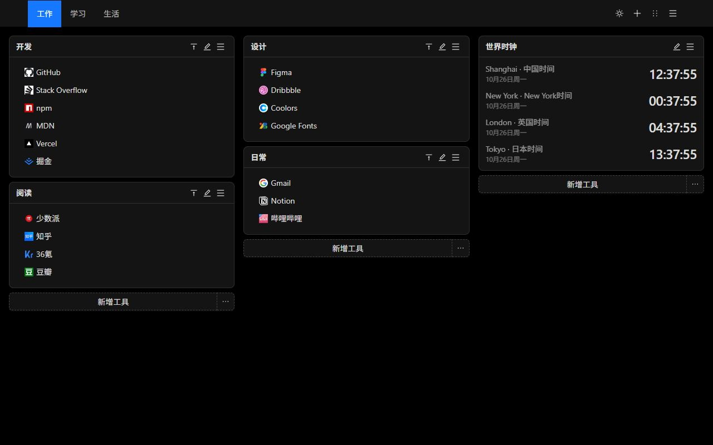
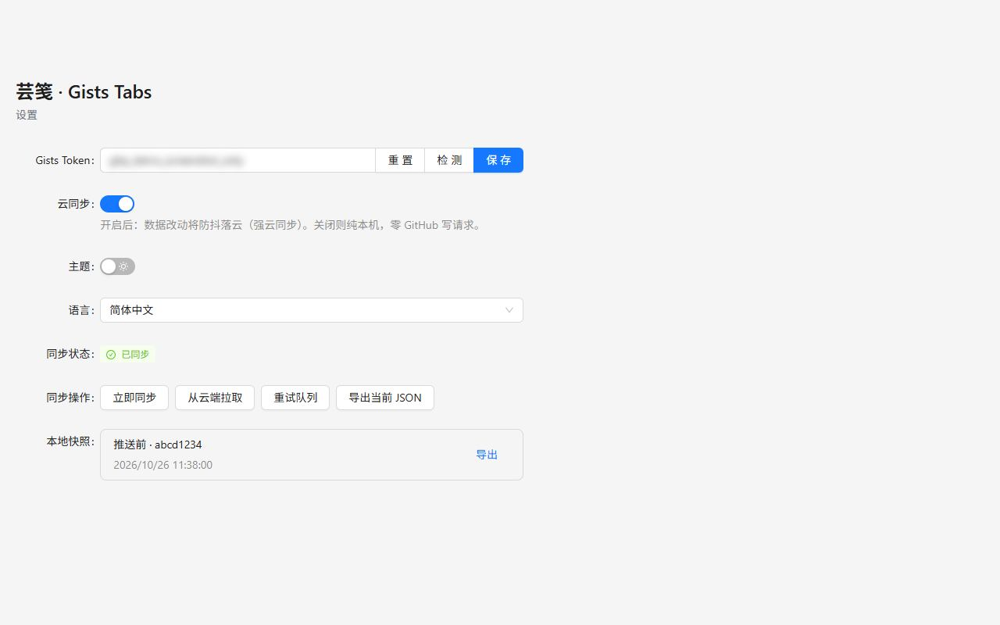
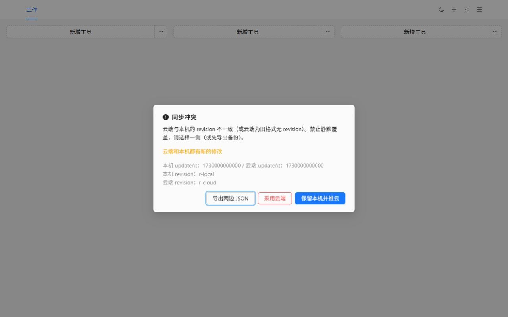

# Gists Tabs

新标签页，由你来排。书签组和世界时钟放在多页画布上。数据留在这台设备上，直到你自己决定同步到私人 GitHub Gist。

[添加到 Chrome](https://chromewebstore.google.com/detail/cghagphlkcfafhacjgkfidbbkiklhacp)

[English](../../README.md) · **简体中文** · [繁體中文](./README.zh-TW.md) · [日本語](./README.ja.md) · [한국어](./README.ko.md) · [Español](./README.es.md) · [Português](./README.pt-BR.md) · [Deutsch](./README.de.md) · [Français](./README.fr.md) · [Русский](./README.ru.md)

芸笺 · Gists Tabs 用一块你自己排布的工作台替换 Chrome 的新标签页。工作、学习和生活各自一页。每一页是三栏书签组和时钟。不创建账号，也不会上传任何内容，除非你打开同步。

还没选过语言时，界面跟随浏览器。可以在设置里改成 English、简体中文、繁體中文、日本語、한국어、Español、Português、Deutsch、Français、Русский。

## 为什么是它

浏览器自带的新标签页是一个搜索框和几枚快捷方式。书签栏是长长的一行。多数仪表盘扩展要注册它们自己的账号，布局存在它们的服务器上。

Gists Tabs 相反。布局是你的。如果同步，文件是你 GitHub 账号里的一个私人 Gist。扩展作者没有服务器，也看不到你的书签。

| | Chrome 新标签页 | 书签栏 | 需要注册的仪表盘 | Gists Tabs |
| --- | --- | --- | --- | --- |
| 多页、三栏 | 无 | 无 | 有时有 | 有 |
| 世界时钟 | 无 | 无 | 有时有 | 有 |
| 不注册也能用 | 能 | 能 | 不能 | 能 |
| 数据在你自己的私人 Gist | 无 | 无 | 无 | 有 |
| 开源 | 否 | — | 很少 | 是 |
| 导入导出 JSON | 无 | 只有浏览器自己的导出 | 不一定 | 有 |
| 广告或追踪 | 快捷方式 | 无 | 常见 | 无 |

## 三步上手

1. 从 Chrome 网上应用店安装。下一个新标签页就是画布。
2. 新建一个书签组，或导入已经在 Chrome 里的文件夹。
3. 用工具栏按钮把正在看的页面收进去。

## 把 Chrome 书签迁过来

打开页面菜单，选择**从 Chrome 书签导入**。第一次会向 Chrome 申请书签权限；这是可选权限，安装时不会要。勾选文件夹。每个文件夹变成一个书签组，只包含这个文件夹里直接放着的链接。可以放到当前页，也可以新建一页。

图标先用默认标记，之后可以再编辑链接。`javascript:` 以及其他新标签页打不开的地址会被跳过。

不想用 GitHub、又要换一台浏览器时，从页面菜单或设置页导出 JSON，再在那边导入。导入会替换当前画布。本地快照不能代替这份文件，想留底就自己保存 JSON。

## 画布

页面在顶栏。从菜单改名、复制或删除。只剩一页时不能删除。

书签组是一份有名字的列表。可以就地改标题和链接，在列表里拖拽，或右键复制、删除。双击标题可以折叠。

时钟显示你添加的城市时间。小时制跟随界面语言：简体中文是 24 小时制，English 是 12 小时制。

排序模式把每个组收成一条。拖到另一栏，再保存。退出排序会丢掉草稿，做到一半的移动不会改写画布。

浅色和深色是顶栏上的一个开关，记在这台设备上。

## 同步到你自己的 Gist

同步默认关闭，贴上 Token 并打开开关之后才会开始。

在 GitHub 上创建 Token：

- 经典个人访问令牌勾选 `gist` 权限。
- 细粒度令牌只给 Gists 读写权限，不需要仓库权限。

在设置里粘贴、检测、保存，然后打开云同步。Token 留在扩展的本地存储里，只用来读写你账号下的私人 Gist。连续修改会合并成一次写入。

第二台设备安装扩展，贴上同一 GitHub 账号的 Token，打开同步，画布会从那个 Gist 下来。

两边都改过时，同步会停下来让你选。可以导出两边的 JSON，保留本机并推上去，或用云端覆盖本机。云端覆盖之前，原来的画布会留在本地快照里。

GitHub 可能会限流。扩展会等待并重试。设置页的状态会显示同步中、已同步、排队、限流或失败。自动重试会逐渐拉长间隔，最长 10 分钟。

## 隐私和权限

| 权限 | 何时 | 原因 |
| --- | --- | --- |
| `storage` | 安装时 | 把画布、主题、语言和 Token 留在这台设备 |
| `tabs`、`activeTab` | 安装时 | 读取当前标签页，供工具栏按钮收藏 |
| `alarms` | 安装时 | 打开云同步后按计划重试 |
| `bookmarks` | 只有导入时 | 读取 Chrome 书签文件夹。安装时不申请 |

没有统计，没有广告，扩展作者也没有自己的服务器。

## 问题

**必须有 GitHub 吗？**
不用。同步保持关闭，新标签页一样能用。

**书签在哪里？**
在这台浏览器的扩展存储里。打开同步后，你的 GitHub 账号下还会有一份私人 Gist。

**更新之后语言会变吗？**
如果从没选过语言，界面跟随浏览器。在设置里选过，就会保持那个选择。

**能在 Firefox 里用吗？**
已上架的是 Chrome 网上应用店。同一份源码可以构建 Firefox，见下面的命令。从 Chrome 书签导入用的是 Chrome 才有的权限。

## 本地开发

需要 Node.js 和 npm。

| 命令 | 作用 |
| --- | --- |
| `npm run dev` | Chrome 开发构建 |
| `npm run dev:firefox` | Firefox 开发构建 |
| `npm run build` | 类型检查，并产出 Chrome 生产构建 |
| `npm run build:firefox` | 类型检查，并产出 Firefox 生产构建 |
| `npm run lint` | `tsc --noEmit` 和 ESLint |
| `npm test` | 语言匹配、书签导入、存储和时钟的单元测试 |

加载未打包扩展时选择 `.output/chrome-mv3`。Firefox 产物在 `.output/firefox-mv2` 或 `.output/firefox-mv3`，以命令打印的目录为准。

## 许可证

[MIT](../../LICENSE)
