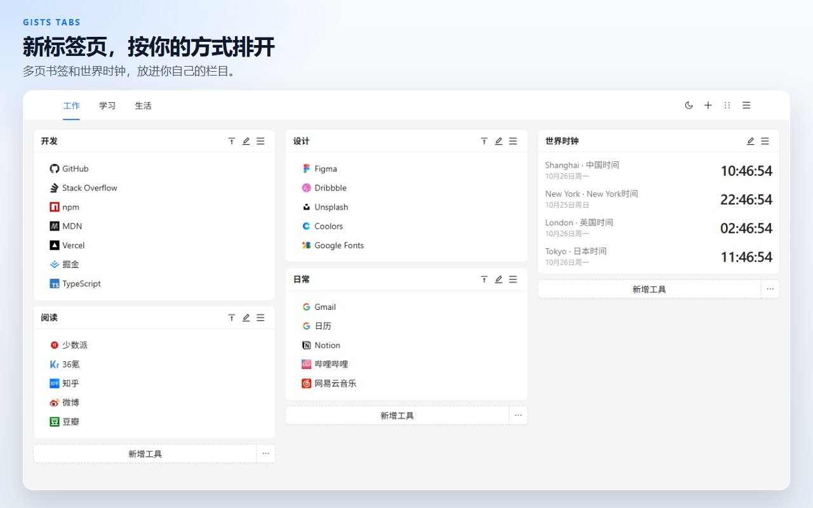
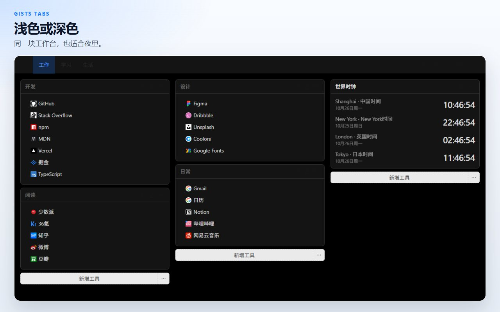
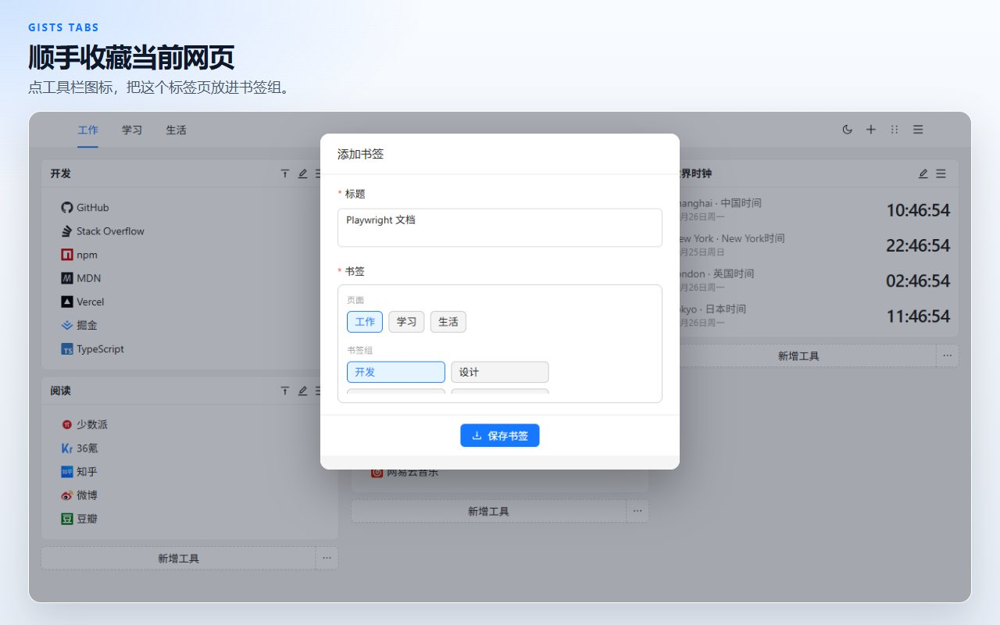
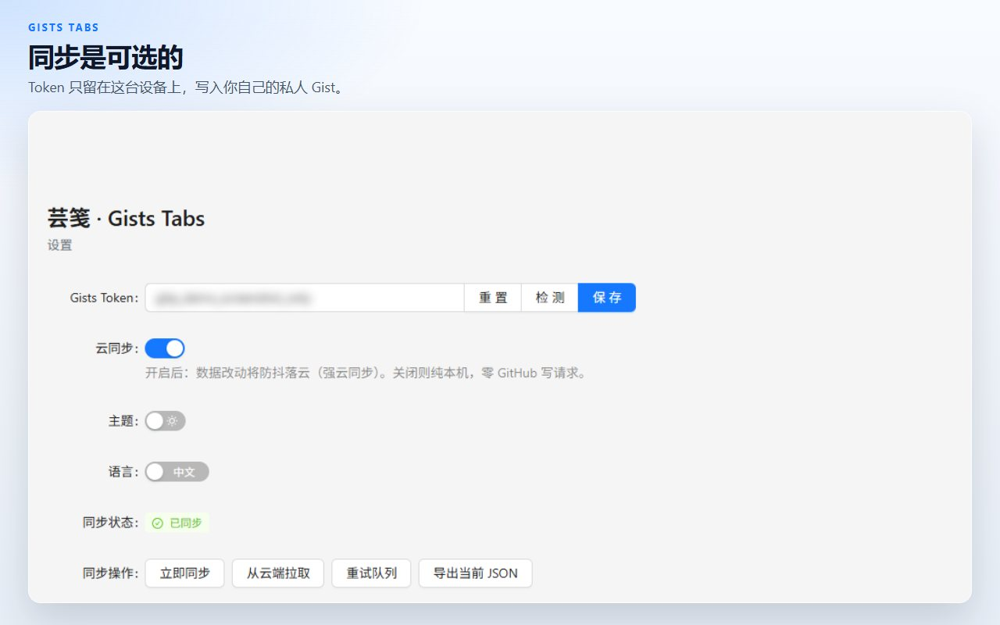

# Gists Tabs

一块你自己排布的新标签页。书签和世界时钟放在多页画布上。数据留在这台设备上，除非你把它同步到自己的私人 GitHub Gist。

[添加到 Chrome](https://chromewebstore.google.com/detail/cghagphlkcfafhacjgkfidbbkiklhacp)

[English](../../README.md) · **简体中文** · [繁體中文](./README.zh-TW.md) · [日本語](./README.ja.md) · [한국어](./README.ko.md) · [Español](./README.es.md) · [Português](./README.pt-BR.md) · [Deutsch](./README.de.md) · [Français](./README.fr.md) · [Русский](./README.ru.md)

芸笺 · Gists Tabs 用一块个人工作台替换 Chrome 的新标签页。把书签组和时钟放进栏目，再拆到不同页面里。你不打开同步，内容就不会离开这台浏览器。

界面语言是中文和 English，在扩展的设置页切换。

## 页面、书签和时钟

每个页面是三栏画布。书签小组件放带站点图标的链接。时钟小组件显示你添加的城市时间。工作和生活不该挤在同一屏时，再开一个页面。

## 拖好再保存

从顶栏进入排序，把小组件拖到另一栏，然后保存。退出排序会丢掉这次草稿，做到一半的移动不会改写画布。

## 收藏正在看的标签页

工具栏按钮读取当前标签页的标题和地址，放进一个书签组。

## 默认在本机

画布存在扩展的本地存储里。可以导出 JSON，也可以导入以前保存的文件。

云同步默认关闭。贴上 GitHub Token 并打开开关之后才会同步。Token 留在本地存储，只用来读写你账号下的一个私人 Gist。经典个人访问令牌需要 `gist` 权限；细粒度令牌需要对 Gist 的读写权限。扩展作者没有自己的服务器。

| 权限 | 用途 |
| --- | --- |
| `storage` | 把工作台留在这台设备上 |
| `tabs`、`activeTab` | 读取当前标签页，供工具栏按钮收藏 |
| `alarms` | 打开云同步后，按计划重试同步 |

## 问题

**必须有 GitHub 账号吗？**
不用。同步保持关闭时，新标签页一样能用。

**书签放在哪里？**
在这台浏览器的扩展存储里。打开同步后，你的 GitHub 账号下还会有一份私人 Gist。

**不用 GitHub，能把画布搬走吗？**
可以。从新标签页菜单或设置页导出 JSON，再到另一台浏览器导入。

**产品界面有哪些语言？**
界面是中文和 English。这份说明翻译得更多，是为了让项目更容易被找到。

**能在 Firefox 里用吗？**
已上架的是 Chrome 网上应用店。同一份源码可以构建 Firefox 版本，见下面的命令。

## 本地开发

需要 Node.js 和 npm。

| 命令 | 作用 |
| --- | --- |
| `npm run dev` | Chrome 开发构建 |
| `npm run dev:firefox` | Firefox 开发构建 |
| `npm run build` | 类型检查，并产出 Chrome 生产构建 |
| `npm run build:firefox` | 类型检查，并产出 Firefox 生产构建 |
| `npm run lint` | `tsc --noEmit` 和 ESLint |
| `npm test` | 存储与时钟格式的单元测试 |

在浏览器里加载未打包扩展时，选择 `.output/chrome-mv3`。Firefox 产物在 `.output/firefox-mv2` 或 `.output/firefox-mv3`，以命令实际打印的目录为准。

## 许可证

[MIT](../../LICENSE)
