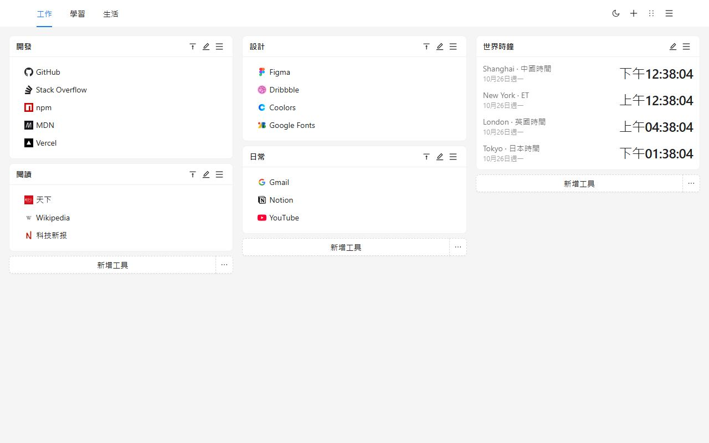
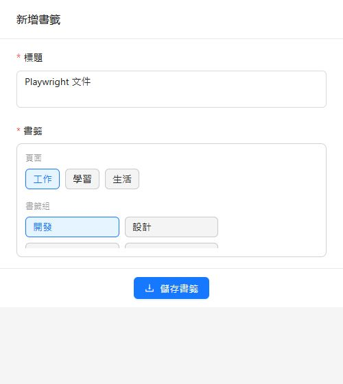
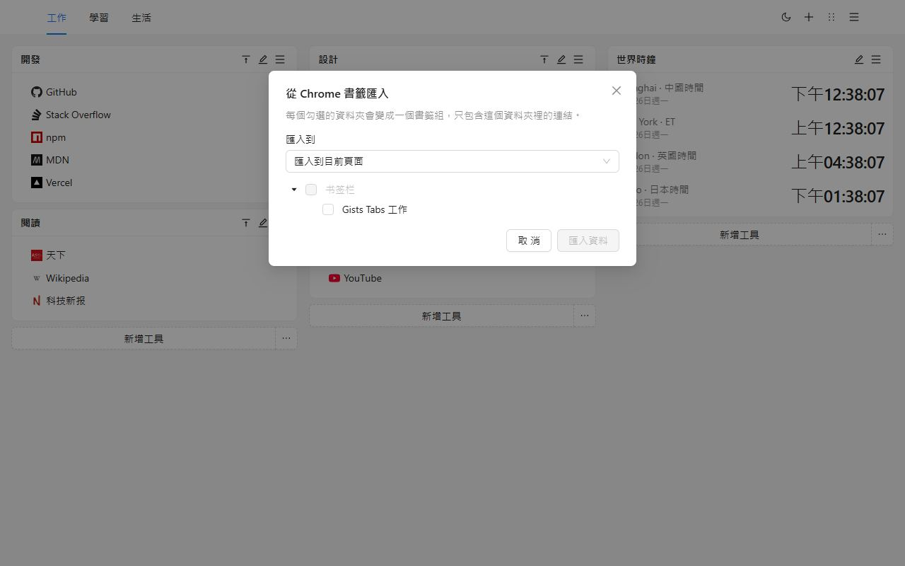
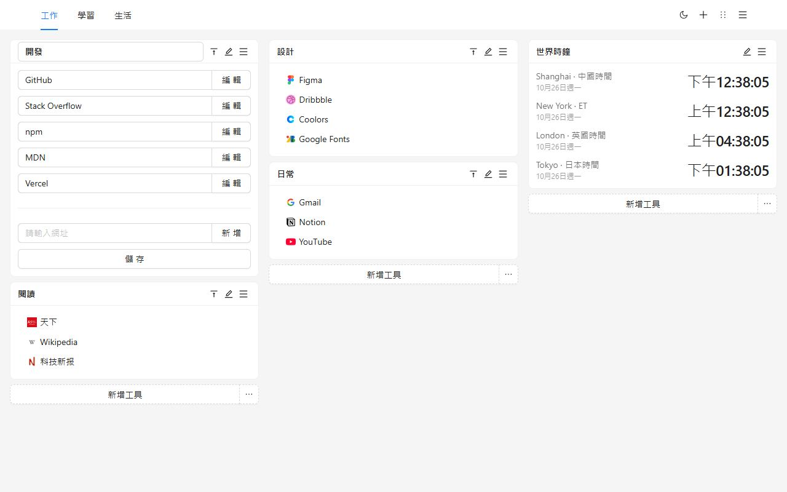
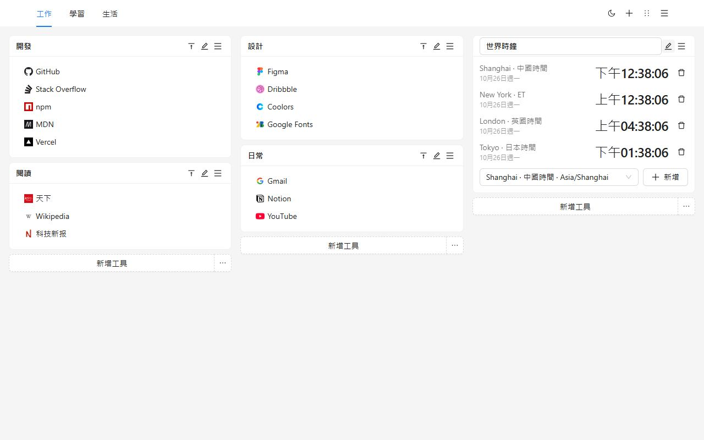
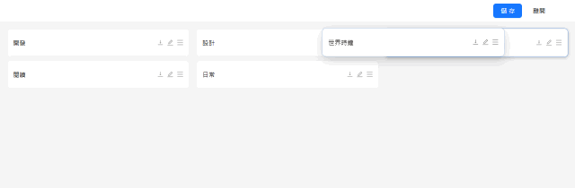
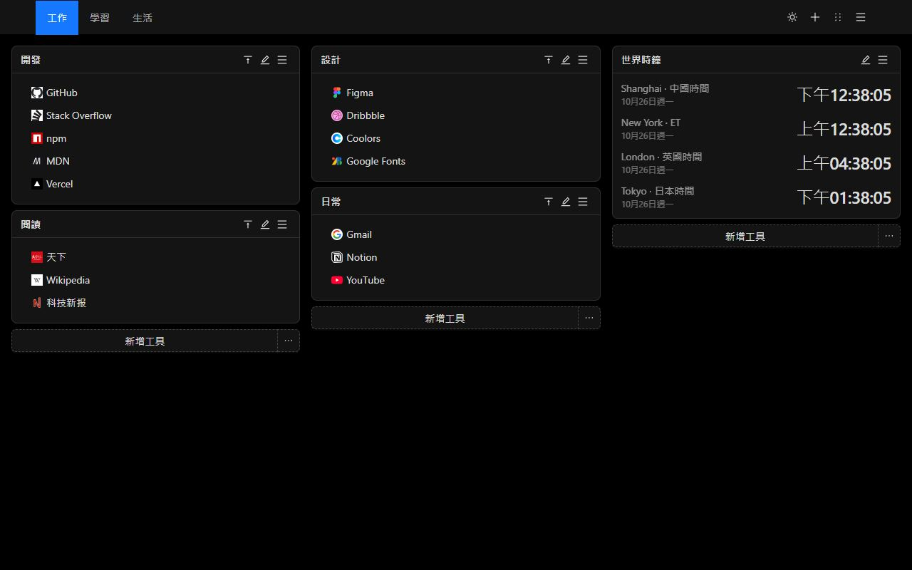
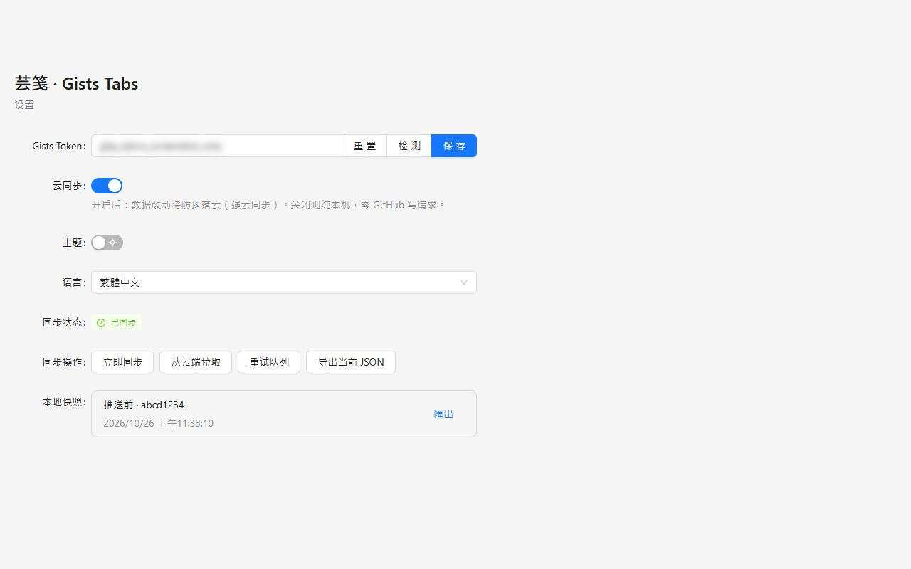
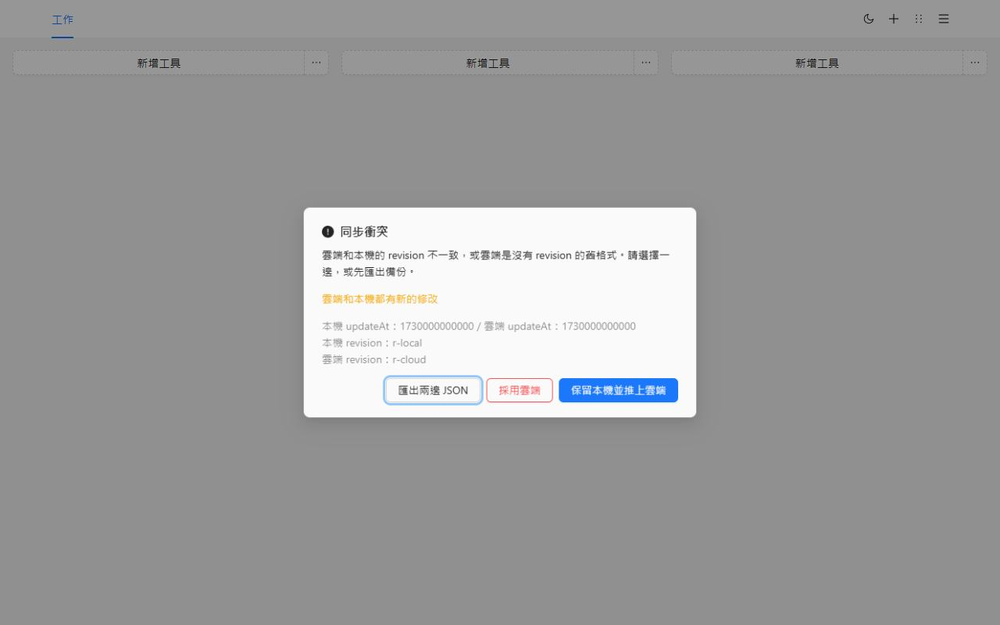

# Gists Tabs

新分頁，由你來排。書籤組和世界時鐘放在多頁畫布上。資料留在這台裝置，直到你決定同步到私人 GitHub Gist。

[加到 Chrome](https://chromewebstore.google.com/detail/cghagphlkcfafhacjgkfidbbkiklhacp)

[English](../../README.md) · [简体中文](./README.zh-CN.md) · **繁體中文** · [日本語](./README.ja.md) · [한국어](./README.ko.md) · [Español](./README.es.md) · [Português](./README.pt-BR.md) · [Deutsch](./README.de.md) · [Français](./README.fr.md) · [Русский](./README.ru.md)

芸箋 · Gists Tabs 用一塊你自己排布的工作台換掉 Chrome 的新分頁。工作、學習和生活各自一頁。每一頁是三欄書籤組和時鐘。不建立帳號，也不會上傳，除非你打開同步。

還沒選過語言時，介面跟隨瀏覽器。可以在設定裡改成 English、简体中文、繁體中文、日本語、한국어、Español、Português、Deutsch、Français、Русский。

## 為什麼是它

瀏覽器自帶的新分頁是搜尋框和幾枚捷徑。書籤列是長長的一行。多數儀表板擴充功能要註冊它們自己的帳號，版面存在它們的伺服器上。

Gists Tabs 相反。版面是你的。如果同步，檔案是你 GitHub 帳號裡的一個私人 Gist。擴充功能作者沒有伺服器，也看不到你的書籤。

| | Chrome 新分頁 | 書籤列 | 需要註冊的儀表板 | Gists Tabs |
| --- | --- | --- | --- | --- |
| 多頁、三欄 | 無 | 無 | 有時有 | 有 |
| 世界時鐘 | 無 | 無 | 有時有 | 有 |
| 不註冊也能用 | 能 | 能 | 不能 | 能 |
| 資料在你自己的私人 Gist | 無 | 無 | 無 | 有 |
| 開源 | 否 | — | 很少 | 是 |
| 匯入匯出 JSON | 無 | 只有瀏覽器自己的匯出 | 不一定 | 有 |
| 廣告或追蹤 | 捷徑 | 無 | 常見 | 無 |

## 三步上手

1. 從 Chrome 線上應用程式商店安裝。下一個新分頁就是畫布。
2. 新建一個書籤組，或匯入已經在 Chrome 裡的資料夾。
3. 用工具列按鈕把正在看的頁面收進去。

## 把 Chrome 書籤搬過來

打開頁面選單，選擇**從 Chrome 書籤匯入**。第一次會向 Chrome 申請書籤權限；這是可選權限，安裝時不會要。勾選資料夾。每個資料夾變成一個書籤組，只包含這個資料夾裡直接放著的連結。可以放到目前頁，也可以新建一頁。

圖示先用預設標記，之後可以再編輯連結。`javascript:` 以及其他新分頁打不開的網址會被跳過。

不想用 GitHub、又要換一台瀏覽器時，從頁面選單或設定頁匯出 JSON，再在那邊匯入。匯入會替換目前畫布。本機快照不能代替這份檔案。

## 畫布

頁面在頂端列。從選單改名、複製或刪除。只剩一頁時不能刪除。

書籤組是一份有名字的清單。可以就地改標題和連結，在清單裡拖曳，或按右鍵複製、刪除。按兩下標題可以摺疊。

時鐘顯示你加入的城市時間。小時制跟隨介面語言。

排序模式把每個組收成一條。拖到另一欄，再儲存。離開排序會丟掉草稿。

淺色和深色是頂端列上的一個開關，記在這台裝置上。

## 同步到你自己的 Gist

同步預設關閉。貼上 Token 並打開開關之後才會開始。

- 經典個人存取權杖勾選 `gist` 權限。
- 細粒度權杖只給 Gists 讀寫權限，不需要存放庫權限。

在設定裡貼上、檢查、儲存，然後打開雲端同步。Token 留在本機儲存，只用來讀寫你帳號下的私人 Gist。連續修改會合併成一次寫入。

第二台裝置安裝擴充功能，貼上同一 GitHub 帳號的 Token，打開同步，畫布會從那個 Gist 下來。

兩邊都改過時，同步會停下來讓你選。可以匯出兩邊的 JSON，保留本機並推上去，或用雲端覆蓋本機。覆蓋之前，原來的畫布會留在本機快照裡。

GitHub 可能會限流。擴充功能會等待並重試，最長 10 分鐘。

## 隱私和權限

| 權限 | 何時 | 原因 |
| --- | --- | --- |
| `storage` | 安裝時 | 把畫布、主題、語言和 Token 留在這台裝置 |
| `tabs`、`activeTab` | 安裝時 | 讀取目前分頁，供工具列按鈕收藏 |
| `alarms` | 安裝時 | 打開雲端同步後依排程重試 |
| `bookmarks` | 只有匯入時 | 讀取 Chrome 書籤資料夾。安裝時不申請 |

沒有統計，沒有廣告，擴充功能作者也沒有自己的伺服器。

## 問題

**一定要有 GitHub 嗎？**
不用。同步保持關閉，新分頁一樣能用。

**書籤在哪裡？**
在這台瀏覽器的擴充功能儲存裡。打開同步後，你的 GitHub 帳號下還會有一份私人 Gist。

**更新之後語言會變嗎？**
如果從沒選過語言，介面跟隨瀏覽器。在設定裡選過，就會保持那個選擇。

**能在 Firefox 裡用嗎？**
已上架的是 Chrome 線上應用程式商店。同一份原始碼可以建置 Firefox。從 Chrome 書籤匯入用的是 Chrome 才有的權限。

## 本地開發

需要 Node.js 和 npm。

| 命令 | 作用 |
| --- | --- |
| `npm run dev` | Chrome 開發建置 |
| `npm run dev:firefox` | Firefox 開發建置 |
| `npm run build` | 型別檢查，並產出 Chrome 生產建置 |
| `npm run build:firefox` | 型別檢查，並產出 Firefox 生產建置 |
| `npm run lint` | `tsc --noEmit` 和 ESLint |
| `npm test` | 語言匹配、書籤匯入、儲存和時鐘的單元測試 |

載入未封裝擴充功能時選擇 `.output/chrome-mv3`。Firefox 產物在 `.output/firefox-mv2` 或 `.output/firefox-mv3`。

## 授權

[MIT](../../LICENSE)
