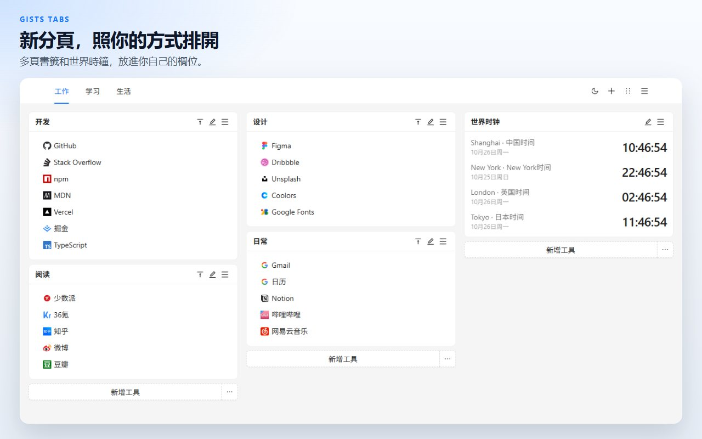
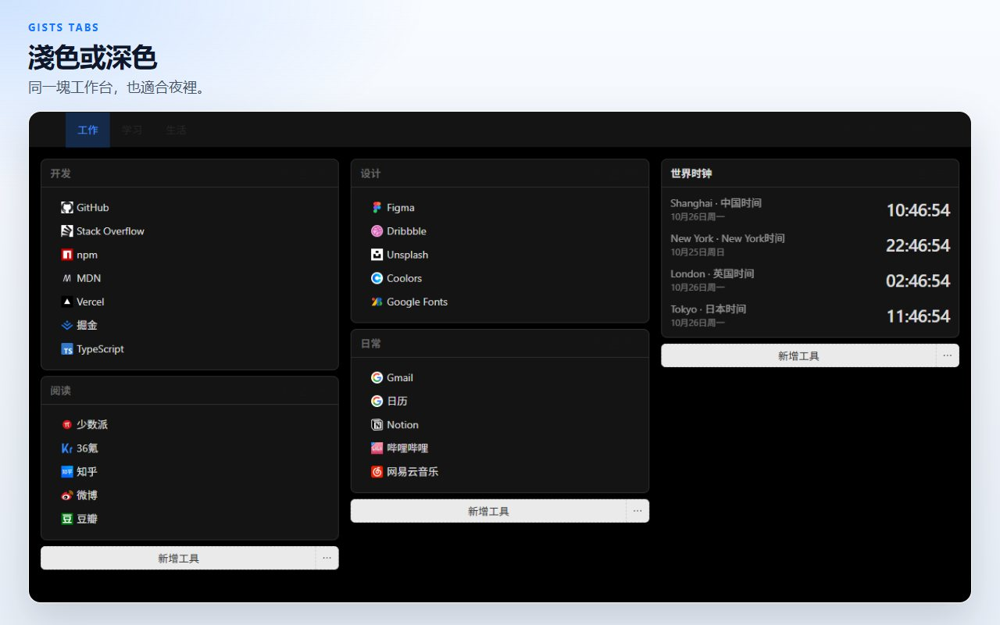
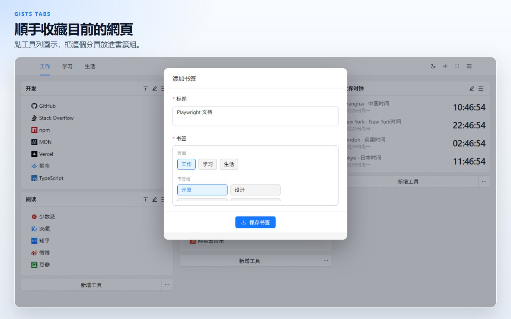
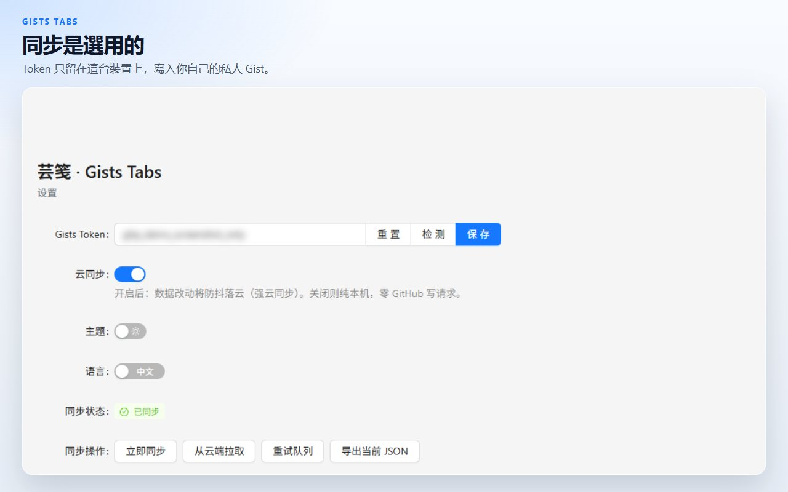

# Gists Tabs

一塊你自己排布的新分頁。書籤和世界時鐘放在多頁畫布上。資料留在這台裝置上，除非你把它同步到自己的私人 GitHub Gist。

[加到 Chrome](https://chromewebstore.google.com/detail/cghagphlkcfafhacjgkfidbbkiklhacp)

[English](../../README.md) · [简体中文](./README.zh-CN.md) · **繁體中文** · [日本語](./README.ja.md) · [한국어](./README.ko.md) · [Español](./README.es.md) · [Português](./README.pt-BR.md) · [Deutsch](./README.de.md) · [Français](./README.fr.md) · [Русский](./README.ru.md)

芸箋 · Gists Tabs 用一塊個人工作台換掉 Chrome 的新分頁。把書籤組和時鐘放進欄位，再拆到不同頁面。你不打開同步，內容就不會離開這台瀏覽器。

介面語言是中文和 English，在擴充功能的設定頁切換。

## 頁面、書籤和時鐘

每個頁面是三欄畫布。書籤小工具放帶網站圖示的連結。時鐘小工具顯示你加入的城市時間。工作和生活不該擠在同一畫面時，再開一個頁面。

## 拖好再儲存

從頂端列進入排序，把小工具拖到另一欄，然後儲存。離開排序會丟掉這次草稿，做到一半的移動不會改寫畫布。

## 收藏正在看的分頁

工具列按鈕讀取目前分頁的標題和網址，放進一個書籤組。

## 預設在這台裝置

畫布存在擴充功能的本機儲存裡。可以匯出 JSON，也可以匯入以前保存的檔案。

雲端同步預設關閉。貼上 GitHub Token 並打開開關之後才會同步。Token 留在本機儲存，只用來讀寫你帳號下的一個私人 Gist。經典個人存取權杖需要 `gist` 權限；細粒度權杖需要對 Gist 的讀寫權限。擴充功能作者沒有自己的伺服器。

| 權限 | 用途 |
| --- | --- |
| `storage` | 把工作台留在這台裝置上 |
| `tabs`、`activeTab` | 讀取目前的分頁，供工具列按鈕收藏 |
| `alarms` | 打開雲端同步後，依排程重試同步 |

## 問題

**一定要有 GitHub 帳號嗎？**
不用。同步保持關閉時，新分頁一樣能用。

**書籤放在哪裡？**
在這台瀏覽器的擴充功能儲存裡。打開同步後，你的 GitHub 帳號下還會有一份私人 Gist。

**不用 GitHub，能把畫布搬走嗎？**
可以。從新分頁選單或設定頁匯出 JSON，再到另一台瀏覽器匯入。

**產品介面有哪些語言？**
介面是中文和 English。這份說明翻譯得更多，是為了讓專案更容易被找到。

**能在 Firefox 裡用嗎？**
已上架的是 Chrome 線上應用程式商店。同一份原始碼可以建置 Firefox 版本，見下面的命令。

## 本地開發

需要 Node.js 和 npm。

| 命令 | 作用 |
| --- | --- |
| `npm run dev` | Chrome 開發建置 |
| `npm run dev:firefox` | Firefox 開發建置 |
| `npm run build` | 型別檢查，並產出 Chrome 生產建置 |
| `npm run build:firefox` | 型別檢查，並產出 Firefox 生產建置 |
| `npm run lint` | `tsc --noEmit` 和 ESLint |
| `npm test` | 儲存與時鐘格式的單元測試 |

在瀏覽器裡載入未封裝的擴充功能時，選擇 `.output/chrome-mv3`。Firefox 產物在 `.output/firefox-mv2` 或 `.output/firefox-mv3`，以命令實際印出的目錄為準。

## 授權

[MIT](../../LICENSE)
